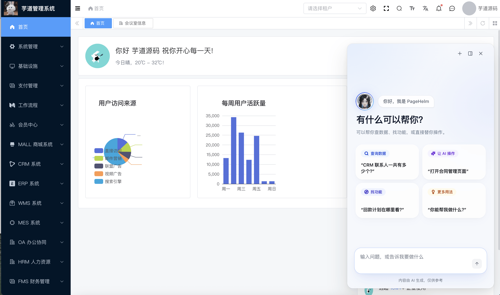
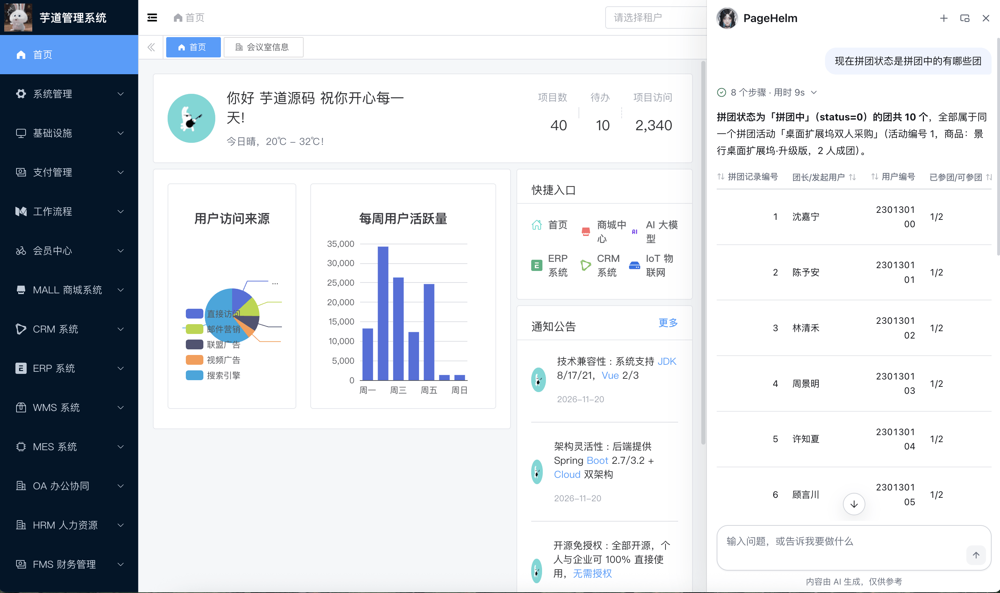
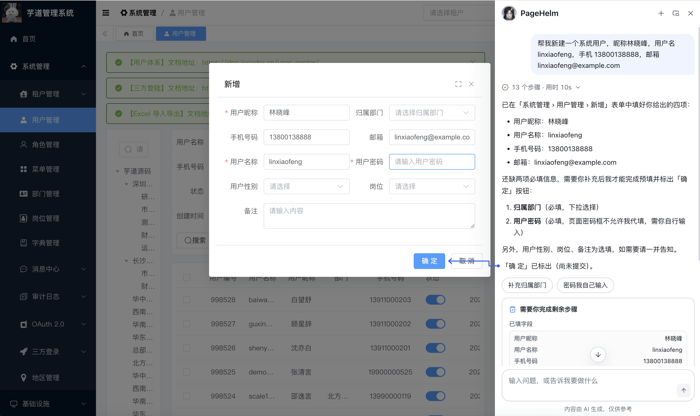

# PageHelm

[简体中文](README.zh-CN.md)

**PageHelm** (`web_operation_agent`) is an embedded AI operations framework for first-party enterprise web applications.

Enterprise back-office systems combine hundreds of routes, strict row-level permissions, multi-hundred-row tabular reporting, and high-stakes state mutations. PageHelm pairs a **same-origin browser Runtime** with an **application-neutral server core** so existing ERP, CRM, finance, and operations apps gain controlled data querying, live UI assistance, and verified writes without rewriting their backend or handing user cookies to a headless browser:

- **Fast, permission-preserving reads:** Aggregations, sorting, and joins run on the server under the signed-in user's identity—no server-held user cookies and no slow UI pagination scraping.
- **Live tab collaboration with undo:** Navigates routes, applies filters, opens dialogs, and prefills forms inside the operator's active tab, with one-click undo and automatic handover of password/upload inputs to the human.
- **Verified writes behind proof:** Production defaults to `read-only`. When writes are enabled, every mutation passes through a visible diff approval card, single-use dispatch lock, pre-dispatch reread, and same-actor readback; timed-out writes become `INDETERMINATE` and are never retried automatically.

---

## Live Preview

Captured live against the repository's synthetic reference environment (`examples/yudao`):

| Same-Origin Panel & Quick Starters | Same-Actor Queries & `<DataTable>` |
| :---: | :---: |
|  |  |
| Embeds with a single script tag inside a Shadow DOM panel; supports floating and side-by-side docked layouts without colliding with host styles. | Queries active records under the signed-in actor via per-turn in-memory SQL and renders a sortable `<DataTable>` directly in the panel without navigating away. |
| **Live Dialog Navigation & Undoable Prefill** | **Visible Diff Approval & Readback Verification** |
|  |  |
| Opens the business dialog, prefills fields, draws a visual guide to the submit button, and provides one-click undo while keeping restricted controls human-only. | Shows the exact target record, before → after field diff, and unchanged fields before human confirmation, single dispatch, and same-actor readback. |

---

## Capabilities

- **Same-actor server reads & deterministic compute:** Executes read ports under the signed-in actor's `PrincipalContext` with concurrent prefetch and ordered main-thread commit, exact `Decimal` summaries (`read_summary`), per-turn read-only in-memory SQLite (`TurnTables`, `SELECT`/`WITH` allowlist), and `<DataTable>` delivery without transcribing rows into prose.
- **Live browser DOM control & handover:** `PageController` captures bounded snapshots (`<= 200` elements, active dialogs prioritized) with noise-filtered settling (`PageSettleWatch`); form prefill returns structured applied/previous/rejected/restricted receipts, supports one-click `undoFormFill`, and skips password or file controls.
- **Six-stage `WritePipeline` safety gate:** Unifies typed write Skills, symmetric flat convention updates (`ConventionWritePort`), and native form submit (`SubmitPort`)—enforcing diff validation, occluded/dwell visibility gates (`>= 0.9` visible ratio, `>= 400ms`, `event.isTrusted`), single-flight consumption, pre-dispatch drift reread, at-most-once dispatch, and same-actor readback.
- **Domain disambiguation & L0–L3 adoption:** Clarifies module terminology via `domain_playbooks/*.md` and renders clickable `need_input` pills when multiple same-actor records match a name; adopt incrementally from a single `<script>` tag (L0) to typed reads (L1), playbooks (L2), and verified writes (L3).
- **Operational guardrails:** Web Locks prevent duplicate-tab session collisions; recursive URL-decoding redaction guards outbound model calls (`AuditedChat`) and replay exports; includes 3-tier spend caps, WAL-safe SQLite backup/restore, `INDETERMINATE` reconciliation CLI/API, and content-free OTLP telemetry.

---

## Why Same-Origin Hybrid

| Dimension | Pure API / RAG Bot | Headless Browser Agent / RPA | Low-Code Workflow Builder | **PageHelm (Same-Origin Hybrid)** |
| --- | --- | --- | --- | --- |
| Live UI navigation & form prefill | None | Slow DOM loops; detached from user tab | None | Same-origin DOM Runtime + dialog prefill & undo |
| Multi-hundred-row reporting | Needs bespoke endpoints | Slow page-by-page UI clicks | Memory/node bottlenecks | Same-actor API + per-turn SQL + `<DataTable>` |
| Auth & row-level permissions | Often global service keys | Server holds user cookies | Static shared credentials | Delegated same-origin browser session |
| Write safety & retry control | Custom per tool | Risk of clicking live Save/Delete | Auto-retry risks duplicates | Single-consume `WritePipeline` + `INDETERMINATE` lock |

---

## Architecture & Safety Modes

```text
First-Party Browser Tab (assistant.js + Shadow DOM Panel + PageController)
                        ^ redacted observations / receipts / single-use approvals
                        v
Application-Neutral Server Core (Executor · TurnHarness · WritePipeline · SQLite Stores)
                        ^ ApplicationPorts & GoalData explicit contracts
                        v
Application Adapter (Identity · Routes · Same-Actor Reads · Verified Writes · Playbooks)
```

| Mode | Same-actor reads & nav | Form prefill (undoable) | Write proposal prep | Write dispatch & readback |
| --- | --- | --- | --- | --- |
| `read-only` (prod default) | Allowed | Off | Off | Off |
| `assisted-draft` | Allowed | Allowed (skips passwords & uploads) | Allowed | Off (never dispatches) |
| `verified-operate` (local default) | Allowed | Allowed | Allowed | At most once after approval + readback |

---

## Quickstart & Integration

### 1. Run the Bundled Reference Demo (`examples/yudao`)

Requires **Python 3.13**, **Node.js (>=22)**, and **Docker Compose 2.30+**. Prepare `.q0-cache/yudao/` first per the [reference build guide](examples/yudao/deploy/README.md).

```bash
# 1) Create the virtual environment and build panel + Runtime bundles
python3.13 -m venv .venv && . .venv/bin/activate
PLAYWRIGHT_SKIP_BROWSER_DOWNLOAD=1 python -m pip install --editable ".[browser]"
python -m pip install --no-deps --editable examples/yudao
python scripts/build_panel.py --install && python scripts/build_runtime.py --skip-build

# 2) Configure a provider API key (1–3 lines) and runtime mode
cp .env.example .env
cp pagehelm.example.toml pagehelm.toml

# 3) Start the local synthetic sandbox (http://localhost:40001)
./local --synthetic-clock
```

Run diff-aware repository checks with `.venv/bin/python scripts/check.py --plan && .venv/bin/python scripts/check.py` (no paid model calls).

### 2. Integrate Into Your Own Web App (L0–L3)

If you are embedding PageHelm into your own application, skip the `yudao` cache and adopt incrementally:

| Level | Host integration work | Capabilities enabled | Reference |
| --- | --- | --- | --- |
| **L0** | Mount `/v1/runtime/assistant.js` + `/bootstrap` | Shadow DOM panel, bounded UI actions, Element Plus helpers | `frontend/src/integrations/element-plus/` |
| **L1** | Implement identity, routes, and read ports | Same-actor queries, `TurnTables` SQL, `<DataTable>` delivery | [`testapps/contacts`](testapps/contacts/adapter.py) |
| **L2** | Add `domain_playbooks` and `entity_rules` | Terminology disambiguation, rule explanations, `need_input` pills | [L0–L3 Integration Guide](docs/integration/levels.md) |
| **L3** | Add journal, postcondition verifier, and Skills / `SubmitPort` | Typed Skill writes, flat `update_record`, native submit & undo | [Write Safety & Privacy](docs/security/verified-writes.md) |

---

## Documentation & License

- **Getting Started & Integration:** [Docs Home](docs/index.md) · [Local Demo Quickstart](docs/integration/quickstart.md) · [L0–L3 Integration Guide](docs/integration/levels.md) · [Skills & Typed Writes](docs/integration/skills-and-writes.md)
- **Architecture & Runtime:** [Architecture Overview](docs/architecture/overview.md) · [Execution & Browser Runtime](docs/architecture/execution-and-runtime.md)
- **Security & Operations:** [Write Safety & Privacy](docs/security/verified-writes.md) · [Deployment & Operations](docs/security/operations-and-observability.md)
- **Reference:** [Configuration & Protocol](docs/reference/protocol-and-configuration.md) · [Tools, Capabilities & Checks](docs/reference/tools-and-capabilities.md)
- **Docs site (`frontend/docs/`):** Built from `docs/` via Astro Starlight with build-time `/llms.txt` and `/llms-full.txt`.
- **Safety & Licensing:** Validate integrations against isolated, resettable synthetic fixtures before enabling writes on live environments. [SECURITY](SECURITY.md) · [LICENSE](LICENSE) · [THIRD_PARTY](THIRD_PARTY.md)
