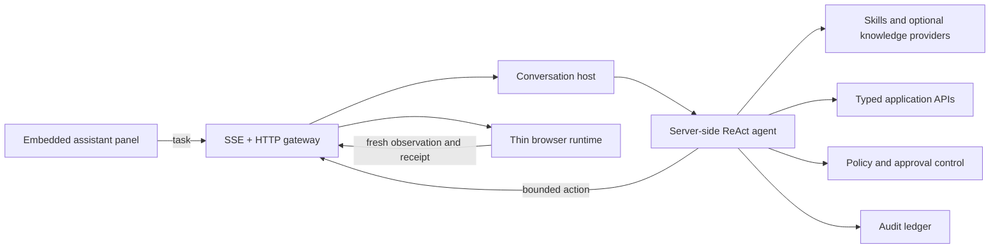

# Web Operation Agent

[简体中文](README.zh-CN.md)

Web Operation Agent is an early-stage framework for building an AI assistant inside a first-party web application. A server-side agent plans and replans from fresh page observations, while a small embedded browser runtime executes a fixed set of page actions. Application Skills and typed APIs can add business knowledge and current data; source retrieval is an optional knowledge provider.

> **Status: alpha.** The repository contains a tested core and three reference integrations, of which Odoo 18 is the main one. It is not a production-ready autonomous agent, a hosted service, or a general browser extension.

## What works today

The repository currently verifies these behaviors with local automated tests and isolated application fixtures:

| Capability | Current scope |
| --- | --- |
| Remote browser loop | An embedded runtime exchanges observations, actions, results, and approval decisions with a local server over SSE and HTTP. |
| ReAct execution | The same server-side agent receives each tool result, observes the page again, and chooses the next step within time and step budgets. |
| Grounded page actions | Navigation and element actions are checked against the current observation and an application-owned control layer. |
| Skills and business tools | An auditable, bounded user-intent matcher selects candidate Skills; an empty match falls back to eligible read Skills and explicitly enabled mutation Skills. Current data comes from typed application APIs rather than Skill text. |
| Guarded writes | Business mutations are disabled by default. A mutation-enabled turn requires verified identity, an explicit page confirmation, and atomic `prepared → dispatching → completed/failed/indeterminate` recording. Production composition also requires a journal that explicitly declares durable restart behavior; volatile journals are accepted only under an explicit test profile. |
| Legacy page control | The legacy external page-control gateway is leased to one cooperating run across local threads and processes, reset before use, and cleared before release. A control cleanup failure stops closed; this compatibility path does not provide concurrent tenant-scoped permits. |
| Multi-turn hosting | A conversation host processes panel messages sequentially, isolates an ordinary turn failure from later turns, and retains at most four turns or 32 KiB of in-memory reference context. Historical business facts can resolve phrases such as “the second company,” but the Agent must refresh the current API or page and historical routes receive no authority. |
| Shared local gateway | A bounded server composition can host multiple independently revocable session capabilities on one gateway; a 50-session deterministic isolation test covers token/channel separation. Sessions have a one-hour default TTL, bounded queues and hard event/message/observation/action/approval/runtime-instance limits. An optional SQLite store adds owner fencing, message tombstones and a progress outbox for cooperating local processes. |
| Task control | The panel can stop its exact active message through the current authenticated runtime lease. Cancellation prevents unclaimed actions and pending approved writes from dispatching; already claimed actions still settle to a definite or indeterminate result. |
| Assistant interface | A React 19 panel in a shadow root, mounted by one npm entry point. It is a view: it holds no session and keeps no timeline, so a full page navigation replays the thread from the server rather than losing it. Every bound, label and colour comes from two files the server owns, and a test refuses anything the panel declares on its own. Chromium coverage spans every panel state, the confirmation card's keyboard paths and 320 px layout, markdown answers, reduced motion, the draggable window, and construction under a strict CSP with Trusted Types. |
| Confirmation | The card shows the exact effect, the records it names in monospace, and the time left before the request expires. It refuses a press that is not a real user gesture or that it cannot show was visible — which closes visual deception and nothing more. The panel shares the host page's realm; `SECURITY.md` states plainly what that costs. |
| Identity binding | A host can bind a short-lived actor/tenant/workspace principal to the runtime capability, Agent turn, typed-tool scope, approval, mutation proposal, and redacted audit events. The Twenty demo resolves the exact HttpOnly browser session against Twenty before startup, requires it to match the delegated OAuth actor/workspace, and closes the Agent session if the browser cookie is replaced or removed. |
| Provider boundary | Model requests have deterministic schema, count, byte, credential, and finite-JSON checks. Pinned framework adapters can preserve their native chat body while using the same server-held credentials, transport, limits, guard, and accounting. A shared in-process guard bounds concurrent requests, charges queue time to the request deadline, and opens a cooldown circuit only after consecutive transient provider-health failures; user cancellation and local deadlines neither increment nor clear that state. Queueing and connection setup on the native Agent path are cancellable. A cancellation before HTTP dispatch creates no spend row, while every dispatched request has a correlation ID and either reported usage or an explicit unknown cost. Content-free per-run summaries bind trials to digests of their request IDs and spend rows. Remote endpoints require HTTPS except on loopback. |
| Operational probes | The loopback gateway separates process liveness at `/healthz` from work readiness at `/readyz`. Readiness reports only schema-fixed counts, admission state, and provider guard health; malformed callbacks fail closed without exposing their error text. |
| Audit and replay primitives | Server events can be written to an append-only ledger and projected into a redacted replay. |
| Twenty CRM vertical | The packaged adapter can query Companies, People, and Opportunities through bounded cursor pagination, project typed results and source information into the user answer, and hand API-discovered record routes to the browser. Company creation is separately enabled and requires confirmation plus delegated-token readback. OAuth refresh is serialized across local threads and processes, including GraphQL `UNAUTHENTICATED` responses encountered during identity resolution. |
| Odoo 18 vertical | Five typed reads and three opt-in writes, including a multi-step order lifecycle: confirm a quotation, then create its customer invoice through Odoo's own wizard. A live model-free gate runs seven scripted cases over six workflow kinds against a real Odoo, a real Chromium and the real product turn, approving each write through the panel's own control in the page. It refuses to start on a fixture that has drifted off its recorded baseline and restores it afterwards. |
| Cited Skills | Every `provenance` entry is a parsed citation — `src:` into the application's source at a release line, or `api:` into its published interface. A live gate resolves every `src:` citation against the release's compiled `SourceMap`, so a citation that has rotted is distinguishable from one that never pointed anywhere. `BusinessSkillCompiler` drafts a Skill from those descriptors and refuses to write its instructions. |
| Settling an uncertain write | A write whose outcome was lost is never retried. The journal lists it with the phase it reached and the record id the adapter captured; an operator performs the application's own read under the original actor, and settles it with a compare-and-swap that records who decided, on what evidence, and their attestation that the original writer can no longer execute. |

These claims describe the implemented paths only. The project does not yet have a public benchmark large enough to establish general task success, a source-retrieval advantage, or superiority over PageAgent or other browser agents.

## Architecture



The server owns model access, planning, knowledge, session policy, authorization state, and audit data. The browser receives only a session-scoped capability, fixed generic actions, and user-visible approval requests. It does not receive model credentials, source indexes, hidden write permissions, or evaluators.

Fresh runtime facts take precedence over Skills, source code, documentation, and API schemas. Those knowledge sources can propose a route or tool call, but the current page and application response determine what is actually true.

The main reusable boundaries are:

| Module | Responsibility |
| --- | --- |
| `web_operation_agent.application` | Validates a versioned application descriptor and executable identity, route, data-classification, mutation-postcondition, and reconciliation ports. |
| `web_operation_agent.product` | Binds a validated application and one user message to the latest observation, then runs one application-neutral agent turn. |
| `web_operation_agent.conversation` | Retains bounded, redacted reference context across turns without granting current facts or routes. |
| `web_operation_agent.live` | Owns the gateway and sequential conversation lifecycle. |
| `web_operation_agent.browser` | Defines the structural browser executor and typed transport outcomes; it contains no browser engine. |
| `web_operation_agent.remote` | Defines the capability-bound remote browser channel and client. |
| `web_operation_agent.embedded_gateway` | Serves the embedded runtime, authenticated SSE/HTTP endpoints, and content-free liveness/readiness probes. |
| `web_operation_agent.business` | Loads Skills and mediates typed read and mutation tools. |
| `web_operation_agent.mutation` | Atomically records single-use mutation intent and terminal outcome in memory or SQLite. |
| `web_operation_agent.egress` | Enforces and audits the model-provider data boundary without storing request content. |
| `web_operation_agent.session` | Implements the bounded server-side agent loop. |

Every application-specific adapter ships as its own separate distribution rather than living in the core package above: [`web-operation-agent-odoo`](examples/odoo) provides `OdooApplicationAdapter` and the Odoo source compiler, [`web-operation-agent-twenty`](examples/twenty) provides `TwentyApplicationAdapter`, and [`web-operation-agent-ofbiz`](examples/ofbiz) provides the Apache OFBiz route grammar, source compiler and App Skill provider. The core package has no application-specific code, and `scripts/check_core_boundary.py` asserts that it imports no application distribution anywhere, tests included; a new application implements the same ports these three do.

Application adapters expose a versioned, non-secret descriptor, a digest-bound Skill and typed-tool catalog, and executable ports for identity, routes, result data classes, mutation postconditions, and conservative reconciliation. `bind_application()` checks that every tool and mutation is covered and that the runtime uses the same port objects. The route port owns application URL syntax, source-aware entry discovery, and browser pre-egress extensions for application-specific handoff secrets; the generic Agent does not parse framework routes. `AgentTurnExecutor(application=...)` rejects another application origin or invalid principal before browser/model work; typed-tool routes are checked before entering the Agent context, and an acknowledged write remains indeterminate until its adapter postcondition passes. Natural-language goals enter the generic Agent loop directly; an adapter does not preclassify them into a fixed product intent enum. This is adapter contract version 2, and the package API is still evolving; no compatibility guarantee is made before a stable release.

See [Integrating an application](docs/integrations/application-adapter.md) for the PageController, identity, static Runtime, typed-tool and verification contracts.

The embedded Runtime is the only shipping browser executor. `RemoteBrowserClient` converts each server action into the versioned `ActionCommand` carried by the authenticated session protocol, and the Runtime returns the matching `ActionReceipt`. The earlier subprocess Playwright worker and its unpublished experimental CLI were removed because their navigation, selection, and observation semantics had diverged from the embedded product path.

For mutation-enabled composition, `AgentTurnConfig.deployment_profile` defaults to `production`. The composition fails before a user task when mutation policy does not require identity, no mutation tool is installed, or the selected journal does not declare durable restart behavior. Tests that intentionally use `MemoryMutationJournal` must set `deployment_profile="test"`; that profile does not relax identity binding or user approval. A deployment host must still supply and renew the authenticated principal, disable browser actions it cannot authorize, revoke changed sessions, protect the approval surface, and verify the deployed page-controller asset. Those host obligations are not inferred from the profile flag.

## Developer setup

Requirements:

- Python 3.12
- a POSIX shell
- Node.js to execute all embedded-runtime tests
- network access during the first dependency installation

From an existing checkout:

```bash
python3.12 -m venv .venv
. .venv/bin/activate
PLAYWRIGHT_SKIP_BROWSER_DOWNLOAD=1 python -m pip install --editable .
python -m pip install --no-deps --editable examples/ofbiz
python -m pip install --no-deps --editable examples/twenty
python -m pip install --no-deps --editable examples/odoo
python src/web_operation_agent/tests/run_all.py
```

The test runner uses Python `unittest` discovery and guards the real model-spend ledger from test writes. Browser-backed tests skip when Chromium is absent. Tests that exercise the upstream PageController run only when `WOA_PAGE_CONTROLLER_MODULE` names an installed module; otherwise they skip. The core suite imports no application distribution: its route, knowledge and source fixtures are synthetic and use a route grammar that is deliberately neither Odoo's nor OFBiz's, so a core module that assumed one application's URL syntax fails there. Each application distribution owns the tests of its own behaviour and runs as its own gate.

To run one test module through the same guarded runner:

```bash
python src/web_operation_agent/tests/run_all.py -k test_product.py
```

### Self-contained example

The [Contacts example](examples/contacts/README.md) removes the external application setup from the first run. It starts a synthetic first-party application and typed API on loopback, injects the real assistant runtime into Chromium, and runs the normal gateway, session host and ReAct executor:

```bash
python -m pip install --editable .
python -m playwright install chromium
PYTHONPATH=src:. python -m examples.contacts.demo --scripted
```

It runs from a checkout and is not installed with the framework. The core distribution ships no application and no demo, which is what lets its wheel assert that it contains neither.

The explicit `--scripted` mode performs one fixed, zero-cost apparatus walkthrough: load a Skill, query the current API, open an API-authorized route, observe the new page, and finish. It does not measure model quality. Omit `--scripted` and configure an OpenAI-compatible provider to use the same application interactively with actual model decisions.

### Qualification

`scripts/qualify.sh` is the single gate. CI runs the same script, so a gate cannot hold locally and be missing in CI:

```bash
scripts/qualify.sh
```

It runs the product suite, the Twenty evaluator foundation tests, the offline PageAgent and Web Operation Agent runner suites, verifies and builds the pinned PageAgent bundle when its installed dependencies are present, and builds an installable wheel whose contents and out-of-checkout import are both checked. It exits non-zero if any required gate fails. Installing the pinned npm dependencies remains environment preparation; CI does that before invoking the same gate.

Two gates depend on the environment and are reported, never assumed:

- **Chromium qualification** runs the packaged minimal demo end to end, the PageAgent browser cases against the built bundle, and the embedded Runtime against the pinned PageController. The Runtime cases cover both a top-level document transition and an OFBiz-shaped same-origin iframe form transition; the latter must return a fresh observation without repeating the form submission. These synthetic cases do not need Twenty or OFBiz, and CI makes them required with `--require-browser`. Without the flag, a missing bundle, PageController, or Chromium is reported rather than counted as a pass.
- **Live Twenty qualification** runs only when every prerequisite is set: `WOA_TWENTY_BASE_URL`, `WOA_TWENTY_STORAGE_STATE`, `WOA_TWENTY_OAUTH_TOKEN`, `WOA_TWENTY_OAUTH_REGISTRATION`, `WOA_TWENTY_PAGE_CONTROLLER_MODULE`, `WOA_TWENTY_DB_CONTAINER`, `WOA_TWENTY_DB_NAME`, `WOA_TWENTY_DB_USER`, `WOA_TWENTY_WORKSPACE_SCHEMA`. The gate reads explicit process values first, then the same `WOA_MODEL_ENV` or ignored repository `.env` used by `demo.sh`; it parses the file as data rather than sourcing shell code. Otherwise it prints `BLOCKED` and names what is unset. A blocked gate is untested — neither a pass nor a product failure. `--require-live` turns that absence into a failure for an environment that must have it.

- **Live Odoo qualification** — the main application's gate — runs only when `WOA_ODOO_BASE_URL`, `WOA_ODOO_API_KEY_FILE`, `WOA_ODOO_STORAGE_STATE` and `WOA_ODOO_PAGE_CONTROLLER_MODULE` are all set, and reports `BLOCKED` otherwise. It is model-free by design: two scripted cases — a typed read into an exact-route open, and a collection open — run through the real product turn in real Chromium against a real Odoo, and the artifact records counts, digests and booleans plus a before/after fixture digest. A pass says the apparatus holds; it says nothing about a model, which is what makes a failure there worth acting on.

This repository provisions neither a Twenty nor an Odoo instance, so a fresh clone reports both live gates as `BLOCKED`.

## Odoo 18 integration — the main application

`OdooApplicationAdapter` ships in the separate [`web-operation-agent-odoo`](examples/odoo/README.md) distribution with its Skills and source policy as package resources. Three things make it the integration worth reading before the others.

**Identity has two sides that must agree.** Odoo 18 keeps the browser session in an HttpOnly cookie and accepts it only as a cookie — the old `X-Openerp-Session-Id` header no longer exists — so page JavaScript cannot hand its credential to a server-side tool. The page instead *asserts* who it is through `/web/session/get_session_info`, which returns identifiers and no secret, while the server side acts through a per-user API key the user generates in Odoo's own settings. `bind_browser_session` resolves both and refuses to produce a principal unless they name the same actor (`db` → tenant, current company → workspace, `uid` → actor). Provisioning that key is a deployment step the record owner performs; nothing automates it.

**Its source compiler is real, and the Skills are checked against it.** `OdooCompiler` reads menus, actions, views and models into cited `SourceRelation` triples — 14 011 of them from a tree carrying `sale`, `sale_management`, `account`, `stock`, `product` and their dependencies — and every one of the 25 actions that declares a URL segment matched the running database exactly. Every `src:` citation in every shipped Skill is resolved against that map by a live-gate check, which is what makes a citation that has rotted distinguishable from one that never pointed anywhere. Two compiler limits are recorded rather than guessed: an `inherit_id` patch that removes or replaces a node is not applied (relations carry `root_view`, which means "declared somewhere in this view family", not "present in the rendered arch"), and a cross-module `<record id="other_module.…">` patch is reported in `unsupported` rather than published as a definition.

**Source configuration arrives as one adapter decision, and it crosses into the turn whole.** `adapter.source_capability(source_root, release=…)` returns a `SourceCapability` carrying the four session settings that only make sense together; with no source root it returns "nothing" and the session runs on runtime facts alone. `AgentTurnConfig` takes that value as one field, so a deployment cannot enable three of the four — which it silently did until G5, dropping the adapter's declared `runtime_source` and leaving a deployment with no cited lookup at all. Source retrieval remains optional.

**A rotted citation is repaired, not hand-resealed.** `python -m web_operation_agent_odoo.demo.skills reissue` takes the Skills the citation gate judged red, recompiles their compiled facts against the current map, and keeps what a person wrote — the instructions byte for byte. It prints a field-by-field diff and writes nothing without `--apply`. `--accept` chooses which compiled fields to take; `--accept provenance` repairs citation rot alone, which matters because these Skills' titles and bilingual trigger lists are human edits no descriptor can regenerate. What no retrieval scheme fixes is still outside it: when the workflow itself changes, a person writes the instructions, because what needs review is judgement rather than fact.

The typed surface is five reads — `query_sale_orders`, `query_quotations`, `query_customers`, `query_products`, `query_customer_invoices` — and three opt-in writes: `create_customer`, `confirm_quotation` and `invoice_sale_order`. Each read scans its whole scope and checks the row count against Odoo's own `search_count`, so completeness is answered by a number that did not come from the page of rows being counted.

Two of those results carry something a page cannot tell you. `sale.action_quotations_with_onboarding` stores **no** domain: the Quotations page lists every sales order and merely defaults its search filter, which anyone can clear. So `query_quotations` reports `collection_ui_path_shows_this_scope: false` with the reason, rather than letting the model assume the page it opens shows the answer it just gave. And `invoice_sale_order` always pins the ordinary-invoice method: Odoo's confirmed-order form carries two buttons both labelled "Create Invoice", separated only by their `invisible` conditions, and the second one proposes a percentage down payment.

```bash
python -m web_operation_agent_odoo.demo --scripted --headless \
  --api-key .private/odoo-api-key.json --storage-state .private/odoo-storage-state.json
```

`--scripted` exercises real Odoo, real Chromium and the real product turn with no provider and no spend.

The gate version (`python -m web_operation_agent_odoo.demo.qualify`) runs seven scripted cases covering six workflow kinds — complete enumeration, conditional query, open a record, open a collection, a safe refusal, and the multi-step write from quotation to confirmed order to customer invoice — plus an eighth when a source root is configured: a cited source lookup followed by a typed read, which checks that the adapter's declared `runtime_source` reached the deployment and that every byte range the lookup cited is still exactly those bytes. The three that write are approved by clicking the panel's own control in the page, because that is the only way to approve. It refuses to start against a library that has drifted off its recorded baseline, restores the fixture afterwards, and asks Odoo whether each write changed the record it named rather than believing the run's own account. `python -m web_operation_agent_odoo.demo.fixture` takes and restores that baseline; `python -m web_operation_agent_odoo.demo.settle` is what an operator closes an uncertain write with.

## Twenty CRM integration

`TwentyApplicationAdapter` ships in the separate `web-operation-agent-twenty` distribution with read-only and mutation Skills as package resources, so it can be imported from an installed wheel outside the repository. Loading a Skill or querying its typed API does not dispatch a browser action; page actions still return fresh observations, and a completed mutation performs one follow-up observation for verification. It still needs:

- a separately provisioned compatible Twenty CRM instance;
- OAuth token and client-registration files for a delegated test user;
- the page-side controller integration; and
- an application composition that supplies the model, control plane, ledger location, and session host.

Read access is the default. Creating a company requires opting in at both the Twenty adapter and turn policy, supplying an explicit mutation journal, binding a verified identity, and completing the user-visible approval flow. The public demo supplies `SQLiteMutationJournal`; the adapter rejects mutation enablement with an omitted journal.

Company enumeration follows Twenty's `pageInfo.endCursor` with `starting_after`, with hard page and record ceilings plus repeated-record, stalled-cursor, changing-total, and malformed-page detection. A bounded interruption is returned as an explicit partial result; it is never represented as a complete company list. Duplicate checks for company creation fail closed unless the complete active set was scanned. Cursor pagination does not provide a database snapshot, so a workspace changing during a scan can still force an incomplete result and a retry after the data settles.

The root [`demo.sh`](examples/twenty/demo.sh) launches the public composition in [`examples/twenty/src/web_operation_agent_twenty/demo`](examples/twenty/src/web_operation_agent_twenty/demo/README.md). Run `./demo.sh --check` first to diagnose configuration, runtime, Twenty health, and browser/OAuth identity without opening a browser or calling the model. The demo requires an externally provisioned, synthetic Twenty instance and explicit local paths for browser state, delegated OAuth state, the same-origin PageController module, audit output, and spend accounting; these `WOA_*` values may live in the safely parsed model environment file. It does not read database truth, reset the application, or present an Agent completion as deterministic business verification. Provisioning a reproducible public Twenty environment remains release work.

See [Durable local operations](docs/integrations/durable-operations.md) for opt-in recovery, shared request quotas, retention and mutation reconciliation.

## Independent Twenty evaluator

The separate [`evals/twenty`](evals/twenty/README.md) foundation keeps deterministic application verification outside the product and Agent process. It covers three Companies task shapes: querying the exact active name/domain set without changing business state, opening one baseline company without changing business state, and creating exactly one requested company with acknowledged same-actor readback and forbidden-change checks.

Results use four distinct states: `PASS`, `FAIL`, `INDETERMINATE` for an uncertain final state or write outcome, and `INVALID` when the task or evidence cannot support a trial. Its offline tests use an injected command runner. Capture, schema snapshot, controlled mutation, restore, and post-restore digest checks have also passed against a local Docker-backed synthetic Twenty fixture. This foundation is not a benchmark and does not establish a success rate, a baseline comparison, or a source-retrieval benefit. The public repository still needs reproducible fixture provisioning before others can repeat the live qualification.

A public six-case development task set and a digest-only commitment to a private twelve-case held-out set now exercise the three supported Companies task shapes. The split verifier rejects task, ID, release, and template-family overlap. These small sets qualify the evaluation pipeline only; they are not a representative or statistically powered benchmark.

The Gate 4 breadth development catalog adds 30 unique English and Chinese prompt templates across Companies, People, and Opportunities: enumeration, filtered lookup, record opening, collection navigation, confirmed company creation, and safe refusal. Its v2 fixture and deterministic evaluator have been qualified against the local synthetic Twenty database. The WOA breadth runner also passes model-free scripted qualification through the real identity, remote-session, ReAct, typed-tool, approval, and audit path. Seven new-entity read, navigation, and refusal cases pass the same checks against local Twenty 2.39.0 in real Chromium. Rephrasings remain correlated development cases rather than independent statistical samples. A fixed 12-case paid development diagnostic against randomly generated synthetic CRM data first exposed a filtered lookup that incorrectly navigated after querying. After adding query-result guidance without changing the tasks or evaluator, the verification run completed with 12 `PASS`, 0 `FAIL`, 0 `INVALID`, two of two correct refusals, zero safety events, complete usage accounting, and CNY 0.433488 recorded cost. Median latency was 8.224 seconds (nearest-rank p95 11.742), median model calls and steps were both 3 (p95 4), and p95 page actions was 1. This single correlated development run is not a benchmark or a product success-rate claim; no paid run against the local Twenty fixture has been authorized or executed.

The evaluator also includes a strict preregistration validator for paired PageAgent, Skill/API, and SourceProvider comparisons. It binds artifact and implementation digests, equal-information arms, provider settings, budgets, task eligibility, source exclusions, deterministic balanced order, and fail-fast stop rules before execution. No formal run protocol or comparative result is frozen yet.

A private append-only batch ledger now enforces that frozen order and a common trial schema across runners. It hash-chains entries, rejects duplicate or overlapping trials, preserves unknown provider cost as unknown, detects paired model drift, and stops on apparatus invalidity or observed safety events. The official PageAgentCore and PageController v1.12.4 packages are also pinned by npm lock and integrity; their thin bridge passes deterministic bundle and real-Chromium DOM/custom-tool qualification without a model call. Both engines now run behind one evidence contract, one typed failure classifier and one protocol-bound trial projector: a read-only PageAgent runner and a read-only Web Operation Agent runner each bind the actual browser/API identity and reject answers or page evidence that cannot be deterministically evaluated. A single serial schedule driver captures state, instantiates the task, runs the scheduled arm, evaluates, projects and appends each trial in the frozen order, with no engine-specific branch; a schema-fixed report recomputes public counts from the verified ledger and refuses to phrase a small batch as a comparison. Both runners have passed no-model live qualification against a local Twenty 2.39.0 fixture through real Chromium, the delegated API, database state capture and the independent evaluator. That result is a record of an earlier run on a provisioned environment, not a property of any checkout: the live gate is re-run through `scripts/qualify.sh`, which reports `BLOCKED` wherever such an environment is absent. A frozen formal protocol, the provider snapshot policy and the source allowlist are still pending; these qualification cases are not a success-rate or comparative result.

## Known limitations

- The shared runtime gateway and active execution remain process-local. Optional SQLite recovery preserves deduplication and progress under a scoped owner lease, rotates browser authority and interrupts old work rather than resuming actions. Cross-host scaling and durable model conversation context are not implemented. Session TTL and hard quotas bound retention; SQLite recovery restores safe history rather than execution authority. Confirmed Twenty API writes have a durable single-use SQLite journal, but a crash after dispatch remains `indeterminate` and requires reconciliation rather than automatic retry. The Twenty demo enforces identity from its trusted Playwright host, but a normal embedded application still needs a server-authenticated identity assertion from its own login boundary; principal renewal and distributed revocation are not implemented. The separate legacy page-control gateway still has global permit and trace state: cooperating clients serialize complete runs and clear state at both boundaries, but a gateway-native tenant/session/turn scope is required before concurrent page writes.
- Turn deadlines cap provider queueing and socket time together. The server Agent's native completion path uses a closeable HTTP connection: message-bound cancellation aborts an in-flight request, releases its provider-guard slot, prevents later tool dispatch, and records the dispatched call with unknown usage rather than retrying it. Every implementation reachable from a turn satisfies one explicit `ChatPort` contract in which cancellation is mandatory, and it is checked where the model is wired rather than probed at call time, so an implementation that cannot be cancelled is rejected instead of silently degraded. Contract-planning calls still use the plain completion path and are not cancellable. The concurrency guard is local to one process. An optional SQLite rolling request quota coordinates a server-assigned tenant/provider scope across local processes; token and currency quotas remain unimplemented. Initial observation binding and claim-before-execution target/form/route freshness checks exist, while dependencies outside the target element, cross-host recovery, and broader operational observability remain incomplete.
- The packaged real-application adapters are narrow. Odoo 18 supports reads over confirmed sales orders, customers and saleable products, plus opt-in customer creation; Twenty CRM supports Companies reads and confirmed creation, and People/Opportunities reads with record navigation; OFBiz is kept for MPA/iframe regression only. Minimal Contacts is a synthetic onboarding example. No adapter covers a multi-step business workflow yet.
- The Odoo source compiler links view inheritance rather than merging it, and does not merge cross-module record patches into their definitions. Both limits are reported in the compiled map's `unsupported` list or through the `root_view` attribute; neither is silent.
- Arbitrary third-party websites and a browser extension are not implemented.
- Browser actions do not provide database transaction or rollback semantics.
- Mutation journals block distinct proposals with the same application/tool/tenant/workspace/actor business key while a write is dispatching or indeterminate. SQLite enforces this across processes sharing the same database. Twenty keys company creation by normalized company name; other adapters may supply a reconcile key or default to normalized arguments. This is not application-wide uniqueness across actors or independent databases. Legacy unresolved rows without a key conservatively block new keyed writes; stop old workers before upgrading. Read-only reconciliation and explicit dry-run operator resolution are available; uncertain results never resolve automatically.
- Source-aware retrieval exists as an optional planning input, but its benefit has not been established across a representative held-out evaluation.
- Provider egress is bounded, classified and credential-checked. Adapters now attach declared application data classes to each typed-tool result and its audit event, but field-level policy enforcement, customer-managed encryption, regional routing, a DLP service, and a complete data-retention policy are not implemented.
- The assistant panel is covered in Chromium for every state in the contract, the confirmation card's keyboard paths and 320 px layout, markdown rendering and link policy, reduced motion, window drag and resize, and construction under a strict CSP with Trusted Types; Storybook renders the same states for review. Copy is Chinese, overridable per session by the integrating application through server-validated label hooks, and not changeable by the end user. Complete action/error localization, an assistive-technology and browser matrix, and the end-to-end deployment experience remain release work.
- The panel runs in the host application page's JavaScript realm. A script in that page can complete an approval, and Content Security Policy and Trusted Types are the host page's to enable — the panel is built never to need them relaxed, and has a regression test for that, but cannot turn them on. Read `SECURITY.md` before enabling mutations.
- Do not connect this alpha to production accounts, customer data, payments, email, or other consequential systems.

## Documentation

- [中文说明](README.zh-CN.md)
- [System design](docs/architecture/system-design.md)
- [Contributing](CONTRIBUTING.md)
- [Security policy](SECURITY.md)
- [License](LICENSE)

## License

This project is licensed under the [MIT License](LICENSE).
