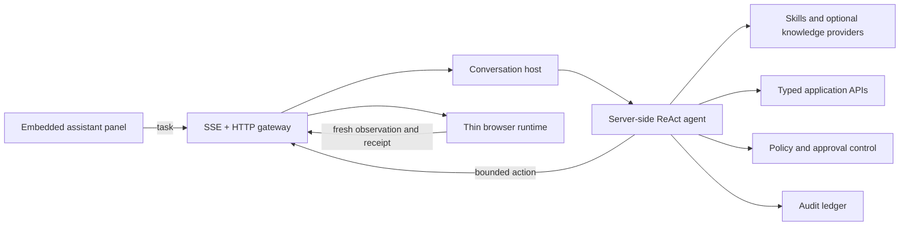

# Web Operation Agent

[简体中文](README.zh-CN.md)

Web Operation Agent is an early-stage framework for building an AI assistant inside a first-party web application. A server-side agent plans and replans from fresh page observations, while a small embedded browser runtime executes a fixed set of page actions. Application Skills and typed APIs can add business knowledge and current data; source retrieval is an optional knowledge provider.

> **Status: alpha.** The repository contains a tested core and one narrow Twenty CRM integration. It is not a production-ready autonomous agent, a hosted service, or a general browser extension.

## What works today

The repository currently verifies these behaviors with local automated tests and isolated application fixtures:

| Capability | Current scope |
| --- | --- |
| Remote browser loop | An embedded runtime exchanges observations, actions, results, and approval decisions with a local server over SSE and HTTP. |
| ReAct execution | The same server-side agent receives each tool result, observes the page again, and chooses the next step within time and step budgets. |
| Grounded page actions | Navigation and element actions are checked against the current observation and an application-owned control layer. |
| Skills and business tools | A Skill describes when and how to use typed tools. Current data comes from the application API rather than the Skill text. |
| Guarded writes | Business mutations are disabled by default. Enabled integrations require an explicit page confirmation and atomically record `prepared → dispatching → completed/failed/indeterminate`. The Twenty demo uses a private SQLite journal so a crash or uncertain outcome cannot make the same proposal retryable. |
| Multi-turn hosting | A conversation host processes panel messages sequentially, isolates an ordinary turn failure from later turns, and retains at most four turns or 32 KiB of in-memory reference context. Historical business facts can resolve phrases such as “the second company,” but the Agent must refresh the current API or page and historical routes receive no authority. |
| Shared local gateway | A bounded server composition can host multiple independently revocable session capabilities on one gateway; a 50-session deterministic isolation test covers token/channel separation. State is still process-local. |
| Task control | The panel can stop its exact active message through the current authenticated runtime lease. Cancellation prevents unclaimed actions and pending approved writes from dispatching; already claimed actions still settle to a definite or indeterminate result. |
| Identity binding primitives | A host can bind a short-lived actor/tenant/workspace principal to the runtime capability, Agent turn, typed-tool scope, approval, mutation proposal, and redacted audit events. Bound sessions reject mismatch, expiry, and cross-operation proposal reuse. |
| Provider data boundary | Model requests have deterministic schema, count, byte, credential, and finite-JSON checks. The audit ledger records a payload digest and data classes without copying page, tool, source, or user content. Remote provider endpoints require HTTPS except on loopback. |
| Audit and replay primitives | Server events can be written to an append-only ledger and projected into a redacted replay. |
| Twenty CRM vertical | The packaged adapter can query companies through bounded cursor pagination, explicitly label incomplete scans, hand an API-discovered company route to the browser, and opt in to creating one company with confirmation and delegated-token readback. OAuth refresh is serialized across local threads and processes. The adapter can resolve the OAuth actor through Twenty's Metadata API for a trusted application host to match against its page-session identity. |

These claims describe the implemented paths only. The project does not yet have a public benchmark large enough to establish general task success, a source-retrieval advantage, or superiority over PageAgent or other browser agents.

## Architecture



The server owns model access, planning, knowledge, session policy, authorization state, and audit data. The browser receives only a session-scoped capability, fixed generic actions, and user-visible approval requests. It does not receive model credentials, source indexes, hidden write permissions, or evaluators.

Fresh runtime facts take precedence over Skills, source code, documentation, and API schemas. Those knowledge sources can propose a route or tool call, but the current page and application response determine what is actually true.

The main reusable boundaries are:

| Module | Responsibility |
| --- | --- |
| `web_operation_agent.application` | Validates a versioned application descriptor and binds its exact Skill/tool catalog to a product session. |
| `web_operation_agent.product` | Validates and binds one user message to the latest observation, then runs one application-neutral agent turn. |
| `web_operation_agent.conversation` | Retains bounded, redacted reference context across turns without granting current facts or routes. |
| `web_operation_agent.live` | Owns the gateway and sequential conversation lifecycle. |
| `web_operation_agent.remote` | Defines the capability-bound remote browser channel and client. |
| `web_operation_agent.embedded_gateway` | Serves the embedded runtime and authenticated SSE/HTTP endpoints. |
| `web_operation_agent.business` | Loads Skills and mediates typed read and mutation tools. |
| `web_operation_agent.mutation` | Atomically records single-use mutation intent and terminal outcome in memory or SQLite. |
| `web_operation_agent.egress` | Enforces and audits the model-provider data boundary without storing request content. |
| `web_operation_agent.twenty` | Provides the current Twenty CRM Companies adapter. |
| `web_operation_agent.session` | Implements the bounded server-side agent loop. |

Application adapters expose a versioned, non-secret descriptor plus a digest-bound Skill and typed-tool catalog. Natural-language goals enter the generic Agent loop directly; an adapter does not preclassify them into a fixed product intent enum. The package API is still evolving; no compatibility guarantee is made before a stable release.

## Developer setup

Requirements:

- Python 3.12
- a POSIX shell
- Node.js to execute all embedded-runtime tests
- network access during the first dependency installation

From an existing checkout:

```bash
python3.12 -m venv .venv
. .venv/bin/activate
PLAYWRIGHT_SKIP_BROWSER_DOWNLOAD=1 python -m pip install --editable .
python src/web_operation_agent/tests/run_all.py
```

The test runner uses Python `unittest` discovery and guards the real model-spend ledger from test writes. Browser-backed tests skip when Chromium is absent. Tests that exercise the upstream PageController run only when `WOA_PAGE_CONTROLLER_MODULE` names an installed module; otherwise they skip. CI also builds and inspects an installable wheel:

```bash
python -m pip wheel --no-deps --wheel-dir dist .
```

To run one test module through the same guarded runner:

```bash
python src/web_operation_agent/tests/run_all.py -k test_product.py
```

## Twenty CRM integration

`TwentyApplicationAdapter` ships with read-only and mutation Skills as package resources, so it can be imported from an installed wheel outside the repository. It still needs:

- a separately provisioned compatible Twenty CRM instance;
- OAuth token and client-registration files for a delegated test user;
- the page-side controller integration; and
- an application composition that supplies the model, control plane, ledger location, and session host.

Read access is the default. Creating a company requires opting in at both the Twenty adapter and turn policy, followed by the user-visible approval flow.

Company enumeration follows Twenty's `pageInfo.endCursor` with `starting_after`, with hard page and record ceilings plus repeated-record, stalled-cursor, changing-total, and malformed-page detection. A bounded interruption is returned as an explicit partial result; it is never represented as a complete company list. Duplicate checks for company creation fail closed unless the complete active set was scanned. Cursor pagination does not provide a database snapshot, so a workspace changing during a scan can still force an incomplete result and a retry after the data settles.

The root [`demo.sh`](demo.sh) launches the public composition in
[`examples/twenty`](examples/twenty/README.md). It requires an externally provisioned,
synthetic Twenty instance and explicit local paths for browser state, delegated OAuth state,
the same-origin PageController module, audit output, and spend accounting. It does not read
database truth, reset the application, or present an Agent completion as deterministic
business verification. Provisioning a reproducible public Twenty environment remains release
work.

## Independent Twenty evaluator

The separate [`evals/twenty`](evals/twenty/README.md) foundation keeps deterministic
application verification outside the product and Agent process. It covers three Companies
task shapes: querying the exact active name/domain set without changing business state,
opening one baseline company without changing business state, and creating exactly one
requested company with acknowledged same-actor readback and forbidden-change checks.

Results use four distinct states: `PASS`, `FAIL`, `INDETERMINATE` for an uncertain final state or write outcome, and `INVALID` when the task or evidence cannot support a trial. Its offline tests use an injected command runner. Capture, schema snapshot, controlled mutation, restore, and post-restore digest checks have also passed against a local Docker-backed synthetic Twenty fixture. This foundation is not a benchmark and does not establish a success rate, a baseline comparison, or a source-retrieval benefit. The public repository still needs reproducible fixture provisioning before others can repeat the live qualification.

## Known limitations

- The shared gateway, session registry, event journal, conversation context, and ledger remain local-process components; restart recovery, horizontal scaling, and durable tenant isolation are not complete. Confirmed Twenty API writes have a durable single-use SQLite journal, but a crash after dispatch remains `indeterminate` and requires reconciliation rather than automatic retry. Identity binding is available as an opt-in fail-closed contract, but the public Twenty demo does not yet obtain a trusted page-session identity from a Twenty server integration and therefore does not enable the production identity requirement.
- Turn deadlines cap each provider request by the remaining wall budget. Message-bound user cancellation prevents later tool dispatch and releases approval waits, but the current provider HTTP transport cannot interrupt an in-flight socket request; its late result is discarded. Initial observation binding and claim-before-execution target/form/route freshness checks exist, while dependencies outside the target element, broader concurrency, crash recovery, and operational observability remain incomplete.
- The only packaged business adapter is a narrow Twenty CRM Companies vertical.
- Arbitrary third-party websites and a browser extension are not implemented.
- Browser actions do not provide database transaction or rollback semantics.
- Source-aware retrieval exists as an optional planning input, but its benefit has not been established across a representative held-out evaluation.
- Provider egress is bounded, classified and credential-checked, but the framework does not yet provide application-specific field classification, customer-managed encryption, regional routing, a DLP service, or a complete data-retention policy.
- The assistant panel and end-to-end deployment flow still need product-level accessibility, localization, and visual polish.
- Do not connect this alpha to production accounts, customer data, payments, email, or other consequential systems.

## Documentation

- [中文说明](README.zh-CN.md)
- [System design](docs/architecture/system-design.md)
- [Contributing](CONTRIBUTING.md)
- [Security policy](SECURITY.md)
- [License](LICENSE)

## License

This project is licensed under the [MIT License](LICENSE).
