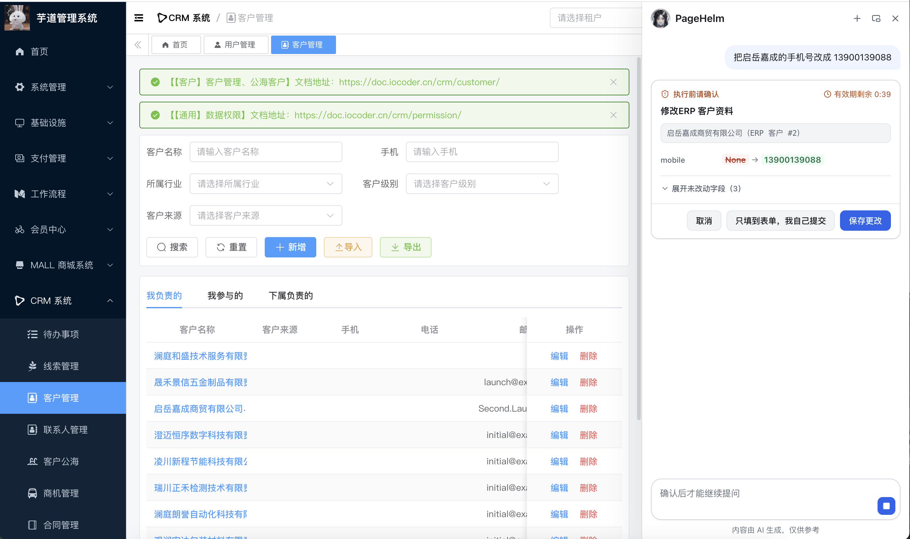
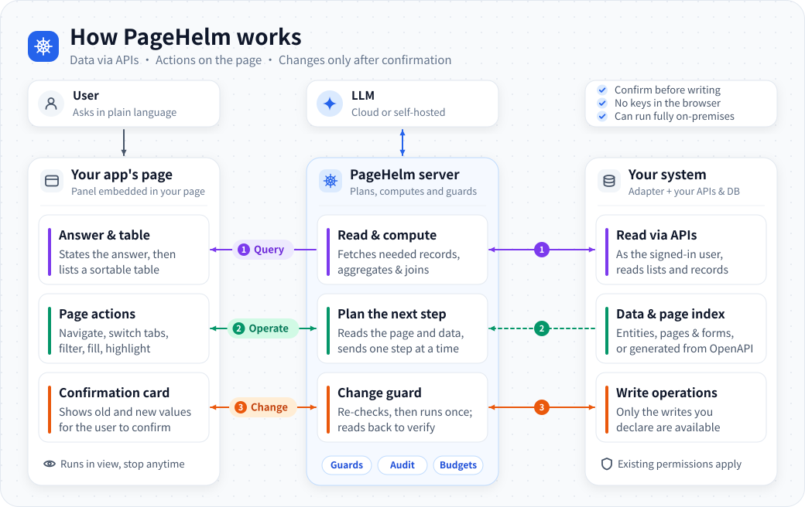

# PageHelm

[简体中文](README.zh-CN.md)

**PageHelm** is an AI agent for operating first-party web applications.

Once added to your web app, PageHelm lets users handle everyday tasks in natural language—querying data, opening screens, filtering lists, filling forms, or updating records. Instead of clicking through menus, configuring filters, and typing fields by hand, users simply state their goal and let the assistant plan and run the steps.

## Try Asking

These examples come from the bundled Yudao admin demo (its UI is in Chinese; the prompts are translated):

| You say | The assistant |
| --- | --- |
| "How many CRM contacts are there?" | Counts them under the current account's permissions and gives the number |
| "Which group buys are currently open?" | States the answer, then lists them in a sortable table in the panel |
| "Open the contract management page" | Goes straight to that page |
| "Create a system user, nickname Lin Xiaofeng, phone 13800000001" | Opens the create dialog, fills in the known fields, lists the required ones still missing, and leaves the password to the user |
| "Change Qiyue Jiacheng's phone number to 13900000002" | Shows a confirmation card with old and new values; once the user confirms, runs the change once and reads it back |

---

## Live Preview

| Assistant Panel & Quick Starters | Data Queries & Sortable Tables |
| :---: | :---: |
|  |  |
| Quick entry points for querying data, finding features, and running page actions. | Query data under the active account's permissions without leaving the current page. |
| **Form Prefill & Submit Guide** | **Before/After Confirmation Card** |
|  |  |
| Opens the target modal, fills in known fields, lists missing required inputs, and points to the Confirm button for the user to click. | Shows the target record and old vs. new field values before any change is applied. |

---

## Key Features

- **Data queries:** Calls backend APIs under the signed-in user's permissions, with filtering, sorting, aggregations, and multi-table joins. Results appear right in the assistant panel without leaving the current page.
- **Page operations:** Handles route navigation, tab switching, locating records, and clicking controls on the page.
- **Form prefill:** Opens create or edit forms and fills in known fields, with one-click undo. It asks when required fields are missing and leaves passwords and file uploads to the user. The assistant fills but never submits—it highlights the save button for the user to click, then reads back the saved record to verify.
- **Data changes:** When writes are enabled, creates records, updates fields, toggles status, or runs row actions in a list. Before making any change, the panel shows a before-and-after diff, runs the write once after confirmation, and reads back the result to verify.

## Key Advantages

- **Safe and controllable:** Always scoped to the signed-in user's permissions. Forms are prefilled without auto-submitting, writes are limited to operations declared by the integration and require human confirmation first, every action is audited, and a read-only kill-switch is one variable away.
- **Fast queries without pagination limits:** Lookups and aggregations go straight to backend APIs rather than paging through the UI screen by screen—faster to return and free from front-end page-size caps.
- **Decoupled core, progressive adoption:** Reuses your app's existing authentication, data permissions, and validation rules with no changes to your business backend. You can start with read-only queries and page navigation, then layer on domain guides, form prefill, and Skill-backed verified writes for high-frequency tasks as you go.

## How It Compares

| | Chat assistants | General browser agents | PageHelm |
| --- | --- | --- | --- |
| Where it works | A separate chat window | A separate browser or browser extension | Inside your app's pages; nothing for users to install |
| Page actions | Gives advice; the user clicks | Clicks step by step from screenshots or page structure | Knows your app's pages, goes straight there and acts in the current page |
| Large data sets | Mostly answers from documents; hard to count live data | Pages through screens; slow and easy to miss rows | Reads complete data through APIs and computes in code |
| Changing data | Usually not supported | Clicks the page's submit button | Shows old and new values, runs once after confirmation, then reads back |
| Setup | Connect documents or APIs | None | A server-side adapter and one script tag |

---

## Architecture



Form prefill and any write operations registered by your adapter are enabled by default (every write still requires human confirmation); set `WOA_READ_ONLY=true` in `.env` whenever you want a read-only deployment (see [Write Safety & Privacy](docs/security/verified-writes.md)).

---

## Quickstart & Integration

### 1. Run the Bundled Demo (`examples/yudao`)

The demo is built on Yudao (ruoyi-vue-pro), an open-source admin system. It requires **Python 3.13**, **Node.js (>=22)**, and **Docker Compose 2.30+**. Prepare `.q0-cache/yudao/` first per the [reference build guide](examples/yudao/deploy/README.md).

```bash
# 1) Create the virtual environment and build the panel and browser script
python3.13 -m venv .venv && . .venv/bin/activate
PLAYWRIGHT_SKIP_BROWSER_DOWNLOAD=1 python -m pip install --editable ".[browser]"
python -m pip install --no-deps --editable examples/yudao
python scripts/build_panel.py --install && python scripts/build_runtime.py --skip-build

# 2) Copy the config file and add your model API key to .env
cp .env.example .env

# 3) Start the local demo (http://localhost:40001)
./local --synthetic-clock
```

After changing code, run `.venv/bin/python scripts/check.py --plan && .venv/bin/python scripts/check.py` to check it (no paid model calls).

### 2. Integrate Your Own Web App

Integration happens on the server, and the core contains no application-specific code. `testapps/contacts/` holds a reference implementation of declarative onboarding (still a prototype), made up of these parts:

| Part | What you provide | What it enables | Reference |
| --- | --- | --- | --- |
| **User identity** | Server-side lookup of the current user from a cookie or token | Queries and actions as that user; refused if the user can't be identified | [`declarative.py`](testapps/contacts/declarative/declarative.py) |
| **Data & pages** | An OpenAPI document, or declarations of entities, pages and forms | Queries under the user's permissions, shown as tables in the panel | [Declarative Onboarding](docs/integration/onboarding.md) |
| **Front end** | Same-origin deployment, `assistant.js` on your pages, and a UI preset (Element Plus or plain HTML) | Assistant panel, page actions, session and usage records | [`testapps/contacts/adapter.py`](testapps/contacts/adapter.py) |
| **Writes (optional)** | The write operations you allow: create, field updates, status toggles, row actions | Changes run once after confirmation and are checked; undoable form prefill | [Write Safety & Privacy](docs/security/verified-writes.md) |

---

## Documentation & License

- **Getting Started & Integration:** [Docs Home](docs/index.md) · [Local Demo Quickstart](docs/integration/quickstart.md) · [Declarative Application Onboarding](docs/integration/onboarding.md) · [Skills & Typed Writes](docs/integration/skills-and-writes.md)
- **Architecture & Runtime:** [Architecture Overview](docs/architecture/overview.md) · [Execution & Browser Runtime](docs/architecture/execution-and-runtime.md)
- **Security & Operations:** [Write Safety & Privacy](docs/security/verified-writes.md) · [Deployment & Operations](docs/security/operations-and-observability.md)
- **Reference:** [Configuration & Protocol](docs/reference/protocol-and-configuration.md) · [Tools, Capabilities & Checks](docs/reference/tools-and-capabilities.md)
- **Status & Licensing:** PageHelm is in alpha. Validate integrations in isolated, resettable test environments before deploying to live systems. [SECURITY](SECURITY.md) · [LICENSE](LICENSE) · [THIRD_PARTY](THIRD_PARTY.md)
