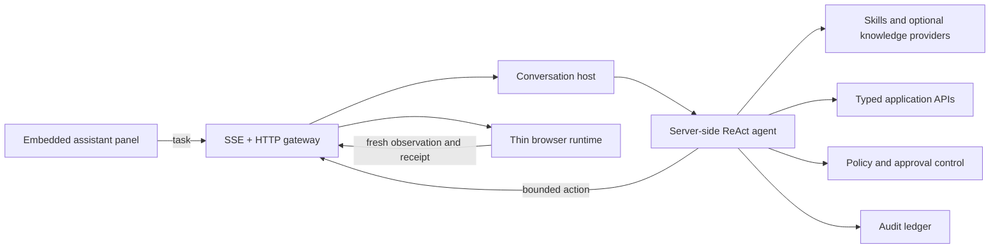

# Web Operation Agent

[简体中文](README.zh-CN.md)

Web Operation Agent is an early-stage framework for building an AI assistant inside a first-party web application. A server-side agent plans and replans from fresh page observations, while a small embedded browser runtime executes a fixed set of page actions. Application Skills and typed APIs can add business knowledge and current data; source retrieval is an optional knowledge provider.

> **Status: alpha.** The repository contains a tested core and one narrow Twenty CRM integration. It is not a production-ready autonomous agent, a hosted service, or a general browser extension.

## What works today

The repository currently verifies these behaviors with local automated tests and isolated application fixtures:

| Capability | Current scope |
| --- | --- |
| Remote browser loop | An embedded runtime exchanges observations, actions, results, and approval decisions with a local server over SSE and HTTP. |
| ReAct execution | The same server-side agent receives each tool result, observes the page again, and chooses the next step within time and step budgets. |
| Grounded page actions | Navigation and element actions are checked against the current observation and an application-owned control layer. |
| Skills and business tools | An auditable, bounded user-intent matcher selects candidate Skills; an empty match falls back to eligible read Skills and explicitly enabled mutation Skills. Current data comes from typed application APIs rather than Skill text. |
| Guarded writes | Business mutations are disabled by default. Enabled integrations require an explicit page confirmation and atomically record `prepared → dispatching → completed/failed/indeterminate`. The Twenty demo uses a private SQLite journal so a crash or uncertain outcome cannot make the same proposal retryable. |
| Legacy page control | The legacy external page-control gateway is leased to one cooperating run across local threads and processes, reset before use, and cleared before release. A control cleanup failure stops closed; this compatibility path does not provide concurrent tenant-scoped permits. |
| Multi-turn hosting | A conversation host processes panel messages sequentially, isolates an ordinary turn failure from later turns, and retains at most four turns or 32 KiB of in-memory reference context. Historical business facts can resolve phrases such as “the second company,” but the Agent must refresh the current API or page and historical routes receive no authority. |
| Shared local gateway | A bounded server composition can host multiple independently revocable session capabilities on one gateway; a 50-session deterministic isolation test covers token/channel separation. Sessions have a one-hour default TTL, bounded queues and hard event/message/observation/action/approval/runtime-instance limits. State is still process-local. |
| Task control | The panel can stop its exact active message through the current authenticated runtime lease. Cancellation prevents unclaimed actions and pending approved writes from dispatching; already claimed actions still settle to a definite or indeterminate result. |
| Assistant interface | A reusable state-driven panel renders embedded and standalone replay modes. It keeps failed input recoverable, restores the initiating goal when a confirmation is denied for editing, exposes calm success/error/indeterminate states, and supports responsive layout, keyboard focus, screen-reader live regions, dark mode, and reduced motion. |
| Identity binding | A host can bind a short-lived actor/tenant/workspace principal to the runtime capability, Agent turn, typed-tool scope, approval, mutation proposal, and redacted audit events. The Twenty demo resolves the exact HttpOnly browser session against Twenty before startup, requires it to match the delegated OAuth actor/workspace, and closes the Agent session if the browser cookie is replaced or removed. |
| Provider boundary | Model requests have deterministic schema, count, byte, credential, and finite-JSON checks. Pinned framework adapters can preserve their native chat body while using the same server-held credentials, transport, limits, guard, and accounting. A shared in-process guard bounds concurrent requests, charges queue time to the request deadline, and opens a cooldown circuit only after consecutive transient provider-health failures; user cancellation and local deadlines neither increment nor clear that state. Queueing and connection setup on the native Agent path are cancellable. A cancellation before HTTP dispatch creates no spend row, while every dispatched request has a correlation ID and either reported usage or an explicit unknown cost. Content-free per-run summaries bind trials to digests of their request IDs and spend rows. Remote endpoints require HTTPS except on loopback. |
| Operational probes | The loopback gateway separates process liveness at `/healthz` from work readiness at `/readyz`. Readiness reports only schema-fixed counts, admission state, and provider guard health; malformed callbacks fail closed without exposing their error text. |
| Audit and replay primitives | Server events can be written to an append-only ledger and projected into a redacted replay. |
| Twenty CRM vertical | The packaged adapter can query companies through bounded cursor pagination, project the returned records, source and completeness into the user answer without trusting model prose, hand an API-discovered company route to the browser, and opt in to creating one company with confirmation and delegated-token readback. OAuth refresh is serialized across local threads and processes, including GraphQL `UNAUTHENTICATED` responses encountered during identity resolution. |

These claims describe the implemented paths only. The project does not yet have a public benchmark large enough to establish general task success, a source-retrieval advantage, or superiority over PageAgent or other browser agents.

## Architecture



The server owns model access, planning, knowledge, session policy, authorization state, and audit data. The browser receives only a session-scoped capability, fixed generic actions, and user-visible approval requests. It does not receive model credentials, source indexes, hidden write permissions, or evaluators.

Fresh runtime facts take precedence over Skills, source code, documentation, and API schemas. Those knowledge sources can propose a route or tool call, but the current page and application response determine what is actually true.

The main reusable boundaries are:

| Module | Responsibility |
| --- | --- |
| `web_operation_agent.application` | Validates a versioned application descriptor and binds its exact Skill/tool catalog to a product session. |
| `web_operation_agent.product` | Validates and binds one user message to the latest observation, then runs one application-neutral agent turn. |
| `web_operation_agent.conversation` | Retains bounded, redacted reference context across turns without granting current facts or routes. |
| `web_operation_agent.live` | Owns the gateway and sequential conversation lifecycle. |
| `web_operation_agent.remote` | Defines the capability-bound remote browser channel and client. |
| `web_operation_agent.embedded_gateway` | Serves the embedded runtime, authenticated SSE/HTTP endpoints, and content-free liveness/readiness probes. |
| `web_operation_agent.business` | Loads Skills and mediates typed read and mutation tools. |
| `web_operation_agent.mutation` | Atomically records single-use mutation intent and terminal outcome in memory or SQLite. |
| `web_operation_agent.egress` | Enforces and audits the model-provider data boundary without storing request content. |
| `web_operation_agent.twenty` | Provides the current Twenty CRM Companies adapter. |
| `web_operation_agent.session` | Implements the bounded server-side agent loop. |

Application adapters expose a versioned, non-secret descriptor plus a digest-bound Skill and typed-tool catalog. Natural-language goals enter the generic Agent loop directly; an adapter does not preclassify them into a fixed product intent enum. The package API is still evolving; no compatibility guarantee is made before a stable release.

## Developer setup

Requirements:

- Python 3.12
- a POSIX shell
- Node.js to execute all embedded-runtime tests
- network access during the first dependency installation

From an existing checkout:

```bash
python3.12 -m venv .venv
. .venv/bin/activate
PLAYWRIGHT_SKIP_BROWSER_DOWNLOAD=1 python -m pip install --editable .
python src/web_operation_agent/tests/run_all.py
```

The test runner uses Python `unittest` discovery and guards the real model-spend ledger from test writes. Browser-backed tests skip when Chromium is absent. Tests that exercise the upstream PageController run only when `WOA_PAGE_CONTROLLER_MODULE` names an installed module; otherwise they skip.

To run one test module through the same guarded runner:

```bash
python src/web_operation_agent/tests/run_all.py -k test_product.py
```

### Self-contained minimal demo

The packaged [Minimal Contacts example](examples/minimal/README.md) removes the external application setup from the first run. It starts a synthetic first-party application and typed API on loopback, injects the real assistant runtime into Chromium, and runs the normal gateway, session host and ReAct executor:

```bash
python -m pip install --editable ".[demo]"
python -m playwright install chromium
web-operation-agent-demo --scripted
```

The explicit `--scripted` mode performs one fixed, zero-cost apparatus walkthrough: load a Skill, query the current API, open an API-authorized route, observe the new page, and finish. It does not measure model quality. Omit `--scripted` and configure an OpenAI-compatible provider to use the same application interactively with actual model decisions.

### Qualification

`scripts/qualify.sh` is the single gate. CI runs the same script, so a gate cannot hold locally and be missing in CI:

```bash
scripts/qualify.sh
```

It runs the product suite, the Twenty evaluator foundation tests, the offline PageAgent and Web Operation Agent runner suites, verifies and builds the pinned PageAgent bundle when its installed dependencies are present, and builds an installable wheel whose contents and out-of-checkout import are both checked. It exits non-zero if any required gate fails. Installing the pinned npm dependencies remains environment preparation; CI does that before invoking the same gate.

Two gates depend on the environment and are reported, never assumed:

- **Chromium qualification** runs both the packaged minimal demo end to end and the PageAgent browser cases against the built bundle. Neither needs Twenty, and CI makes both required with `--require-browser`. Without the flag, a missing bundle or Chromium is reported rather than counted as a pass.
- **Live Twenty qualification** runs only when every prerequisite is set: `WOA_TWENTY_BASE_URL`, `WOA_TWENTY_STORAGE_STATE`, `WOA_TWENTY_OAUTH_TOKEN`, `WOA_TWENTY_OAUTH_REGISTRATION`, `WOA_TWENTY_PAGE_CONTROLLER_MODULE`, `WOA_TWENTY_DB_CONTAINER`, `WOA_TWENTY_DB_NAME`, `WOA_TWENTY_DB_USER`, `WOA_TWENTY_WORKSPACE_SCHEMA`. Otherwise it prints `BLOCKED` and names what is unset. A blocked gate is untested — neither a pass nor a product failure. `--require-live` turns that absence into a failure for an environment that must have it.

This repository does not yet provision a Twenty instance, so a fresh clone reports the live gate as `BLOCKED`.

## Twenty CRM integration

`TwentyApplicationAdapter` ships with read-only and mutation Skills as package resources, so it can be imported from an installed wheel outside the repository. It still needs:

- a separately provisioned compatible Twenty CRM instance;
- OAuth token and client-registration files for a delegated test user;
- the page-side controller integration; and
- an application composition that supplies the model, control plane, ledger location, and session host.

Read access is the default. Creating a company requires opting in at both the Twenty adapter and turn policy, followed by the user-visible approval flow.

Company enumeration follows Twenty's `pageInfo.endCursor` with `starting_after`, with hard page and record ceilings plus repeated-record, stalled-cursor, changing-total, and malformed-page detection. A bounded interruption is returned as an explicit partial result; it is never represented as a complete company list. Duplicate checks for company creation fail closed unless the complete active set was scanned. Cursor pagination does not provide a database snapshot, so a workspace changing during a scan can still force an incomplete result and a retry after the data settles.

The root [`demo.sh`](demo.sh) launches the public composition in [`examples/twenty`](examples/twenty/README.md). Run `./demo.sh --check` first to diagnose configuration, runtime, Twenty health, and browser/OAuth identity without opening a browser or calling the model. The demo requires an externally provisioned, synthetic Twenty instance and explicit local paths for browser state, delegated OAuth state, the same-origin PageController module, audit output, and spend accounting; these `WOA_*` values may live in the safely parsed model environment file. It does not read database truth, reset the application, or present an Agent completion as deterministic business verification. Provisioning a reproducible public Twenty environment remains release work.

## Independent Twenty evaluator

The separate [`evals/twenty`](evals/twenty/README.md) foundation keeps deterministic application verification outside the product and Agent process. It covers three Companies task shapes: querying the exact active name/domain set without changing business state, opening one baseline company without changing business state, and creating exactly one requested company with acknowledged same-actor readback and forbidden-change checks.

Results use four distinct states: `PASS`, `FAIL`, `INDETERMINATE` for an uncertain final state or write outcome, and `INVALID` when the task or evidence cannot support a trial. Its offline tests use an injected command runner. Capture, schema snapshot, controlled mutation, restore, and post-restore digest checks have also passed against a local Docker-backed synthetic Twenty fixture. This foundation is not a benchmark and does not establish a success rate, a baseline comparison, or a source-retrieval benefit. The public repository still needs reproducible fixture provisioning before others can repeat the live qualification.

A public six-case development task set and a digest-only commitment to a private twelve-case held-out set now exercise the three supported Companies task shapes. The split verifier rejects task, ID, release, and template-family overlap. These small sets qualify the evaluation pipeline only; they are not a representative or statistically powered benchmark.

The evaluator also includes a strict preregistration validator for paired PageAgent, Skill/API, and SourceProvider comparisons. It binds artifact and implementation digests, equal-information arms, provider settings, budgets, task eligibility, source exclusions, deterministic balanced order, and fail-fast stop rules before execution. No formal run protocol or comparative result is frozen yet.

A private append-only batch ledger now enforces that frozen order and a common trial schema across runners. It hash-chains entries, rejects duplicate or overlapping trials, preserves unknown provider cost as unknown, detects paired model drift, and stops on apparatus invalidity or observed safety events. The official PageAgentCore and PageController v1.12.4 packages are also pinned by npm lock and integrity; their thin bridge passes deterministic bundle and real-Chromium DOM/custom-tool qualification without a model call. Both engines now run behind one evidence contract, one typed failure classifier and one protocol-bound trial projector: a read-only PageAgent runner and a read-only Web Operation Agent runner each bind the actual browser/API identity and reject answers or page evidence that cannot be deterministically evaluated. A single serial schedule driver captures state, instantiates the task, runs the scheduled arm, evaluates, projects and appends each trial in the frozen order, with no engine-specific branch; a schema-fixed report recomputes public counts from the verified ledger and refuses to phrase a small batch as a comparison. Both runners have passed no-model live qualification against a local Twenty 2.39.0 fixture through real Chromium, the delegated API, database state capture and the independent evaluator. That result is a record of an earlier run on a provisioned environment, not a property of any checkout: the live gate is re-run through `scripts/qualify.sh`, which reports `BLOCKED` wherever such an environment is absent. A frozen formal protocol, the provider snapshot policy and the source allowlist are still pending; these qualification cases are not a success-rate or comparative result.

## Known limitations

- The shared runtime gateway, session registry, bounded event journal, message queue, conversation context, and ledger remain local-process components; restart recovery, horizontal scaling, and durable tenant isolation are not complete. A session TTL and hard quotas prevent unbounded retention but do not make state recoverable. Confirmed Twenty API writes have a durable single-use SQLite journal, but a crash after dispatch remains `indeterminate` and requires reconciliation rather than automatic retry. The Twenty demo enforces identity from its trusted Playwright host, but a normal embedded application still needs a server-authenticated identity assertion from its own login boundary; principal renewal and distributed revocation are not implemented. The separate legacy page-control gateway still has global permit and trace state: cooperating clients serialize complete runs and clear state at both boundaries, but a gateway-native tenant/session/turn scope is required before concurrent page writes.
- Turn deadlines cap provider queueing and socket time together. The server Agent's native completion path uses a closeable HTTP connection: message-bound cancellation aborts an in-flight request, releases its provider-guard slot, prevents later tool dispatch, and records the dispatched call with unknown usage rather than retrying it. Every implementation reachable from a turn satisfies one explicit `ChatPort` contract in which cancellation is mandatory, and it is checked where the model is wired rather than probed at call time, so an implementation that cannot be cancelled is rejected instead of silently degraded. Contract-planning calls still use the plain completion path and are not cancellable. The provider guard is local to one process and has no distributed tenant rate quota. Initial observation binding and claim-before-execution target/form/route freshness checks exist, while dependencies outside the target element, crash recovery, and broader operational observability remain incomplete.
- The only packaged real-application adapter is a narrow Twenty CRM Companies vertical; Minimal Contacts is a synthetic onboarding example.
- Arbitrary third-party websites and a browser extension are not implemented.
- Browser actions do not provide database transaction or rollback semantics.
- Mutation-journal idempotency covers one exact proposal digest. Separate sessions can still create distinct proposals for the same business key; cross-session in-flight business-key exclusion is not implemented.
- Source-aware retrieval exists as an optional planning input, but its benefit has not been established across a representative held-out evaluation.
- Provider egress is bounded, classified and credential-checked, but the framework does not yet provide application-specific field classification, customer-managed encryption, regional routing, a DLP service, or a complete data-retention policy.
- The assistant panel has automated keyboard, responsive, semantic, reduced-motion, recovery, and visual-state coverage. Its default copy is Chinese and can be overridden through label hooks; broader localization, assistive-technology/browser matrix testing, and the end-to-end deployment experience remain release work.
- Do not connect this alpha to production accounts, customer data, payments, email, or other consequential systems.

## Documentation

- [中文说明](README.zh-CN.md)
- [System design](docs/architecture/system-design.md)
- [Contributing](CONTRIBUTING.md)
- [Security policy](SECURITY.md)
- [License](LICENSE)

## License

This project is licensed under the [MIT License](LICENSE).
