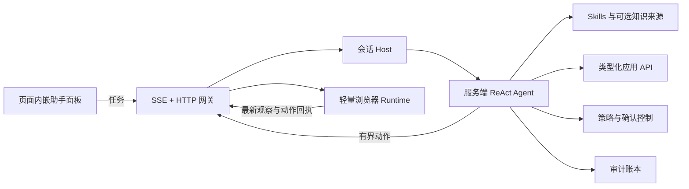

# Web Operation Agent

[English](README.md)

Web Operation Agent 是一个早期阶段的框架，用于在第一方 Web 应用中构建 AI 助手。服务端 Agent 根据最新页面观察进行规划和重规划，轻量的页面内嵌 Runtime 只执行固定的页面操作。应用 Skill 和类型化 API 可以补充业务知识与实时数据；源码检索是可选的知识来源。

> **状态：Alpha。** 仓库已有经过测试的核心模块和一个范围有限的 Twenty CRM 集成，但还不是可用于生产的自主 Agent、托管服务或通用浏览器扩展。

## 当前可以验证的能力

仓库目前通过本地自动化测试和隔离的应用 fixture 验证以下行为：

| 能力 | 当前范围 |
| --- | --- |
| 远程浏览器闭环 | 页面内嵌 Runtime 通过 SSE 和 HTTP 与本地服务端交换观察、动作、结果和确认决定。 |
| ReAct 执行 | 同一个服务端 Agent 接收每次工具结果，重新观察页面，并在时间与步数预算内决定下一步。 |
| 有依据的页面操作 | 导航和元素操作必须通过当前页面观察与应用控制层检查。 |
| Skill 与业务工具 | 可审计、有上限的用户意图匹配器选择候选 Skill；没有命中时回退到合格的只读 Skill 和显式开启的写 Skill。实时数据来自类型化应用 API，而不是 Skill 文本。 |
| 受控写入 | 业务写入默认关闭。启用写入的 turn 必须绑定已验证身份、经过页面内明确确认，并原子记录 `prepared → dispatching → completed/failed/indeterminate`。生产组合还要求 journal 明确声明具备跨重启持久性；易失 journal 只允许在显式 test profile 下使用。 |
| 旧页面控制层 | 旧版外部页面控制网关在本机线程和进程间只允许一个协作 run 持有租约，使用前重置，释放前清空；清理失败时关闭执行。这条兼容路径不能提供并发的租户级许可。 |
| 多轮会话承载 | 会话 Host 按顺序处理面板消息、隔离普通单轮失败，并在内存中保留最多 4 轮或 32 KiB 的引用上下文。历史业务事实可以帮助理解“第二家公司”等指代，但 Agent 必须重新读取当前 API 或页面，历史路由不会获得权限。 |
| 共享本地网关 | 有容量上限的 server composition 可以在一个网关中承载多个可独立撤销的 session capability；50 会话确定性隔离测试覆盖 token 与 channel 分离。Session 默认一小时过期，队列有背压，事件、消息、观察、动作、审批和 Runtime 实例都有硬上限。可选 SQLite 存储支持本机进程间的 owner fencing、消息去重记录与进度 outbox。 |
| 任务控制 | 面板可通过当前已认证 Runtime lease 停止精确绑定的活动消息。尚未被浏览器认领的动作和等待确认的写入不会再下发；已经认领的动作仍会结算为确定结果或 `indeterminate`。 |
| 助手交互 | 基于显式状态模型的复用面板同时支持页面内嵌和独立回放。进度和结果按用户轮次分组，提交失败会保留输入，确认被拒绝后会恢复原目标供修改，机器状态与可覆盖的显示文案分离。窄视口审批、键盘焦点、屏幕阅读器 live region、深色模式和减弱动画已有自动化覆盖。 |
| 身份绑定 | 应用宿主可以把短期 actor/tenant/workspace 主体绑定到 Runtime capability、Agent turn、类型化工具 scope、审批、mutation proposal 和脱敏审计事件。Twenty demo 会在启动前通过 Twenty 解析准确的 HttpOnly 浏览器 session，要求其与委托 OAuth 的 actor/workspace 一致，并在浏览器 cookie 被替换或删除时关闭 Agent session。 |
| Provider 边界 | 模型请求在发送前经过结构、数量、字节、凭据形态和有限 JSON 检查。固定版本的框架适配器可以保留自己的原生 chat 请求体，同时共用服务端凭据、传输、限制、guard 和费用记账。进程内共享 guard 限制并发请求，把排队时间计入请求截止时间，且只在连续的 provider 瞬时健康故障后进入冷却短路；用户取消和本地 deadline 既不累加也不清空该状态。原生 Agent 路径的排队和建连阶段均可取消。HTTP 派发前取消不会生成费用行；每个已派发请求都有相关 ID，并记录 provider 报告的 usage，或将无法确认的费用明确标为未知。逐 run 的无内容摘要用请求 ID 和费用行摘要把试验绑定到实际调用。远程 provider 必须使用 HTTPS，本机 loopback 开发端点除外。 |
| 运行探针 | Loopback 网关用 `/healthz` 表示进程存活，用 `/readyz` 表示可处理工作。Readiness 只返回固定 schema 的数量、准入状态和 provider guard 健康信息；回调畸形时关闭就绪状态，并隐藏错误正文。 |
| 审计与回放基础能力 | 服务端事件可以写入追加式账本，并转换成脱敏回放。 |
| Twenty CRM 纵切 | 已打包的适配器通过有界 cursor 分页查询 Companies、People 和 Opportunities，把类型化结果、来源及 API 找到的详情路由交给 Agent。公司创建需单独开启，并要求用户确认及委托 token 回读。OAuth 刷新会在本机线程和进程间串行化，身份解析遇到 GraphQL `UNAUTHENTICATED` 时也会进入受控刷新。 |

这些结论只覆盖已经实现的路径。项目还没有规模足够的公开评测，不能据此宣称通用任务成功率、源码检索收益，或优于 PageAgent 等浏览器 Agent。

## 架构



服务端持有模型访问、规划、知识、会话策略、授权状态和审计数据。浏览器只接收仅限当前会话的能力凭据、固定的通用动作和用户可见的确认请求，不接收模型密钥、源码索引、隐藏写权限或 evaluator。

运行时事实的优先级高于 Skill、源码、文档和 API schema。知识来源可以提出路由或工具调用建议，最终以当前页面和应用响应为准。

主要复用边界如下：

| 模块 | 职责 |
| --- | --- |
| `web_operation_agent.application` | 校验版本化应用描述，以及可执行的身份、路由、数据分类、mutation 后置条件与核对端口。 |
| `web_operation_agent.product` | 把已校验的应用和一条用户消息绑定到最新页面观察，并执行一次与具体应用无关的 Agent turn。 |
| `web_operation_agent.conversation` | 在多轮之间保留有界、脱敏的引用上下文，不把历史事实或路由当成当前权限。 |
| `web_operation_agent.live` | 管理网关和顺序执行的会话生命周期。 |
| `web_operation_agent.browser` | 定义结构化浏览器执行协议和类型化传输结果，不包含浏览器引擎。 |
| `web_operation_agent.remote` | 定义受能力凭据约束的远程浏览器通道和客户端。 |
| `web_operation_agent.embedded_gateway` | 提供页面 Runtime、带认证的 SSE/HTTP 端点，以及不含业务内容的存活与就绪探针。 |
| `web_operation_agent.business` | 加载 Skill，并代理类型化的读取和写入工具。 |
| `web_operation_agent.egress` | 执行模型 provider 数据边界，并在不保存请求内容的前提下生成审计记录。 |
| `web_operation_agent.mutation` | 在内存或 SQLite 中原子记录一次性 mutation intent 与终态。 |
| `web_operation_agent.twenty` | 提供当前 Twenty CRM Companies、People 和 Opportunities 适配器。 |
| `web_operation_agent.session` | 实现有步数和时间限制的服务端 Agent 循环。 |

Application Adapter 暴露版本化、无敏感信息的描述，由摘要绑定的 Skill/typed-tool catalog，以及身份、路由、结果数据分类、mutation 后置条件和保守核对端口。`bind_application()` 会检查所有工具和 mutation 均被覆盖，并确认运行时使用的就是同一组端口对象。路由端口拥有应用 URL 语法、源码感知的入口发现，以及应用特有 handoff secret 的浏览器出站前脱敏扩展；通用 Agent 不解析具体框架的路由。`AgentTurnExecutor(application=...)` 会在浏览器或模型工作开始前拒绝来自其它应用 Origin 的消息和无效 principal；typed-tool 路由进入 Agent 上下文前必须通过 Adapter 校验，已收到确认的写入也只有通过 Adapter 后置条件后才能记为完成。这是 Adapter contract version 2。自然语言目标直接进入通用 Agent 循环，Adapter 不会先把目标分类成固定的产品意图枚举。软件包 API 仍在演进，稳定版本发布前不承诺向后兼容。

PageController、身份、静态 Runtime、typed-tool 与验证合同见[应用接入指南](docs/integrations/application-adapter.zh-CN.md)。

页面内嵌 Runtime 是当前唯一随产品发布的浏览器执行端。`RemoteBrowserClient` 把每个服务端动作转换为认证会话协议中的版本化 `ActionCommand`，Runtime 返回与之匹配的 `ActionReceipt`。此前基于子进程 Playwright worker 的执行端及其未发布实验 CLI 已删除，因为它们的导航、选择和观察语义已经与内嵌产品路径分叉。

启用 mutation 时，`AgentTurnConfig.deployment_profile` 默认为 `production`。如果 mutation 策略没有要求身份、没有安装写工具，或所选 journal 没有声明跨重启持久性，组合会在接收用户任务前失败。测试若有意使用 `MemoryMutationJournal`，必须设置 `deployment_profile="test"`；该 profile 不会放宽身份绑定或用户确认。部署 Host 仍需提供并续期认证 principal、关闭无法授权的浏览器动作、撤销已变化的会话、保护确认界面，并校验实际部署的 page-controller 资产；这些 Host 责任不会由 profile 标志自动推导。

## 开发环境

要求：

- Python 3.12
- POSIX shell
- Node.js，用于执行全部页面 Runtime 测试
- 首次安装依赖时可访问网络

在已有 checkout 中运行：

```bash
python3.12 -m venv .venv
. .venv/bin/activate
PLAYWRIGHT_SKIP_BROWSER_DOWNLOAD=1 python -m pip install --editable .
python src/web_operation_agent/tests/run_all.py
```

测试入口使用 Python `unittest` 自动发现，并防止测试数据写入真实模型费用账本。浏览器测试会在缺少 Chromium 时跳过。依赖上游 PageController 的测试只有在 `WOA_PAGE_CONTROLLER_MODULE` 指向已安装模块时才会运行，否则会跳过。

通过同一受保护入口只运行一个测试模块：

```bash
python src/web_operation_agent/tests/run_all.py -k test_product.py
```

### 自包含 minimal demo

打包发布的 [Minimal Contacts 示例](examples/minimal/README.md) 去除了首次运行所需的外部应用配置。它会在 loopback 启动合成的第一方应用和类型化 API，把真实助手 Runtime 注入 Chromium，并运行现有网关、会话 Host 和 ReAct executor：

```bash
python -m pip install --editable ".[demo]"
python -m playwright install chromium
web-operation-agent-demo --scripted
```

显式的 `--scripted` 模式只执行一次固定的零费用装置演示：加载 Skill、查询当前 API、打开 API 授权的精确路由、观察新页面并结束。它不衡量模型能力。去掉 `--scripted` 并配置 OpenAI-compatible provider 后，同一个应用会改用真实模型决策并保持浏览器可交互。

### 资格门禁

`scripts/qualify.sh` 是唯一入口。CI 运行同一个脚本，因此不会出现某道门禁只在本地成立、CI 里缺失的情况：

```bash
scripts/qualify.sh
```

它会运行产品套件、Twenty evaluator 基础测试、PageAgent 与 Web Operation Agent 的离线 runner 套件，在已安装固定 npm 依赖时验证并构建 PageAgent bundle，并构建可安装 wheel，同时检查 wheel 内容和在 checkout 之外的导入。任一必需门禁失败即以非零码退出。安装固定 npm 依赖仍属于环境准备；CI 会先完成该步骤，再调用同一个门禁。

有两道门禁取决于环境，它们只会被如实报告，不会被默认当作通过：

- **Chromium 资格**会端到端运行打包的 minimal demo，并用已构建 bundle 运行 PageAgent 浏览器用例。二者都不需要 Twenty；CI 用 `--require-browser` 把它们设为必需。不加该参数时，缺少 bundle 或 Chromium 会被报告出来，而不是计为通过。
- **本地 Twenty 资格**只在全部前置条件就绪时运行：`WOA_TWENTY_BASE_URL`、`WOA_TWENTY_STORAGE_STATE`、`WOA_TWENTY_OAUTH_TOKEN`、`WOA_TWENTY_OAUTH_REGISTRATION`、`WOA_TWENTY_PAGE_CONTROLLER_MODULE`、`WOA_TWENTY_DB_CONTAINER`、`WOA_TWENTY_DB_NAME`、`WOA_TWENTY_DB_USER`、`WOA_TWENTY_WORKSPACE_SCHEMA`。门禁优先读取进程变量，随后读取与 `demo.sh` 相同的 `WOA_MODEL_ENV` 或被忽略的仓库 `.env`；配置文件按数据解析，不作为 shell 代码执行。否则输出 `BLOCKED` 并列出未设置的变量。BLOCKED 表示未被测试，既不是通过，也不是产品失败。需要该门禁的环境可用 `--require-live` 把缺失变成失败。

本仓库还没有提供 Twenty 实例的准备资产，因此全新 clone 会把本地 Twenty 门禁报告为 `BLOCKED`。

## Twenty CRM 集成

`TwentyApplicationAdapter` 将只读和写入 Skill 作为包资源分发，因此从仓库外安装 wheel 后也能加载。加载 Skill 或查询类型化 API 不会触发浏览器动作；页面动作仍会返回新的页面观察，写入完成后也会执行一次后续观察用于验证。完整运行仍需要：

- 独立部署的兼容 Twenty CRM 实例；
- 测试用户的 OAuth token 和客户端注册文件；
- 页面端 controller 集成；
- 提供模型、控制层、账本位置和会话 Host 的应用装配。

默认只有读取能力。创建公司需要同时在 Twenty 适配器和 turn 策略中显式开启、提供明确的 mutation journal、绑定已验证身份，然后经过页面内的用户确认流程。公开 demo 使用 `SQLiteMutationJournal`；适配器会拒绝启用 mutation 却省略 journal 的组合。

公司枚举使用 Twenty 的 `pageInfo.endCursor` 和 `starting_after` 翻页，并设置页数与记录数硬上限，同时检测重复记录、cursor 停滞、总数变化和畸形响应。扫描被有界中断时，工具会明确返回部分结果，不会把它表示成完整公司清单。创建公司的重复项检查只有在完整扫描当前集合后才会继续。Cursor 分页不是数据库快照；如果扫描期间工作区正在变化，结果仍可能被标记为不完整，需要等数据稳定后重试。

根目录 [`demo.sh`](demo.sh) 会启动 [`examples/twenty`](examples/twenty/README.md) 中的公开装配。先运行 `./demo.sh --check`，可以在不打开浏览器、不调用模型的情况下诊断配置、运行时、Twenty 健康状态和浏览器/OAuth 身份。Demo 要求已有一个只包含合成数据的 Twenty 实例，并显式提供浏览器登录状态、委托 OAuth 状态、同源 PageController 模块、审计输出和费用账本的本地路径；这些 `WOA_*` 值可以放在经安全解析的模型环境文件中。这个进程不读取数据库真值、不复位应用，也不会把 Agent 结束当成确定性的业务验收。可由全新 clone 一键部署的公开 Twenty 环境仍属于发布前工作。

## 独立 Twenty evaluator

独立的 [`evals/twenty`](evals/twenty/README.md) 基础设施把确定性的应用验收放在产品与 Agent 进程之外。它覆盖三类 Companies 任务：查询全部活跃公司的准确名称和域名且业务状态不变；打开基线中的指定公司且业务状态不变；创建且仅创建一个指定公司，同时要求已确认的同一用户回读，并检查禁止变化的状态。

结果明确区分四种状态：`PASS`、`FAIL`、表示终态或写入结果不确定的 `INDETERMINATE`，以及表示任务或证据无法支撑该次试验的 `INVALID`。离线测试使用注入的假命令执行器；采集、schema 快照、受控变化、恢复和恢复后摘要核对也已在本地 Docker 合成 Twenty fixture 上通过。这套基础设施还不是 benchmark，不能据此给出成功率、基线对比或源码检索收益结论。公开仓库仍需提供可复现的 fixture 部署，其他开发者才能重复这项真实装置资格验证。

当前还提供一份公开的 6 用例开发任务集，以及一份只公开摘要承诺、私下保存完整内容的 12 用例保留测试集。Split verifier 会拒绝任务、ID、版本和模板族交叉。这些小型任务集只用于验证评估流水线，既不代表完整业务范围，也不具备统计功效。

Gate 4 breadth 开发目录新增 30 个唯一的中英文提示模板，覆盖 Companies、People、Opportunities 的完整列举、条件查询、打开记录、模块导航、确认后创建公司和安全拒绝。v2 fixture 与确定性 evaluator 已在本地合成 Twenty 数据库上完成资格验证。WOA breadth runner 也已经通过无模型 scripted qualification，执行时走真实的身份绑定、远程会话、ReAct、类型化工具、确认和审计链路。新增对象的 7 个查询、导航和拒绝用例还在本地 Twenty 2.39.0 + 真实 Chromium 上通过了同一组检查。改写提示仍属于相关的开发用例，不能当作相互独立的统计样本。一轮固定 12 用例的付费开发诊断在随机生成的合成 CRM 数据上首次发现：模型在条件查询后错误地执行了页面导航。在不修改任务和 evaluator 的前提下增加查询结果指引后，验证运行得到 12 个 `PASS`、0 个 `FAIL`、0 个 `INVALID`，两个安全拒绝均正确，安全事件为零，用量记账完整，记录费用 0.433488 元。延迟中位数为 8.224 秒（nearest-rank p95 为 11.742 秒），模型调用次数和步骤数的中位数均为 3（p95 为 4），页面动作 p95 为 1。这一次相关开发运行不构成 benchmark 或产品成功率结论；尚未授权或执行针对本地 Twenty fixture 的付费运行。

Evaluator 还包含一套严格的配对实验预注册校验器，用于在运行前绑定 PageAgent、Skill/API 与 SourceProvider 对比所需的工件和实现摘要、等信息量实验臂、provider 参数、预算、任务资格、源码排除、确定性平衡顺序和 fail-fast 停止规则。当前尚未冻结正式运行协议，也没有形成比较结果。

私有的 append-only batch ledger 会让所有 runner 使用同一种 trial schema，并强制执行冻结顺序。它通过摘要链检测删改和重排，拒绝重复或时间重叠的 trial，不会把未知 provider 费用写成零，还会检测同一 pair 的模型漂移，并在装置无效或观察到安全事件时停止。官方 PageAgentCore 与 PageController v1.12.4 已通过 npm lock 和 integrity 固定，其轻量 bridge 已完成可复现构建以及无模型调用的真实 Chromium DOM/custom-tool 资格检查。两个引擎现在共用同一套证据合同、同一个 typed failure 分类器和同一个协议绑定 trial projector：只读 PageAgent runner 与只读 Web Operation Agent runner 都绑定真实浏览器/API 身份，并拒绝无法确定性验收的答案或页面证据。统一的串行 schedule driver 按冻结顺序完成状态采集、任务实例化、执行、判定、投影与追加，内部没有任何引擎特例；固定 schema 的报告只从已验证账本重算公开计数，并拒绝把小批次表述成对比结论。两个 runner 都曾在本地 Twenty 2.39.0 fixture 上用真实 Chromium、委托 API、数据库状态采集和独立 evaluator 通过无模型 live 资格验证。该结论记录的是一次在已准备环境上的运行，不是任何 checkout 自带的属性：live 门禁通过 `scripts/qualify.sh` 重跑，缺少该环境时它会报告 `BLOCKED`。冻结的正式协议、provider 快照策略和源码 allowlist 仍未完成；这些资格用例不构成成功率或对比结论。

本机持久恢复、共享请求配额、保留策略与 mutation 核对见[持久化运维指南](docs/integrations/durable-operations.zh-CN.md)。

## 已知限制

- 共享 Runtime 网关及活跃执行仍位于进程内。可选 SQLite 恢复在身份作用域内保存去重与进度并使用 owner lease，重新签发浏览器权限，将旧工作标记为中断而不重跑动作；跨主机扩展和模型对话上下文持久化尚未实现。Session TTL 与硬配额限制资源占用；SQLite 模式只恢复安全历史，不恢复执行权限。已确认的 Twenty API 写入拥有持久的一次性 SQLite journal，但 dispatch 之后发生崩溃仍会标记为 `indeterminate`，必须核对而不能自动重试。Twenty demo 已通过可信 Playwright 宿主强制身份绑定；普通嵌入式应用仍需从自身登录边界提供服务端认证的身份断言，principal 续期和分布式撤销也尚未实现。独立的旧页面控制网关仍使用全局许可与 trace：协作客户端会串行执行完整 run，并在前后边界清空状态，但并发页面写入前仍需在网关内部实现 tenant/session/turn scope。
- 单轮截止时间同时覆盖 provider 排队和 socket 调用。服务端 Agent 的原生 completion 路径使用可关闭的 HTTP 连接：消息级主动取消会中断进行中的请求、释放 provider guard 名额、阻止后续工具下发，并把已派发调用记为 usage 未知而不自动重试。所有能被单轮触达的实现都满足同一个显式 `ChatPort` 契约，其中取消能力是必需项，并在模型被组装的位置校验，而不是在调用时探测，因此无法取消的实现会被直接拒绝，而不是静默降级。合同规划调用仍走普通 completion 路径，不可取消。并发 guard 只在单进程内生效；可选 SQLite 滚动请求配额可按服务端指定的租户/provider scope 在本机进程间协调，尚无 token 和金额配额。已有初始页面观察绑定，以及 claim 前对目标控件、关联表单和路由的新鲜度检查；目标元素之外的依赖、跨机器恢复和更完整的运行监控仍未完成。
- 唯一打包的真实应用适配器仍是范围有限的 Twenty CRM 纵切：Companies 支持读取和确认后创建，People 与 Opportunities 目前支持读取及记录导航；Minimal Contacts 只是合成的上手示例。
- 尚未实现任意第三方网站支持和浏览器扩展。
- 浏览器操作不具备数据库事务或回滚语义。
- Mutation journal 会阻断同一应用、工具、租户、工作区、actor 业务键的在途与不确定写入，即使 proposal 不同。SQLite 通过同一数据库的事务实现跨进程互斥。Twenty 创建公司使用规范化名称作为业务键；其它 Adapter 可声明 reconcile key，否则使用规范化参数。这不保证跨 actor 或独立数据库的全局唯一性。旧版无业务键的未解决记录会保守阻断新写入；升级前需停止旧进程。已提供只读核对及默认 dry-run 的运维裁决，不确定结果不会自动解除阻断。
- 源码感知检索可以作为可选规划输入，但尚未在有代表性的保留测试集上证明收益。
- Provider egress 已有大小限制、数据分类和凭据检查。Adapter 现在会为每个 typed-tool 结果及其审计事件附加声明的数据类别，但尚未实现字段级策略执行、客户管理的加密、区域路由、DLP 服务或完整的数据保留策略。
- 助手面板已有多轮分组、窄视口审批、键盘、语义、减弱动画、错误恢复、宿主事件隔离和视觉状态的自动化覆盖。状态迁移使用稳定枚举，默认中文状态与进度文案可通过服务端校验的 labels hook 覆盖；完整动作与错误文案本地化、辅助技术与浏览器矩阵测试，以及端到端部署体验仍属于发布前工作。
- 不要把当前 Alpha 版本连接到生产账号、客户数据、支付、邮件或其他高影响系统。

## 文档

- [English README](README.md)
- [系统设计](docs/architecture/system-design.md)
- [贡献指南](CONTRIBUTING.md)
- [安全策略](SECURITY.md)
- [许可证](LICENSE)

## 许可证

本项目采用 [MIT License](LICENSE)。
