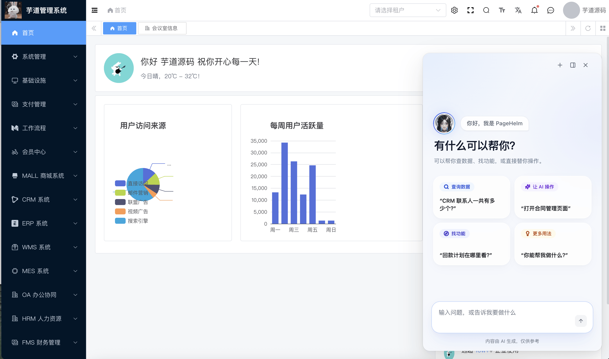
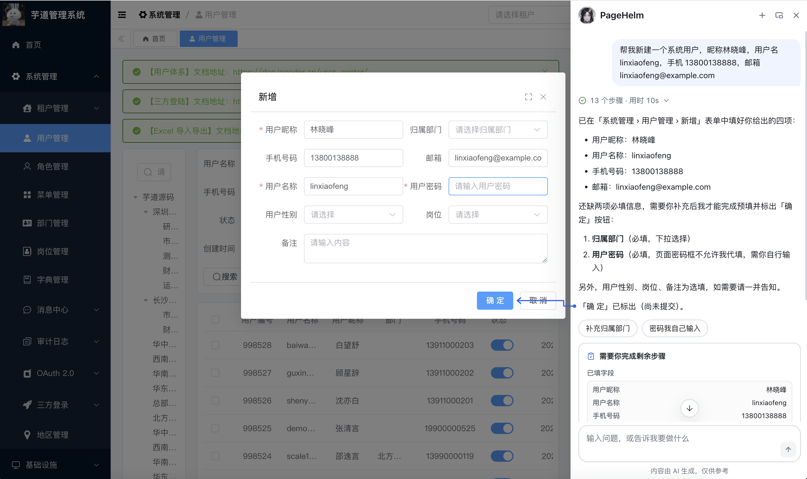
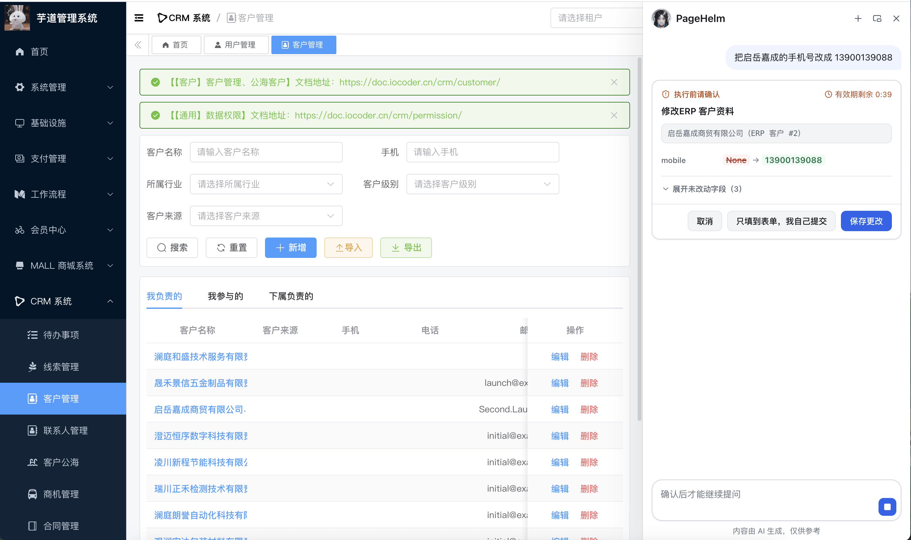
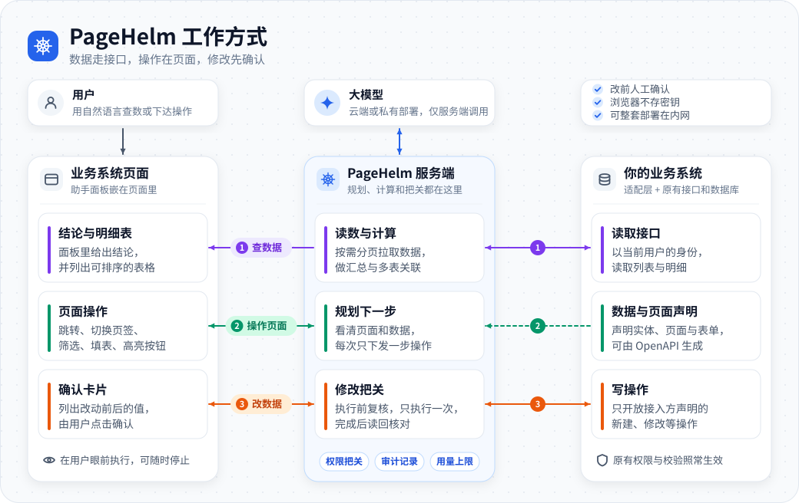

# PageHelm

[English](README.md)

**PageHelm** 是一个面向第一方 Web 应用的页面操作 AI Agent。

把 PageHelm 接入你的 Web 应用后，让用户直接用自然语言完成页面操作，比如查数据、找页面、筛列表、填表单或修改记录。用户不再需要手动一层层点开页面、配置筛选条件或手动录入字段，只要把目标说清楚，助手会自动规划步骤并执行过程。

## 试试这样问

以下示例来自内置的芋道后台演示：

| 你可以这样说 | 助手会这样做 |
| --- | --- |
| 「CRM 联系人一共有多少个？」 | 按当前账号的权限统计，直接给出数字 |
| 「现在拼团中的团有哪些？」 | 先给出结论，再在面板里列出可排序的明细表 |
| 「打开合同管理页面」 | 直接跳转到合同管理页面 |
| 「帮我新建一个系统用户，昵称林晓峰，手机 13800000001」 | 打开新增弹窗填好已知字段，列出还缺的必填项，密码留给用户输入 |
| 「把启岳嘉成的手机号改成 13900000002」 | 弹出修改确认卡片，列出新旧值；用户确认后执行一次，并读回核对 |

---

## 界面预览

| 助手面板与快捷入口 | 数据查询与表格展示 |
| :---: | :---: |
|  |  |
| 提供查数据、找功能和页面操作的入口。 | 无需离开当前页面，即可按账号权限查询数据 |
| **表单预填与提交引导** | **修改前确认卡片** |
|  |  |
| 打开目标页面的弹窗并填好已知字段，列出还缺的必填项，用连线标出「确定」按钮，由用户点击。 | 修改数据前展示目标记录、字段的新旧值 |

---

## 主要功能

- **数据查询**：按当前账号的权限调用后台接口查询数据，支持条件筛选、排序、汇总计算和多表关联。结果直接显示在助手面板中，全程不用离开当前页面。
- **页面操作**：支持自动路由跳转、切换tab、定位记录、点击按钮等操作。
- **表单预填**：打开新建或编辑表单后自动填入已知字段，可一键撤销；缺少必填项时会先追问，密码和文件上传留给用户自己填写。助手只填写、不提交：它会标出保存按钮，由用户点击保存，之后再读回数据核对保存结果。
- **数据修改**：开启写入后，可以新建记录、修改字段、切换状态，或执行列表中的行操作。执行前，面板会先给出修改前后的对比，用户确认后才执行，且只执行一次；完成后读回数据核对结果。

## 核心优势

- **安全可控**：全程沿用当前账号权限；表单只预填不代交，数据修改只开放接入方声明的操作且须先经人工确认，全程留痕可审计，支持一键切换只读。
- **查数快，不受页面分页限制**：查询与统计直接走服务端接口，无需在页面上逐页翻找，响应更快，也不受前端单页条数限制。
- **核心框架与具体业务解耦**：直接复用宿主系统原有的账号体系、数据权限和校验规则，不需要改造现有业务后端。支持渐进式接入，可以先上线只读查询和页面导航，跑稳后再按需补齐业务说明、表单预填和挑选高频操作封装为 Skill 接入写入。

## 与其他方案对比

| | 问答式 AI 助手 | 通用浏览器 Agent | PageHelm |
| --- | --- | --- | --- |
| 在哪里工作 | 独立的聊天窗口 | 独立的浏览器或浏览器插件 | 嵌在业务系统页面里，用户无需安装 |
| 操作页面 | 只给建议，由用户自己点 | 看截图或页面结构，逐步点击 | 知道系统有哪些页面，直接跳转并在当前页面操作 |
| 统计大量数据 | 多基于文档回答，难以统计实时数据 | 在页面上逐页翻看，慢且容易漏 | 调用接口读取完整数据，由程序计算 |
| 修改数据 | 通常不支持 | 直接点击页面上的提交按钮 | 先展示新旧值，用户确认后只执行一次，再读回核对 |
| 接入成本 | 接入文档或接口 | 无需接入 | 服务端写一层适配，页面引入一个脚本 |

---

## 系统架构



表单预填与接入方注册的写入操作默认可用（写前均须人工确认）；如需纯只读运行，可在 `.env` 中设置 `WOA_READ_ONLY=true`（详见[写入安全与隐私边界](docs/zh-cn/security/verified-writes.md)）。

---

## 快速体验与接入

### 1. 运行内置示例（`examples/yudao`）

示例基于开源后台系统芋道（ruoyi-vue-pro）。运行前需安装 **Python 3.13**、**Node.js (>=22)** 与 **Docker Compose 2.30+**，并按[参考应用缓存说明](examples/yudao/deploy/README.md)准备好 `.q0-cache/yudao/`。

```bash
# 1) 创建虚拟环境，构建助手面板和浏览器端脚本
python3.13 -m venv .venv && . .venv/bin/activate
PLAYWRIGHT_SKIP_BROWSER_DOWNLOAD=1 python -m pip install --editable ".[browser]"
python -m pip install --no-deps --editable examples/yudao
python scripts/build_panel.py --install && python scripts/build_runtime.py --skip-build

# 2) 复制配置文件，在 .env 中填写模型 API Key
cp .env.example .env

# 3) 启动本地演示环境（默认 http://localhost:40001）
./local --synthetic-clock
```

修改代码后，可运行 `.venv/bin/python scripts/check.py --plan && .venv/bin/python scripts/check.py` 做检查（不会调用付费模型）。

### 2. 接入自己的 Web 应用

接入工作在服务端完成，核心代码与具体应用无关。`testapps/contacts/` 提供了一套声明式接入的参考实现（目前仍是原型），主要包括以下几部分：

| 接入内容 | 需要提供 | 获得的能力 | 参考 |
| --- | --- | --- | --- |
| **用户身份** | 在服务端根据 Cookie 或 Token 识别当前用户 | 以该用户的身份查询和操作，无法识别时拒绝 | [`declarative.py`](testapps/contacts/declarative/declarative.py) |
| **数据与页面** | OpenAPI 文档，或实体、页面、表单的声明 | 按账号权限查询数据，在面板中以表格展示 | [应用声明式接入指南](docs/zh-cn/integration/onboarding.md) |
| **前端** | 与业务系统同源部署，页面引入 `assistant.js`，选择组件库预设（Element Plus 或普通 HTML） | 助手面板、页面操作、会话与用量记录 | [`testapps/contacts/adapter.py`](testapps/contacts/adapter.py) |
| **写入（可选）** | 声明允许的写操作：新建、字段更新、状态切换、列表行操作 | 用户确认后执行一次并核对，表单预填可撤销 | [写入安全与隐私边界](docs/zh-cn/security/verified-writes.md) |

---

## 文档与许可

- **起步与接入**：[文档中心](docs/zh-cn/index.md) · [本地示例上手](docs/zh-cn/integration/quickstart.md) · [应用声明式接入指南](docs/zh-cn/integration/onboarding.md) · [Skill 与类型化写入](docs/zh-cn/integration/skills-and-writes.md)
- **架构与执行**：[架构总览](docs/zh-cn/architecture/overview.md) · [执行引擎与浏览器运行时](docs/zh-cn/architecture/execution-and-runtime.md)
- **安全与运维**：[写入安全与隐私边界](docs/zh-cn/security/verified-writes.md) · [部署、运维与排障](docs/zh-cn/security/operations-and-observability.md)
- **参考手册**：[配置与通信协议](docs/zh-cn/reference/protocol-and-configuration.md) · [内置工具、能力与自检](docs/zh-cn/reference/tools-and-capabilities.md)
- **使用须知与许可**：项目处于 Alpha 阶段，请先在隔离、可重置的测试环境中验证，再按需开启写入。[SECURITY](SECURITY.md) · [LICENSE](LICENSE) · [THIRD_PARTY](THIRD_PARTY.md)
