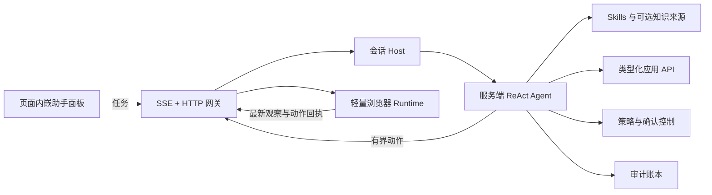

# Web Operation Agent

[English](README.md)

Web Operation Agent 是一个早期阶段的框架，用于在第一方 Web 应用中构建 AI 助手。服务端 Agent 根据最新页面观察进行规划和重规划，轻量的页面内嵌 Runtime 只执行固定的页面操作。应用 Skill 和类型化 API 可以补充业务知识与实时数据；源码检索是可选的知识来源。

> **状态：Alpha。** 仓库已有经过测试的核心模块和一个范围有限的 Twenty CRM 集成，但还不是可用于生产的自主 Agent、托管服务或通用浏览器扩展。

## 当前可以验证的能力

仓库目前通过本地自动化测试和隔离的应用 fixture 验证以下行为：

| 能力 | 当前范围 |
| --- | --- |
| 远程浏览器闭环 | 页面内嵌 Runtime 通过 SSE 和 HTTP 与本地服务端交换观察、动作、结果和确认决定。 |
| ReAct 执行 | 同一个服务端 Agent 接收每次工具结果，重新观察页面，并在时间与步数预算内决定下一步。 |
| 有依据的页面操作 | 导航和元素操作必须通过当前页面观察与应用控制层检查。 |
| Skill 与业务工具 | Skill 描述何时、如何调用类型化工具；实时数据来自应用 API，而不是 Skill 文本。 |
| 受控写入 | 业务写入默认关闭。启用后仍需页面中的明确确认；结果不确定时标记为 `indeterminate`，不会自动重试。 |
| 多轮会话承载 | 会话 Host 按顺序处理面板消息，并隔离普通单轮失败，使后续任务仍可继续。 |
| 审计与回放基础能力 | 服务端事件可以写入追加式账本，并转换成脱敏回放。 |
| Twenty CRM 纵切 | 已打包的适配器支持查询公司、把 API 找到的公司路由交给浏览器，以及在显式开启后经确认创建一家公司并以同一用户回读。 |

这些结论只覆盖已经实现的路径。项目还没有规模足够的公开评测，不能据此宣称通用任务成功率、源码检索收益，或优于 PageAgent 等浏览器 Agent。

## 架构



服务端持有模型访问、规划、知识、会话策略、授权状态和审计数据。浏览器只接收仅限当前会话的能力凭据、固定的通用动作和用户可见的确认请求，不接收模型密钥、源码索引、隐藏写权限或 evaluator。

运行时事实的优先级高于 Skill、源码、文档和 API schema。知识来源可以提出路由或工具调用建议，最终以当前页面和应用响应为准。

主要复用边界如下：

| 模块 | 职责 |
| --- | --- |
| `web_operation_agent.product` | 校验一条用户消息，将它绑定到最新页面观察，并执行一次与具体应用无关的 Agent turn。 |
| `web_operation_agent.live` | 管理网关和顺序执行的会话生命周期。 |
| `web_operation_agent.remote` | 定义受能力凭据约束的远程浏览器通道和客户端。 |
| `web_operation_agent.embedded_gateway` | 提供页面 Runtime 及带认证的 SSE/HTTP 端点。 |
| `web_operation_agent.business` | 加载 Skill，并代理类型化的读取和写入工具。 |
| `web_operation_agent.twenty` | 提供当前 Twenty CRM Companies 适配器。 |
| `web_operation_agent.session` | 实现有步数和时间限制的服务端 Agent 循环。 |

软件包 API 仍在演进，稳定版本发布前不承诺向后兼容。

## 开发环境

要求：

- Python 3.12
- POSIX shell
- Node.js，用于执行全部页面 Runtime 测试
- 首次安装依赖时可访问网络

在已有 checkout 中运行：

```bash
python3.12 -m venv .venv
. .venv/bin/activate
PLAYWRIGHT_SKIP_BROWSER_DOWNLOAD=1 python -m pip install --editable .
python src/web_operation_agent/tests/run_all.py
```

测试入口使用 Python `unittest` 自动发现，并防止测试数据写入真实模型费用账本。浏览器测试会在缺少 Chromium 时跳过。依赖上游 PageController 的测试只有在 `WOA_PAGE_CONTROLLER_MODULE` 指向已安装模块时才会运行，否则会跳过。CI 还会构建并检查可安装 wheel：

```bash
python -m pip wheel --no-deps --wheel-dir dist .
```

通过同一受保护入口只运行一个测试模块：

```bash
python src/web_operation_agent/tests/run_all.py -k test_product.py
```

## Twenty CRM 集成

`TwentyApplicationAdapter` 将只读和写入 Skill 作为包资源分发，因此从仓库外安装 wheel 后也能加载。完整运行仍需要：

- 独立部署的兼容 Twenty CRM 实例；
- 测试用户的 OAuth token 和客户端注册文件；
- 页面端 controller 集成；
- 提供模型、控制层、账本位置和会话 Host 的应用装配。

默认只有读取能力。创建公司需要同时在 Twenty 适配器和 turn 策略中显式开启，然后经过页面内的用户确认流程。

根目录 [`demo.sh`](demo.sh) 会启动 [`examples/twenty`](examples/twenty/README.md)
中的公开装配。它要求已有一个只包含合成数据的 Twenty 实例，并显式提供浏览器登录状态、
委托 OAuth 状态、同源 PageController 模块、审计输出和费用账本的本地路径。这个进程不读取
数据库真值、不复位应用，也不会把 Agent 结束当成确定性的业务验收。可由全新 clone 一键
部署的公开 Twenty 环境仍属于发布前工作。

## 独立 Twenty evaluator

独立的 [`evals/twenty`](evals/twenty/README.md) 基础设施把确定性的应用验收放在产品与 Agent
进程之外。它覆盖三类 Companies 任务：查询全部活跃公司的准确名称和域名且业务状态不变；
打开基线中的指定公司且业务状态不变；创建且仅创建一个指定公司，同时要求已确认的同一用户
回读，并检查禁止变化的状态。

结果明确区分四种状态：`PASS`、`FAIL`、表示终态或写入结果不确定的 `INDETERMINATE`，以及
表示任务或证据无法支撑该次试验的 `INVALID`。离线测试使用注入的假命令执行器。当前公开形态
尚未在真实 Docker Twenty 环境中运行 fixture 命令。这套基础设施还不是 benchmark，不能据此
给出成功率、基线对比或源码检索收益结论。

## 已知限制

- 服务端状态、账本和会话注册表目前是本地进程组件；持久化、水平扩展、租户隔离和生产身份绑定尚未完成。
- 当前已有单轮截止时间和初始页面观察绑定，但用户主动取消、动作相关的 DOM 新鲜度、
  更广泛的并发、崩溃恢复和运行监控仍未完成。
- 唯一打包的业务适配器是范围有限的 Twenty CRM Companies 纵切。
- 尚未实现任意第三方网站支持和浏览器扩展。
- 浏览器操作不具备数据库事务或回滚语义。
- 源码感知检索可以作为可选规划输入，但尚未在有代表性的保留测试集上证明收益。
- 助手面板和端到端部署流程仍需按产品标准完善无障碍、本地化和视觉体验。
- 不要把当前 Alpha 版本连接到生产账号、客户数据、支付、邮件或其他高影响系统。

## 文档

- [English README](README.md)
- [系统设计](docs/architecture/system-design.md)
- [贡献指南](CONTRIBUTING.md)
- [安全策略](SECURITY.md)
- [许可证](LICENSE)

## 许可证

本项目采用 [MIT License](LICENSE)。
