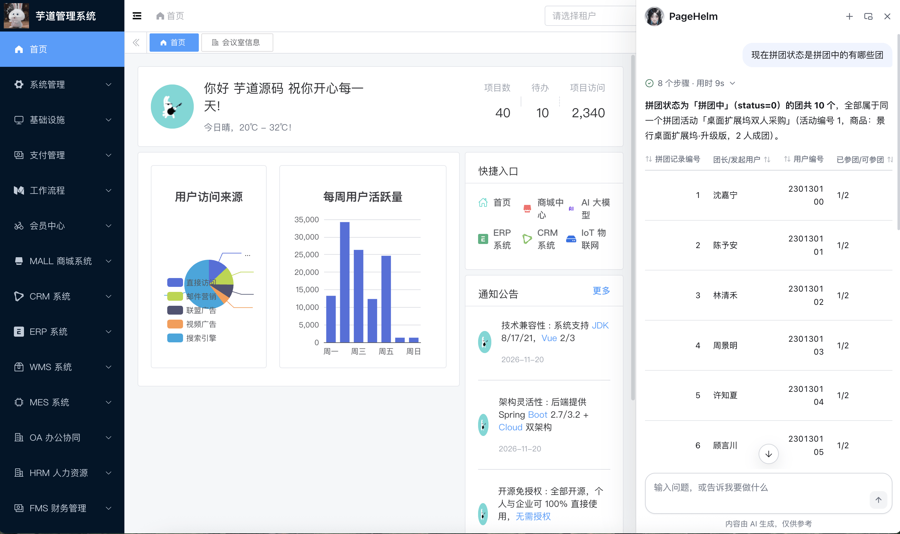

# PageHelm

[English](README.md)

**PageHelm**（核心包 `web_operation_agent`）是一个面向第一方企业 Web 应用的嵌入式 AI 操作框架。

企业后台通常同时面临四个难题：页面路由动辄上百个、行级数据权限严格、跨数百行数据的统计与筛选难以靠浏览器翻页完成、业务写入一旦误操作或超时重试代价极高。PageHelm 通过**同源嵌入 + 双轨执行 + 服务端治理**的架构，让现有 ERP、CRM、财务或运营后台在不推翻重写的前提下，直接获得受控的 AI 查数、界面协同与核验写入能力：

- **查数快且不越权**：统计、排序和多表关联在服务端沿用当前登录人身份执行，不需要把用户 Cookie 交给服务端托管，也不依赖无头浏览器逐页爬取 DOM。
- **真页面协同且可撤销**：直接在用户当前标签页内打开目标页面、切换筛选、展开业务弹窗并预填表单，提供一键撤销并将密码、上传等受限控件交回人工输入。
- **改数必须过核验关**：生产默认只读（`read-only`）；开启写入后，每笔变更必须经由差异审批卡确认、单次消费锁、派发前复读与同账号回读核验，派发后超时或断连记为未决态（`INDETERMINATE`），不自动重试。

---

## 界面预览

以下画面均基于仓库内置合成测试环境（`examples/yudao`）实时截取：

| 同源嵌入与快捷入口 | 同账号查数与 `<DataTable>` |
| :---: | :---: |
|  |  |
| 单脚本挂入现有业务后台，Shadow DOM 隔离宿主样式，支持悬浮与并排双视图。 | 沿用当前登录人权限查询业务数据，经单轮内存 SQL 汇总并在面板内直接渲染可排序 `<DataTable>`，无需切换当前页面。 |
| **弹窗导航与可撤销表单预填** | **差异审批卡与回读核验** |
|  |  |
| 自动打开业务弹窗、预填字段并连线标出提交按钮，保留一键撤销；密码和文件上传控件交由人工填写。 | 修改前清晰展示目标记录、旧值 → 新值差异及未改动字段，经人工确认后单次派发并同账号回读核验。 |

---

## 核心能力

- **同账号服务端读取 + 确定性计算**：通过 `ApplicationPorts` 与当前登录人身份绑定执行只读接口查询；支持并发预取与主线程按序提交、`Decimal` 精确汇总（`read_summary`）、单轮进程内只读 SQLite（`TurnTables`，`SELECT`/`WITH` 白名单）以及零转抄交互式 `<DataTable>` 渲染。
- **真实标签页 DOM 操作与交接**：`PageController` 提供有界快照（单帧最多 200 个交互元素、弹窗优先采集）与去噪稳定监测（`PageSettleWatch`）；表单预填返回精确的已填/原值/跳过/受限字段回执，支持面板内一键撤销（`undoFormFill`）与视觉引导人工提交。
- **六阶段 `WritePipeline` 写安全治理**：统一收口类型化写入 Skill、对称平铺约定更新（`ConventionWritePort`）与原生表单提交（`SubmitPort`）——依次完成提案差异校验、防遮挡可见审批（覆盖率 `>= 0.9`、连续露出 `>= 400ms`、`event.isTrusted`）、单飞并发锁、派发前漂移复读、至多派发一次与同账号回读核验。
- **业务口径消歧与渐进式接入（L0–L3）**：通过 `domain_playbooks/*.md` 澄清跨模块业务术语，命中多条同名记录时弹出可点选消歧胶囊（`need_input`）；支持从单 `<script>` 标签挂载（L0）平滑升级到只读端口（L1）、口径消歧（L2）和核验写入（L3）。
- **生产级隔离、预算与可观测**：Web Locks 解决“复制标签页”会话串线；URL 与出站请求执行多层递归解码脱敏（`AuditedChat`）；提供单轮 / 按日 / 全局三层预算护栏、SQLite WAL 在线一致性备份与 `INDETERMINATE` 人工对账工具，以及无正文泄露的 OTLP 遥测与 `TurnTrace` 回放。

---

## 为什么选择同源双轨架构

| 对比维度 | 纯 API 对话 / RAG | 外部无头浏览器 / RPA | 低代码工作流画布 | **PageHelm（同源双轨）** |
| --- | --- | --- | --- | --- |
| 真实界面定位与表单预填 | 不支持 | 纯视觉/DOM 慢速试错，无法交回当前页 | 不支持 | 同源语义 DOM + 弹窗预填与一键撤销 |
| 数百至数千行列表统计 | 依赖现成聚合接口 | 逐页翻 DOM 耗时长且易漏页 | 节点内存与超时受限 | 同账号接口 + 进程内只读 SQL + `<DataTable>` |
| 身份与行级数据权限 | 常见全局服务密钥 | 服务端托管用户 Cookie（合规高危） | 静态共享凭据 | 浏览器同源会话绑定，按当前登录人执行 |
| 写入安全与防重复机制 | 依赖各工具自行实现 | 易误触页面原生保存/删除钮 | 超时重跑存在重复写入风险 | 六阶段单次审批 `WritePipeline` + 未决态锁死 |

---

## 系统架构与安全模式

```text
第一方业务标签页（assistant.js + Shadow DOM 面板 + PageController）
                        ^ 脱敏页面观测 / 动作回执 / 一次性审批决定
                        v
应用无关服务端核心（Executor · TurnHarness · WritePipeline · SQLite 账本）
                        ^ ApplicationPorts & GoalData 显式能力契约
                        v
业务应用适配器（身份反查 · 路由校验 · 同账号读取 · 核验写入 · Domain Playbooks）
```

| 安全模式（`mode`） | 同账号读取与导航 | 表单预填（可撤销） | 写入提案准备 | 写入派发与回读核验 |
| --- | --- | --- | --- | --- |
| `read-only`（生产默认） | 允许 | 关闭 | 关闭 | 关闭 |
| `assisted-draft` | 允许 | 允许（跳过密码与上传控件） | 允许 | 关闭（不派发） |
| `verified-operate`（本地默认） | 允许 | 允许 | 允许 | 获批后至多派发一次并强制回读 |

---

## 快速体验与渐进接入

### 1. 运行内置参考示例（`examples/yudao`）

需预先安装 **Python 3.13**、**Node.js (>=22)** 与 **Docker Compose 2.30+**，并按[参考应用缓存说明](examples/yudao/deploy/README.md)准备好 `.q0-cache/yudao/`。

```bash
# 1) 初始化虚拟环境并构建前端面板与 Runtime
python3.13 -m venv .venv && . .venv/bin/activate
PLAYWRIGHT_SKIP_BROWSER_DOWNLOAD=1 python -m pip install --editable ".[browser]"
python -m pip install --no-deps --editable examples/yudao
python scripts/build_panel.py --install && python scripts/build_runtime.py --skip-build

# 2) 配置模型 API Key（1–3 行）与运行模式
cp .env.example .env
cp pagehelm.example.toml pagehelm.toml

# 3) 启动本地合成环境（默认 http://localhost:40001）
./local --synthetic-clock
```

日常改动检查可通过 `.venv/bin/python scripts/check.py --plan && .venv/bin/python scripts/check.py` 执行（不调用付费模型）。

### 2. 接入自己的 Web 应用（L0–L3）

如果你要将 PageHelm 接入自有后台，无需准备 `yudao` 示例缓存，按投入逐级接入即可：

| 等级 | 宿主侧工作 | 获得能力 | 仓内参考 |
| --- | --- | --- | --- |
| **L0** | 挂载 `/v1/runtime/assistant.js` 与 `/bootstrap` | Shadow DOM 面板、有界页面操作、Element Plus 公共适配层 | `frontend/src/integrations/element-plus/` |
| **L1** | 实现身份、路由与只读数据端口 | 同账号查询、`TurnTables` 内存 SQL 与 `<DataTable>` 输出 | [`testapps/contacts`](testapps/contacts/adapter.py) |
| **L2** | 补充领域口径手册与 `entity_rules` | 跨模块术语消歧、拒绝条件说明与可点选 `need_input` 胶囊 | [L0–L3 接入指南](docs/zh-cn/integration/levels.md) |
| **L3** | 接入写入账本、后置核验与 Skill / `SubmitPort` | 类型化写入、对称 `update_record`、原生提交与撤销预填 | [写入安全与隐私边界](docs/zh-cn/security/verified-writes.md) |

---

## 文档与许可

- **起步与接入**：[文档中心](docs/zh-cn/index.md) · [本地示例上手](docs/zh-cn/integration/quickstart.md) · [L0–L3 接入指南](docs/zh-cn/integration/levels.md) · [Skill 与类型化写入](docs/zh-cn/integration/skills-and-writes.md)
- **架构与执行**：[架构总览](docs/zh-cn/architecture/overview.md) · [执行引擎与浏览器运行时](docs/zh-cn/architecture/execution-and-runtime.md)
- **安全与运维**：[写入安全与隐私边界](docs/zh-cn/security/verified-writes.md) · [部署、运维与排障](docs/zh-cn/security/operations-and-observability.md)
- **参考手册**：[配置与通信协议](docs/zh-cn/reference/protocol-and-configuration.md) · [内置工具、能力与自检](docs/zh-cn/reference/tools-and-capabilities.md)
- **文档站（`frontend/docs/`）**：由 `docs/` 经 Astro Starlight 构建，并同步生成 `/llms.txt` 与 `/llms-full.txt`。
- **安全与许可**：建议先在隔离、可重置的合成测试环境中验证，再按需开启写入能力。[SECURITY](SECURITY.md) · [LICENSE](LICENSE) · [THIRD_PARTY](THIRD_PARTY.md)
