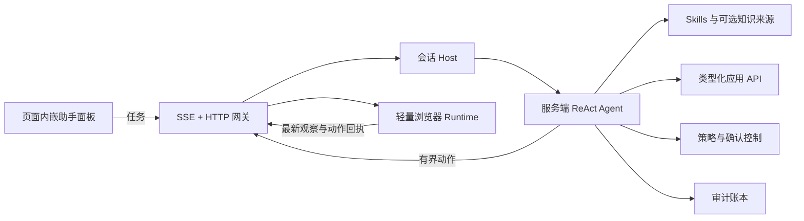

# Web Operation Agent

[English](README.md)

Web Operation Agent 是一个早期阶段的框架，用于在第一方 Web 应用中构建 AI 助手。服务端 Agent 根据最新页面观察进行规划和重规划，轻量的页面内嵌 Runtime 只执行固定的页面操作。应用 Skill 和类型化 API 可以补充业务知识与实时数据；源码检索是可选的知识来源。

> **状态：Alpha。** 仓库已有经过测试的核心模块和三个参考接入，其中 Odoo 18 是主应用，但还不是可用于生产的自主 Agent、托管服务或通用浏览器扩展。

## 当前可以验证的能力

仓库目前通过本地自动化测试和隔离的应用 fixture 验证以下行为：

| 能力 | 当前范围 |
| --- | --- |
| 远程浏览器闭环 | 页面内嵌 Runtime 通过 SSE 和 HTTP 与本地服务端交换观察、动作、结果和确认决定。 |
| ReAct 执行 | 同一个服务端 Agent 接收每次工具结果，重新观察页面，并在时间与步数预算内决定下一步。 |
| 有依据的页面操作 | 导航和元素操作必须通过当前页面观察与应用控制层检查。 |
| Skill 与业务工具 | 可审计、有上限的用户意图匹配器选择候选 Skill；没有命中时回退到合格的只读 Skill 和显式开启的写 Skill。对于只要求导航的请求，应用可以用声明过的当前路由提示缩小原本为空的匹配；该提示不授予工具或路由权限。实时数据来自类型化应用 API，而不是 Skill 文本。 |
| 表单接管 | 应用接入可以为“提交前保持临时状态”的字段签发一次性的精确表单草稿。服务端从最新页面观察中解析应用签发的字段标识，并且只填写签发值；模型不能改写字段绑定，最终提交仍由用户完成。自动保存表单必须进入常规的确认写入路径。 |
| 受控写入 | 业务写入默认关闭。启用写入的 turn 必须绑定已验证身份、经过页面内明确确认，并原子记录 `prepared → dispatching → completed/failed/indeterminate`。过期确认以及同业务键的在途或未决写入会在 dispatch 前以类型化产品拒绝结束。生产组合还要求 journal 明确声明具备跨重启持久性；易失 journal 只允许在显式 test profile 下使用。当前 actor 自身的权限拒绝读取或写入时——无论是请求到达应用之前的逐工具 scope 检查，还是应用收到请求后自己的权限系统——本轮以类型化的 `permission_denied` 拒绝结束，并记录是哪一层拒绝。拒绝结果不会交还 Agent 去寻找达成同一效果的页面路径；evaluator 把它作为产品行为评分，而不是装置故障。同一轮先前已完成的可信查询或确认写入仍会显示为已完成，权限拒绝只适用于后续操作。Odoo 的 `AccessError` 与 Twenty 的 HTTP 403 都映射到这一结果。 |
| 旧页面控制层 | 旧版外部页面控制网关在本机线程和进程间只允许一个协作 run 持有租约，使用前重置，释放前清空；清理失败时关闭执行。这条兼容路径不能提供并发的租户级许可。 |
| 多轮会话承载 | 会话 Host 按顺序处理面板消息、隔离普通单轮失败，并在内存中保留最多 4 轮或 32 KiB 的引用上下文。历史业务事实可以帮助理解“第二家公司”等指代，但 Agent 必须重新读取当前 API 或页面，历史路由不会获得权限。必要参数缺失或目标有歧义时，产品 Agent 可以用一个有界问题结束本轮，并从用户在面板发出的下一条消息继续，不占住模型或浏览器工作线程；单选标签与记录引用必须来自最新应用证据，该回复仍只是任务输入，不能充当写入确认。 |
| 共享本地网关 | 有容量上限的 server composition 可以在一个网关中承载多个可独立撤销的 session capability；50 会话确定性隔离测试覆盖 token 与 channel 分离。Session 默认一小时过期，队列有背压，事件、消息、观察、动作、审批和 Runtime 实例都有硬上限。可选 SQLite 存储支持本机进程间的 owner fencing、消息去重记录与进度 outbox。本机运维命令可为会话与 mutation 状态生成经校验的在线备份，恢复只能进入新的 writer 隔离目录；capability 与审批永不恢复。 |
| 任务控制 | 面板可通过当前已认证 Runtime lease 停止精确绑定的活动消息。尚未被浏览器认领的动作和等待确认的写入不会再下发；已经认领的动作仍会结算为确定结果或 `indeterminate`。在页面状态不变时，产品会在派发前拒绝连续重复的相同工具和参数，给 Agent 一次改用其他策略或提问的机会，再次原样重复则结束本轮。 |
| 助手交互 | Shadow DOM 里的 React 19 面板，由一个 npm 入口挂载。它只是视图：不持会话、不存时间线，所以整页导航之后线程由服务端回放而不是丢掉。Runtime 把 fixed、零尺寸的容器挂在稳定的文档根节点下，避开应用拥有的 `body` 子树并脱离文档流，因此 SPA 协调既不会拆下助手，也不会改变应用宽度。它渲染所依据的每一条上限、每一句文案、每一个颜色都来自服务端拥有的两个文件，面板自行声明的东西会被测试判红。Chromium 覆盖契约里的每个面板状态、确认卡的键盘路径与 320px 布局、Markdown 答案、减弱动画、窗口拖动缩放，以及在 strict CSP + Trusted Types 下的构造。在 320px 与模拟 200% 缩放下、亮暗两种配色中，输入区、确认卡标题和两个答复按钮都留在窗口内且不被遮挡；被检查的文字对比度不低于 4.5:1，减弱动画同时停掉过渡与动画，键盘能按顺序到达每个控件并显示安静但可见的焦点提示。已经完成一次 macOS VoiceOver 人工验收，其他读屏软件与浏览器尚未验证。 |
| 执行前确认 | 确认卡给出确切的 effect、用等宽字排出它点名的记录，以及这次请求还剩多少时间过期。它拒绝不是真实用户手势、或它无法证明当时可见的那一次按下——这堵住的是视觉欺骗，仅此而已。面板与宿主页共用同一个 JavaScript realm，`SECURITY.md` 写明了这件事的代价。 |
| 身份绑定 | 应用宿主可以把短期 actor/tenant/workspace 主体绑定到 Runtime capability、Agent turn、类型化工具 scope、审批、mutation proposal 和脱敏审计事件。可选的进程间共享撤销存储会在下一个认证 channel 边界关闭该次 principal 签发；重新登录必须绑定新权限并获得新 capability。Contacts 示例只把应用实际授予该 actor 的 scope 放进 principal，并让一个工作区的记录不进入另一个工作区的 API、页面、模型上下文、审计账本和回放；Chromium 测试覆盖只读 actor 与两个含同名记录的工作区。Twenty demo 会在启动前通过 Twenty 解析准确的 HttpOnly 浏览器 session，要求其与委托 OAuth 的 actor/workspace 一致，并在浏览器 cookie 被替换或删除时关闭 Agent session。 |
| Provider 边界 | 模型请求在发送前经过结构、数量、字节、凭据形态和有限 JSON 检查。固定版本的框架适配器可以保留自己的原生 chat 请求体，同时共用服务端凭据、传输、限制、guard 和费用记账。进程内共享 guard 限制并发请求，把排队时间计入请求截止时间，且只在连续的 provider 瞬时健康故障后进入冷却短路；用户取消和本地 deadline 既不累加也不清空该状态。原生 Agent 路径的排队和建连阶段均可取消。HTTP 派发前取消不会生成费用行；每个已派发请求都有相关 ID，并记录 provider 报告的 usage，或将无法确认的费用明确标为未知。逐 run 的无内容摘要用请求 ID 和费用行摘要把试验绑定到实际调用。远程 provider 必须使用 HTTPS，本机 loopback 开发端点除外。 |
| 运行探针 | Loopback 网关用 `/healthz` 表示进程存活，用 `/readyz` 表示可处理工作。Readiness 只返回固定 schema 的数量、准入状态和 provider guard 健康信息；回调畸形时关闭就绪状态，并隐藏错误正文。 |
| 审计与回放基础能力 | 服务端事件可以写入追加式账本，并转换成脱敏回放。 |
| Twenty CRM 纵切 | 已打包的适配器通过有界 cursor 分页查询 Companies、People 和 Opportunities，把类型化结果、来源及 API 找到的详情路由交给 Agent。公司创建需单独开启，并要求用户确认及委托 token 回读。OAuth 刷新会在本机线程和进程间串行化，身份解析遇到 GraphQL `UNAUTHENTICATED` 时也会进入受控刷新。 |
| Odoo 18 纵切 | 五个 typed 读加三个可选开启的写，含一条多步订单生命周期：确认报价单，再通过 Odoo 自己的向导为它开客户发票。普通浏览器 Host 只在会话空闲、且 Odoo 浏览器身份仍与原委托 API 身份一致时续期短期 principal。一项无模型的 live 门禁在真实 Odoo、真实 Chromium 与真实产品轮次上跑七个脚本化用例、覆盖六类工作流，每次写入都在页面里点面板自己的控件批准。库若已偏离记录基线，它拒绝开始；跑完把夹具恢复回去。 |
| 带引证的 Skill | 每条 `provenance` 都是可解析的引证——`src:` 指向应用源码的某个发布线，`api:` 指向它公开的接口。一项 live 门禁拿该发布编译出的 `SourceMap` 去解析每一条 `src:` 引证，于是“已经烂掉的引证”与“本来就指向不存在之处的引证”区分得开。`BusinessSkillCompiler` 能从这些描述符起草 Skill，并且**拒绝**代写它的 instructions。 |
| 了结不确定的写入 | 结果丢失的写入永不重试。日志会列出它走到哪个阶段、adapter 当时抓到的记录 id；运维人员以原始 actor 的身份执行应用自己的读取，再用一次 compare-and-swap 了结它，记录下是谁决定的、依据什么证据，以及“原写入方已不可能再执行”这项由人做出的断言。 |

这些结论只覆盖已经实现的路径。项目还没有规模足够的公开评测，不能据此宣称通用任务成功率、源码检索收益，或优于 PageAgent 等浏览器 Agent。

对于提供类型化答案证据的集成，只读回答使用版本化结论合同。Agent 可以在本轮同一数据集内筛选、计数、求和和查找极值；服务器解析被引用的字段并呈现有据结论，不再用最后一次查询表覆盖回答。选择结果保留字段引用，供后续操作使用。模型指令要求遵守用户指定的读取上限；计算不能把不完整输入升级为全量结果；错误引用会收到有限次数的纠正反馈。“未找到”结论只限定于本次查询覆盖、且当前账号有权访问的范围，不声称整个系统中不存在。覆盖范围描述的是证据范围，并不保证任意用户问题已经完整回答。Odoo 与最小 Contacts 示例提供这类证据。尚未提供答案证据的集成保留原有回答路径；导航与写入结果仍由执行回执和审批控制裁决。已完成的动作可以在同一条回答中附带独立核验的数据结论。面板可展开查看被引用读取/计算的时间、范围及可用读取计数；部分回答的提示保留在正文中。面板容量与产品可配置的答案上限共用服务端合同（20,000 字符）；每轮默认答案限制仍为 4,000。配置允许的长答案不会再被面板静默切回默认长度。

Odoo 读取工具还提供电话、手机、邮箱、订单及发票日期和发票待付金额。日期与客户 ID 筛选由适配器执行；币种取自每条记录，而非公司默认值。日期边界、支持范围和扫描一致性见 [Odoo 工具语义](examples/odoo/README.md#tools)。

默认产品还支持 `observe(answer_evidence=true)`，用于有界的页面局部回答。它区分实际返回的控件值与没有可读值的标签，并注明页面来源、呈现原文片段。页面引用在下一次观察后失效，不能冒充 API 记录或用于全量计算。Runtime 在页面提取时排除助手整棵子树；有界摘录跳过空标签和控制器布局元信息。这条显式路径不依赖业务工具，但不会自动核验旧页面流程的每一句自由回答。

## 架构



服务端持有模型访问、规划、知识、会话策略、授权状态和审计数据。浏览器只接收仅限当前会话的能力凭据、固定的通用动作和用户可见的确认请求，不接收模型密钥、源码索引、隐藏写权限或 evaluator。

运行时事实的优先级高于 Skill、源码、文档和 API schema。知识来源可以提出路由或工具调用建议，最终以当前页面和应用响应为准。

主要复用边界如下：

| 模块 | 职责 |
| --- | --- |
| `web_operation_agent.application` | 校验版本化应用描述，以及可执行的身份、路由、数据分类、mutation 后置条件与核对端口。 |
| `web_operation_agent.product` | 把已校验的应用和一条用户消息绑定到最新页面观察，并执行一次与具体应用无关的 Agent turn。 |
| `web_operation_agent.conversation` | 在多轮之间保留有界、脱敏的引用上下文，不把历史事实或路由当成当前权限。 |
| `web_operation_agent.live` | 管理网关和顺序执行的会话生命周期。 |
| `web_operation_agent.browser` | 定义结构化浏览器执行协议和类型化传输结果，不包含浏览器引擎。 |
| `web_operation_agent.remote` | 定义受能力凭据约束的远程浏览器通道和客户端。 |
| `web_operation_agent.embedded_gateway` | 提供页面 Runtime、带认证的 SSE/HTTP 端点，以及不含业务内容的存活与就绪探针。 |
| `web_operation_agent.business` | 加载 Skill，并代理类型化的读取和写入工具。 |
| `web_operation_agent.egress` | 执行模型 provider 数据边界，并在不保存请求内容的前提下生成审计记录。 |
| `web_operation_agent.mutation` | 在内存或 SQLite 中原子记录一次性 mutation intent 与终态。 |
| `web_operation_agent.session` | 实现有步数和时间限制的服务端 Agent 循环。 |
| `web_operation_agent.observability` | 把脱敏账本事件转换为无业务内容的 OTLP trace、metric 和运维告警，不改变任务结果。 |

每个应用专有 Adapter 都以独立 distribution 发布，不放在上面的核心包里：[`web-operation-agent-odoo`](examples/odoo) 提供 `OdooApplicationAdapter` 和 Odoo 源码编译器，[`web-operation-agent-twenty`](examples/twenty) 提供 `TwentyApplicationAdapter`，[`web-operation-agent-ofbiz`](examples/ofbiz) 提供 Apache OFBiz 的路由语法、源码编译器和 App Skill provider。核心包不含任何应用专有代码，`scripts/check_core_boundary.py` 断言核心（含测试）不 import 任何应用 distribution；接入新应用时实现的是这三者同样实现的端口。

Application Adapter 暴露版本化、无敏感信息的描述，由摘要绑定的 Skill/typed-tool catalog，以及身份、路由、结果数据分类、mutation 后置条件和保守核对端口。`bind_application()` 会检查所有工具和 mutation 均被覆盖，并确认运行时使用的就是同一组端口对象。路由端口拥有应用 URL 语法、源码感知的入口发现，以及应用特有 handoff secret 的浏览器出站前脱敏扩展；通用 Agent 不解析具体框架的路由。`AgentTurnExecutor(application=...)` 会在浏览器或模型工作开始前拒绝来自其它应用 Origin 的消息和无效 principal；typed-tool 路由进入 Agent 上下文前必须通过 Adapter 校验，已收到确认的写入也只有通过 Adapter 后置条件后才能记为完成。这是 Adapter contract version 2。自然语言目标直接进入通用 Agent 循环，Adapter 不会先把目标分类成固定的产品意图枚举。软件包 API 仍在演进，稳定版本发布前不承诺向后兼容。

PageController、身份、静态 Runtime、typed-tool 与验证合同见[应用接入指南](docs/integrations/application-adapter.zh-CN.md)。

页面内嵌 Runtime 是当前唯一随产品发布的浏览器执行端。`RemoteBrowserClient` 把每个服务端动作转换为认证会话协议中的版本化 `ActionCommand`，Runtime 返回与之匹配的 `ActionReceipt`。此前基于子进程 Playwright worker 的执行端及其未发布实验 CLI 已删除，因为它们的导航、选择和观察语义已经与内嵌产品路径分叉。

启用 mutation 时，`AgentTurnConfig.deployment_profile` 默认为 `production`。如果 mutation 策略没有要求身份、没有安装写工具，或所选 journal 没有声明跨重启持久性，组合会在接收用户任务前失败。测试若有意使用 `MemoryMutationJournal`，必须设置 `deployment_profile="test"`；该 profile 不会放宽身份绑定或用户确认。部署 Host 仍需提供并续期认证 principal、关闭无法授权的浏览器动作、撤销已变化的会话、保护确认界面，并校验实际部署的 page-controller 资产；这些 Host 责任不会由 profile 标志自动推导。

## 开发环境

要求：

- Python 3.12
- POSIX shell
- Node.js，用于执行全部页面 Runtime 测试
- 首次安装依赖时可访问网络

在已有 checkout 中运行：

```bash
python3.12 -m venv .venv
. .venv/bin/activate
PLAYWRIGHT_SKIP_BROWSER_DOWNLOAD=1 python -m pip install --editable .
python -m pip install --no-deps --editable examples/ofbiz
python -m pip install --no-deps --editable examples/twenty
python -m pip install --no-deps --editable examples/odoo
python src/web_operation_agent/tests/run_all.py
```

测试入口使用 Python `unittest` 自动发现，并防止测试数据写入真实模型费用账本。浏览器测试会在缺少 Chromium 时跳过。依赖上游 PageController 的测试只有在 `WOA_PAGE_CONTROLLER_MODULE` 指向已安装模块时才会运行，否则会跳过。核心测试套件不 import 任何应用 distribution：它的路由、知识与源码夹具都是合成的，且刻意采用既不是 Odoo 也不是 OFBiz 的路由语法——一个假设了某个应用 URL 写法的核心模块会在那里失败。每个应用 distribution 自己负责自己行为的测试，并作为独立门禁运行。

通过同一受保护入口只运行一个测试模块：

```bash
python src/web_operation_agent/tests/run_all.py -k test_product.py
```

### 自包含 minimal demo

[Contacts 示例](examples/contacts/README.md) 去除了首次运行所需的外部应用配置。它的可重复资格命令会在 loopback 启动合成的第一方应用和类型化 API，把真实助手 Runtime 注入 Chromium，并运行现有网关、会话 Host 和 ReAct executor：

```bash
python -m pip install --editable .
python -m playwright install chromium
PYTHONPATH=src:. python -m examples.contacts.demo --scripted
```

它还提供一个普通浏览器参考 Host。这条路径不会启动或注入 Playwright：已登录的应用页面加载不含密钥的同源 bootstrap，应用服务端根据自身 HttpOnly cookie 解析 actor，再绑定独立的委托凭据。会话与 mutation 状态使用本地持久化后端。

```bash
PYTHONPATH=src:. python -m examples.contacts.server --scripted --port 8765
```

参考 Host 默认接纳 10 个浏览器会话、最多 3 个并发模型请求，且同一认证用户最多占用 2 个模型请求。第 11 个会话会在签发 capability 之前收到明确的可重试容量响应。可通过 `--max-sessions`、`--max-active-requests` 和 `--max-active-requests-per-actor` 调整限制；`/readyz` 只报告不含业务内容的聚合状态。模型限流、暂时不可用和凭据无效会作为有界、可操作的结果显示给用户，并在审计中保留不同的机器分类。

Agent 网关仍只监听 loopback。部署时可以为它配置一个独立的、浏览器可见的 HTTPS 反向代理 URL；Runtime 资源和认证后的会话流量会使用该 URL，而监听地址的安全策略不变。

### Odoo 单机试用部署

[Odoo 单机部署](deploy/odoo-single-node/README.zh-CN.md) 是第一套面向私有试用的普通浏览器组合。固定摘要的 Docker 镜像在一台 Linux 主机运行 Odoo 18、PostgreSQL、Agent 和独立同源 HTTPS 网关。Odoo 用自身登录会话解析并签名身份；Agent 将其与该用户独立登记的 API key 及收窄工具 scope 对齐。SQLite session、mutation 与 conversation 状态、分阶段备份恢复、逐 actor 有界容量、保留策略、OTLP/HTTP telemetry 和无业务内容告警都有可执行运维路径。仓库中的资格记录会区分自动合同证据、单机观测和仍需人工或被环境阻塞的检查，不构成生产或跨主机声明。

显式的 `--scripted` 模式只执行一次固定的零费用装置演示：加载 Skill、查询当前 API、打开 API 授权的精确路由、观察新页面并结束。它不衡量模型能力。去掉 `--scripted` 并配置 OpenAI-compatible provider 后，同一个应用会改用真实模型决策并保持浏览器可交互。

### 资格门禁

`scripts/qualify.sh` 是唯一入口。CI 运行同一个脚本，因此不会出现某道门禁只在本地成立、CI 里缺失的情况：

```bash
scripts/qualify.sh
```

它会运行产品套件、Twenty evaluator 基础测试、PageAgent 与 Web Operation Agent 的离线 runner 套件，在已安装固定 npm 依赖时验证并构建 PageAgent bundle，并构建可安装 wheel，同时检查 wheel 内容和在 checkout 之外的导入。任一必需门禁失败即以非零码退出。安装固定 npm 依赖仍属于环境准备；CI 会先完成该步骤，再调用同一个门禁。

有两道门禁取决于环境，它们只会被如实报告，不会被默认当作通过：

- **Chromium 资格**会端到端运行打包的 minimal demo、在没有 init-script 注入的普通浏览器里打开应用原生的 Contacts Host、用已构建 bundle 运行 PageAgent 浏览器用例，并用固定版本的 PageController 运行嵌入式 Runtime。Runtime 用例同时覆盖顶层文档换页和 OFBiz 风格的同源 iframe 表单换页；后者必须返回新的页面观察，而且不能重复提交表单。这些合成用例都不需要 Twenty 或 OFBiz；CI 用 `--require-browser` 把它们设为必需。不加该参数时，缺少 bundle、PageController 或 Chromium 会被报告出来，而不是计为通过。
- **本地 Twenty 资格**只在全部前置条件就绪时运行：`WOA_TWENTY_BASE_URL`、`WOA_TWENTY_STORAGE_STATE`、`WOA_TWENTY_OAUTH_TOKEN`、`WOA_TWENTY_OAUTH_REGISTRATION`、`WOA_TWENTY_PAGE_CONTROLLER_MODULE`、`WOA_TWENTY_DB_CONTAINER`、`WOA_TWENTY_DB_NAME`、`WOA_TWENTY_DB_USER`、`WOA_TWENTY_WORKSPACE_SCHEMA`。门禁优先读取进程变量，随后读取与 `demo.sh` 相同的 `WOA_MODEL_ENV` 或被忽略的仓库 `.env`；配置文件按数据解析，不作为 shell 代码执行。否则输出 `BLOCKED` 并列出未设置的变量。BLOCKED 表示未被测试，既不是通过，也不是产品失败。需要该门禁的环境可用 `--require-live` 把缺失变成失败。

- **本地 Odoo 资格**是主应用的门禁，只在 `WOA_ODOO_BASE_URL`、`WOA_ODOO_API_KEY_FILE`、`WOA_ODOO_STORAGE_STATE`、`WOA_ODOO_PAGE_CONTROLLER_MODULE` 全部就绪时运行，否则报告 `BLOCKED`。它刻意不调用模型：两个脚本化用例——typed 查询后打开确切记录路由、打开集合——在真实 Chromium 里走真实产品轮次、打真实 Odoo，产物只记录计数、摘要和布尔值，并附夹具运行前后的摘要。通过说明装置成立，不说明模型如何；正因如此，这里失败才值得处理。

Odoo 装置现在由本仓库自己建起来：`python -m web_operation_agent_odoo.deploy provision` 一条命令建好应用、数据库、服务 PageController 的 addon、凭据，以及门禁恢复用的快照，然后打印要追加到 `.env` 的配置。需要 Docker 和几分钟；它按构造只走 loopback，任何会把装置口令发给别人够得着的主机的步骤都会先拒绝。之后 `python -m web_operation_agent_odoo.demo --allow-mutations` 会开一个真实 Chromium、把面板挂在那个 Odoo 上等你输入：读取的答案来自 typed 投影，写入会停在一张要你自己点的确认卡上，而删除会被拒绝——工具面上根本没有这个工具。全新 clone 仍会把 live Twenty 门禁报成 `BLOCKED`——那个实例本仓库没有提供准备资产。

## Odoo 18 集成 —— 主应用

`OdooApplicationAdapter` 在独立的 [`web-operation-agent-odoo`](examples/odoo/README.md) distribution 里发布，Skill 与源码策略作为包资源随包。三件事让它成为最值得先读的接入。

**身份是必须互相对上的两侧。** Odoo 18 把浏览器会话放在 HttpOnly cookie 里，而且只接受 cookie——旧的 `X-Openerp-Session-Id` 头已经不存在——所以页面 JavaScript 无法把凭据交给服务端工具。页面改为通过 `/web/session/get_session_info` **断言**自己是谁（只返回标识符，不含密钥），服务端则用用户在 Odoo 设置里自己签发的 per-user API key 行动。`bind_browser_session` 解析两侧，只有指向同一个 actor 时才产出 principal（`db` → tenant，当前公司 → workspace，`uid` → actor）。签发那把 key 是记录所有者自己完成的部署步骤，没有任何自动化。

**它的源码编译器是真的，而且 Skill 会被拿去对账。** `OdooCompiler` 把菜单、动作、视图和模型读成带引证的 `SourceRelation` 三元组——在带 `sale`、`sale_management`、`account`、`stock`、`product` 及其依赖的源码树上共 14 011 条——而 25 个声明了 URL 段的动作与运行中的数据库**逐个完全一致**。每个随包发出的 Skill 里每一条 `src:` 引证，都由一项 live 门禁拿这张图去解析：这才让"已经烂掉的引证"与"本来就指向不存在之处的引证"区分得开。两条编译器局限被如实记录而不是猜测：删除或替换节点的 `inherit_id` 补丁没有被应用（关系带 `root_view`，含义是"在这个视图族里被声明过"，不是"渲染后确实存在"）；跨模块的 `<record id="别的模块.…">` 补丁被列进 `unsupported`，不会当成定义发出。

**源码配置是 Adapter 下发的一个决定，并且整体进入轮次。** `adapter.source_capability(source_root, release=…)` 返回一个 `SourceCapability`，把四个只能一起成立的会话设置装成一个值；不给源码根时它返回"什么都没有"，会话只靠运行时事实工作。`AgentTurnConfig` 把这个值当作一个字段接收，所以部署无法"四个里挑三个"——G5 之前它正是这么做的：adapter 声明的 `runtime_source` 被丢掉，部署里根本没有带引证的源码查询。源码检索始终是可选的。

**引证烂掉是被修复的，不是手工重封的。** `python -m web_operation_agent_odoo.demo.skills reissue` 取出引证门禁判红的 Skill，拿当前的 map 重算它们的编译事实，并保留人写的东西——`instructions` 逐字节不动。它打印逐字段的 diff，不加 `--apply` 不写任何文件。`--accept` 决定采纳哪些编译字段；`--accept provenance` 只修引证腐烂，这一点是要紧的：这些 Skill 的标题和双语触发词是人改过的，任何描述符都生不出来。它解决不了的那部分仍然在它之外——工作流本身变了时 `instructions` 仍须人写，因为需要复核的是判断而不是事实。

typed 工具面是五个读——`query_sale_orders`、`query_quotations`、`query_customers`、`query_products`、`query_customer_invoices`——加三个可选开启的写：`create_customer`、`confirm_quotation`、`invoice_sale_order`。每次读取都扫完整个范围，并拿 Odoo 自己的 `search_count` 对账——"我是否看全了"由一个不是从同一页结果里数出来的数字回答。

纯打开记录的请求可以启用确定性只读导航策略。精确命中唯一只读 Skill，或者原本为空的匹配被应用声明的当前路由提示缩小后，服务端会在第一次模型决策前加载该 Skill。类型化读取若识别出唯一且由 Adapter 授权的记录路由，服务端会直接打开并验证，无需再调用一次模型。结果有歧义时仍由模型和用户澄清；同时要求读取数据的请求仍走完整 ReAct 循环。

其中两个结果携带的东西，页面本身讲不出来。`sale.action_quotations_with_onboarding` **没有**存任何 domain：报价单页面列的是全部销售订单，只是把搜索过滤器默认设成了当前用户的报价单，而这个默认任何人都能清掉。所以 `query_quotations` 会报 `collection_ui_path_shows_this_scope: false` 并给出理由，而不是让模型以为自己打开的页面就是刚才那个答案。`invoice_sale_order` 则始终把开票方式钉在普通发票上：Odoo 已确认销售订单的表单上有两个都叫 "Create Invoice" 的按钮，区别只在各自的 `invisible` 条件，其中一个提出的是按百分比的预付款。

```bash
python -m web_operation_agent_odoo.demo --scripted --headless \
  --api-key .private/odoo-api-key.json --storage-state .private/odoo-storage-state.json
```

`--scripted` 用真实 Odoo、真实 Chromium 和真实产品轮次跑一遍，不调用 provider、不产生费用。

门禁版本（`python -m web_operation_agent_odoo.demo.qualify`）跑七个脚本化用例，覆盖六类工作流——完整列举、条件查询、打开记录、打开集合、安全拒绝，以及"报价单→确认订单→客户发票"的多步写入；配置了源码根时还有第八个：一次带引证的源码查询接一次 typed 读，用来检查 adapter 声明的 `runtime_source` 确实到达了部署，以及那次查询引用的每一段字节今天仍然是那些字节。三个写入用例由页面里点击面板自己的确认控件批准，因为只有这一条路可以批准。它在库已经偏离记录基线时**拒绝开始**，运行后把夹具恢复回去，并且逐个去问 Odoo 每次写入是否真的改动了它点名的那条记录，而不是相信这次运行自己的说法。`python -m web_operation_agent_odoo.demo.fixture` 负责取与恢复这个基线；`python -m web_operation_agent_odoo.demo.settle` 是运维人员用来了结一次不确定写入的入口。

## Twenty CRM 集成

`TwentyApplicationAdapter` 现在随独立的 `web-operation-agent-twenty` distribution 发布，将只读和写入 Skill 作为包资源分发，因此从仓库外安装 wheel 后也能加载。加载 Skill 或查询类型化 API 不会触发浏览器动作；页面动作仍会返回新的页面观察，写入完成后也会执行一次后续观察用于验证。完整运行仍需要：

- 独立部署的兼容 Twenty CRM 实例；
- 测试用户的 OAuth token 和客户端注册文件；
- 页面端 controller 集成；
- 提供模型、控制层、账本位置和会话 Host 的应用装配。

默认只有读取能力。创建公司需要同时在 Twenty 适配器和 turn 策略中显式开启、提供明确的 mutation journal、绑定已验证身份，然后经过页面内的用户确认流程。公开 demo 使用 `SQLiteMutationJournal`；适配器会拒绝启用 mutation 却省略 journal 的组合。

公司枚举使用 Twenty 的 `pageInfo.endCursor` 和 `starting_after` 翻页，并设置页数与记录数硬上限，同时检测重复记录、cursor 停滞、总数变化和畸形响应。扫描被有界中断时，工具会明确返回部分结果，不会把它表示成完整公司清单。创建公司的重复项检查只有在完整扫描当前集合后才会继续。Cursor 分页不是数据库快照；如果扫描期间工作区正在变化，结果仍可能被标记为不完整，需要等数据稳定后重试。

根目录 [`demo.sh`](examples/twenty/demo.sh) 会启动 [`examples/twenty/src/web_operation_agent_twenty/demo`](examples/twenty/src/web_operation_agent_twenty/demo/README.md) 中的公开装配。先运行 `./demo.sh --check`，可以在不打开浏览器、不调用模型的情况下诊断配置、运行时、Twenty 健康状态和浏览器/OAuth 身份。Demo 要求已有一个只包含合成数据的 Twenty 实例，并显式提供浏览器登录状态、委托 OAuth 状态、同源 PageController 模块、审计输出和费用账本的本地路径；这些 `WOA_*` 值可以放在经安全解析的模型环境文件中。这个进程不读取数据库真值、不复位应用，也不会把 Agent 结束当成确定性的业务验收。可由全新 clone 一键部署的公开 Twenty 环境仍属于发布前工作。

## 独立 Twenty evaluator

独立的 [`evals/twenty`](evals/twenty/README.md) 基础设施把确定性的应用验收放在产品与 Agent 进程之外。它覆盖三类 Companies 任务：查询全部活跃公司的准确名称和域名且业务状态不变；打开基线中的指定公司且业务状态不变；创建且仅创建一个指定公司，同时要求已确认的同一用户回读，并检查禁止变化的状态。

结果明确区分四种状态：`PASS`、`FAIL`、表示终态或写入结果不确定的 `INDETERMINATE`，以及表示任务或证据无法支撑该次试验的 `INVALID`。离线测试使用注入的假命令执行器；采集、schema 快照、受控变化、恢复和恢复后摘要核对也已在本地 Docker 合成 Twenty fixture 上通过。这套基础设施还不是 benchmark，不能据此给出成功率、基线对比或源码检索收益结论。公开仓库仍需提供可复现的 fixture 部署，其他开发者才能重复这项真实装置资格验证。

当前还提供一份公开的 6 用例开发任务集，以及一份只公开摘要承诺、私下保存完整内容的 12 用例保留测试集。Split verifier 会拒绝任务、ID、版本和模板族交叉。这些小型任务集只用于验证评估流水线，既不代表完整业务范围，也不具备统计功效。

Gate 4 breadth 开发目录新增 30 个唯一的中英文提示模板，覆盖 Companies、People、Opportunities 的完整列举、条件查询、打开记录、模块导航、确认后创建公司和安全拒绝。v2 fixture 与确定性 evaluator 已在本地合成 Twenty 数据库上完成资格验证。WOA breadth runner 也已经通过无模型 scripted qualification，执行时走真实的身份绑定、远程会话、ReAct、类型化工具、确认和审计链路。新增对象的 7 个查询、导航和拒绝用例还在本地 Twenty 2.39.0 + 真实 Chromium 上通过了同一组检查。改写提示仍属于相关的开发用例，不能当作相互独立的统计样本。一轮固定 12 用例的付费开发诊断在随机生成的合成 CRM 数据上首次发现：模型在条件查询后错误地执行了页面导航。在不修改任务和 evaluator 的前提下增加查询结果指引后，验证运行得到 12 个 `PASS`、0 个 `FAIL`、0 个 `INVALID`，两个安全拒绝均正确，安全事件为零，用量记账完整，记录费用 0.433488 元。延迟中位数为 8.224 秒（nearest-rank p95 为 11.742 秒），模型调用次数和步骤数的中位数均为 3（p95 为 4），页面动作 p95 为 1。这一次相关开发运行不构成 benchmark 或产品成功率结论；尚未授权或执行针对本地 Twenty fixture 的付费运行。

Evaluator 还包含一套严格的配对实验预注册校验器，用于在运行前绑定 PageAgent、Skill/API 与 SourceProvider 对比所需的工件和实现摘要、等信息量实验臂、provider 参数、预算、任务资格、源码排除、确定性平衡顺序和 fail-fast 停止规则。当前尚未冻结正式运行协议，也没有形成比较结果。

私有的 append-only batch ledger 会让所有 runner 使用同一种 trial schema，并强制执行冻结顺序。它通过摘要链检测删改和重排，拒绝重复或时间重叠的 trial，不会把未知 provider 费用写成零，还会检测同一 pair 的模型漂移，并在装置无效或观察到安全事件时停止。官方 PageAgentCore 与 PageController v1.12.4 已通过 npm lock 和 integrity 固定，其轻量 bridge 已完成可复现构建以及无模型调用的真实 Chromium DOM/custom-tool 资格检查。两个引擎现在共用同一套证据合同、同一个 typed failure 分类器和同一个协议绑定 trial projector：只读 PageAgent runner 与只读 Web Operation Agent runner 都绑定真实浏览器/API 身份，并拒绝无法确定性验收的答案或页面证据。统一的串行 schedule driver 按冻结顺序完成状态采集、任务实例化、执行、判定、投影与追加，内部没有任何引擎特例；固定 schema 的报告只从已验证账本重算公开计数，并拒绝把小批次表述成对比结论。两个 runner 都曾在本地 Twenty 2.39.0 fixture 上用真实 Chromium、委托 API、数据库状态采集和独立 evaluator 通过无模型 live 资格验证。该结论记录的是一次在已准备环境上的运行，不是任何 checkout 自带的属性：live 门禁通过 `scripts/qualify.sh` 重跑，缺少该环境时它会报告 `BLOCKED`。冻结的正式协议、provider 快照策略和源码 allowlist 仍未完成；这些资格用例不构成成功率或对比结论。

本机持久恢复、共享请求配额、保留策略与 mutation 核对见[持久化运维指南](docs/integrations/durable-operations.zh-CN.md)。

**两个引擎到底在哪里被分开了。** 上面这些对照测的是成功率，而它们都饱和了——47 对配对、零不一致——因为它们出的每道题，从页面和从 typed 工具都做得出来。[`evals/woa/pilot_structural.py`](evals/woa/README.md) 问的是四个跟「做对得更多」无关的问题，评分只用两类数字：应用自己的状态，和每条臂自己的持久记录。无模型跑法下三项把臂分开了：只有 typed 那条臂报得出集合的真实规模（240），那个数来自游标分页页面从不发起的第二次计数调用；确认丢失之后，只有带 journal 的臂留下一条记录加一行指名该记录的持久未决行，而页面写入路径留下重复记录、磁盘上什么都没有；页面上真有一个删除控件，只有产品这条臂在派发前拒绝了它。每一项都有反向验证——放开页面点击、让工具数自己的列表而不是问应用、或者去掉持久 journal——对应维度就不再能把臂分开。

第四项被撤回重建。`groundedness` 给「把模型写的话丢掉」打高分，而它奖励的那个行为本身是缺陷：用户问哪些报价单金额超过 2000，看到的是全部五条，因为「渲染上一次查询的行」这种投影根本不知道问题是什么。替代它的是 `answer_quality`，六项判定分开记录——问题是否被回答、事实与算术是否正确、每条断言是否立在本轮、来源是否被如实描述、正确结论是否活着到达读者、缺口是否被诚实处理。按旧名评分的报告保留旧名，不重评。新维度已定义、已测试，但目前还产不出观测：探针问的是一个计数，而评测器的 `query` 任务是按答案复述了哪些记录来判的，答一个总数的臂会因为缺 `aggregate` 任务类型而失败。一条臂不构成对照，所以报告把这个维度连同原因写成「未测量」，而不是省略它。

有两件事是写出来而不是藏起来的。第三条臂让 DOM 引擎跑在**本项目的** adapter 上：在完整性和写入安全这两项上它的表现和产品一样，所以这两条保证属于架构而不是循环。另外，同一组探针用真实模型重跑了一遍（`qwen3.8-flash`，85 次调用，0.316202 元），完整性与写入安全复现了——该模型的页面写入路径建出了五条重复记录——而产品这条臂自己就没去尝试删除，所以它的拒绝闸门这一轮没有被检验，报告如实记为"未被检验"而不是一个结果。一个合成应用上的三次单跑不是 benchmark，也不携带任何成功率。

## 已知限制

- 共享 Runtime 网关及活跃执行仍位于进程内。Odoo 单机 Host 会持久保存有界 conversation 上下文、session 进度与 mutation 状态，重启时轮换浏览器执行权限，并中断旧工作而不会恢复动作或审批；其它组合需要显式接入相同存储。跨主机扩缩容、活跃任务迁移和分布式撤销尚未实现。dispatch 后崩溃仍标记为 `indeterminate`，必须核对而不能自动重试。Odoo 已示范普通浏览器里的服务端登录断言与逐用户 delegation；Twenty 仍使用可信 Playwright Host，其它应用需要实现自己的可信登录边界。独立的旧页面控制网关仍使用全局许可与 trace。
- 单轮截止时间同时覆盖 provider 排队和 socket 调用。服务端 Agent 的原生 completion 路径使用可关闭的 HTTP 连接：消息级主动取消会中断进行中的请求、释放 provider guard 名额、阻止后续工具下发，并把已派发调用记为 usage 未知而不自动重试。所有能被单轮触达的实现都满足一个在组装时检查、且强制可取消的显式 `ChatPort`。合同规划调用仍不可取消。并发 guard 只在单进程内生效；可选 SQLite 滚动请求配额可协调本机多进程的租户/provider 请求，token 与金额配额尚未实现。Odoo 单机 Host 会导出模型等待/调用、工具、浏览器往返、答案核验和整轮执行的无业务内容 OTLP trace/metric，并对 provider 连续故障、未决写入、恢复失败和配置的费用阈值告警。收集器存储、仪表盘、通知路由与跨主机观测由运维方负责。
- 打包的真实应用适配器都很窄。Odoo 18 支持读取已确认销售订单、客户和可售产品，外加可选开启、且要求用户提供名称与邮箱的创建客户；Twenty CRM 支持 Companies 读取与确认后创建、People/Opportunities 读取与记录导航；OFBiz 只保留 MPA/iframe 回归。Minimal Contacts 只是合成的上手示例。目前没有任何 adapter 覆盖多步业务流程。
- 跨工作区数据隔离只在合成 Contacts 应用完成资格验证。Odoo 单机资格验证已让独立的只读与写用户完成签名 bootstrap，框架只把每个 actor 显式登记的 scope 放进 principal。Odoo 自身 group 仍是业务权限权威；真实的第二 Odoo 公司和全部应用级 RBAC 拒绝尚未实测。逐工具 scope 只约束 typed tool：应用已经向该 actor 展示的页面仍会作为页面观察进入模型，窄于应用权限的 principal 不会隐藏这个页面。
- Odoo 源码编译器只链接视图继承关系，不做 xpath 合并，也不把跨模块的补丁记录并入定义。两条局限都通过编译产物的 `unsupported` 列表或 `root_view` 属性显式暴露，不会静默。
- 尚未实现任意第三方网站支持和浏览器扩展。
- 浏览器操作不具备数据库事务或回滚语义。
- Mutation journal 会阻断同一应用、工具、租户、工作区、actor 业务键的在途与不确定写入，即使 proposal 不同。SQLite 通过同一数据库的事务实现跨进程互斥。该阻断会报告为 `dispatched=false` 的产品拒绝，不会误算成装置故障或可能已产生副作用。Twenty 创建公司使用规范化名称作为业务键；其它 Adapter 可声明 reconcile key，否则使用规范化参数。这不保证跨 actor 或独立数据库的全局唯一性。旧版无业务键的未解决记录会保守阻断新写入；升级前需停止旧进程。已提供只读核对及默认 dry-run 的运维裁决，不确定结果不会自动解除阻断。
- 源码感知检索可以作为可选规划输入，但尚未在有代表性的保留测试集上证明收益。
- 四个结构性维度只在一个合成应用上、每条臂跑一次测得；对照方是真实 Chromium 里的 PageAgent 1.12.4，而本产品那条臂跑在模拟 runtime 上。它们确立的是「被驱动到同一个控件前各自做了什么」，不确立任何成功率，也还没有换第二个应用验证过。
- Provider egress 已有大小限制、数据分类和凭据检查。Adapter 现在会为每个 typed-tool 结果及其审计事件附加声明的数据类别，但尚未实现字段级策略执行、客户管理的加密、区域路由、DLP 服务或完整的数据保留策略。
- 助手面板在 Chromium 里覆盖契约中的每个状态、确认卡的键盘路径与 320px 布局、Markdown 渲染与链接策略、减弱动画、窗口拖动缩放，以及 strict CSP + Trusted Types 下的构造；Storybook 用同一批状态供人查看。文案为中文，接入应用可在建会话时按 session 覆盖（服务端校验），最终使用者不能改。完整动作与错误文案本地化、辅助技术与浏览器矩阵测试，以及端到端部署体验仍属于发布前工作。
- 面板运行在宿主应用页面的 JavaScript realm 里。该页面中的脚本可以完成一次审批；Content Security Policy 与 Trusted Types 属于宿主页——面板按"永不需要放宽它们"来写并有回归测试，但开不开由宿主页决定。启用写入前请先读 `SECURITY.md`。
- 不要把当前 Alpha 版本连接到生产账号、客户数据、支付、邮件或其他高影响系统。

## 文档

- [English README](README.md)
- [系统设计](docs/architecture/system-design.md)
- [写一个应用 Adapter](docs/integrations/application-adapter.zh-CN.md) · [English](docs/integrations/application-adapter.md)
- [持久化操作](docs/integrations/durable-operations.zh-CN.md) · [English](docs/integrations/durable-operations.md)
- [Odoo 单机试用部署](deploy/odoo-single-node/README.zh-CN.md) · [English](deploy/odoo-single-node/README.md)
- [HTTP 接入契约可行性](docs/integrations/http-contract-feasibility.md)
- [第三方组件与许可](THIRD_PARTY.md) · [依赖锁](requirements.lock) · [SBOM](sbom.json)
- [贡献指南](CONTRIBUTING.md)
- [安全策略](SECURITY.md)
- [许可证](LICENSE)

## 许可证

本项目采用 [MIT License](LICENSE)。
