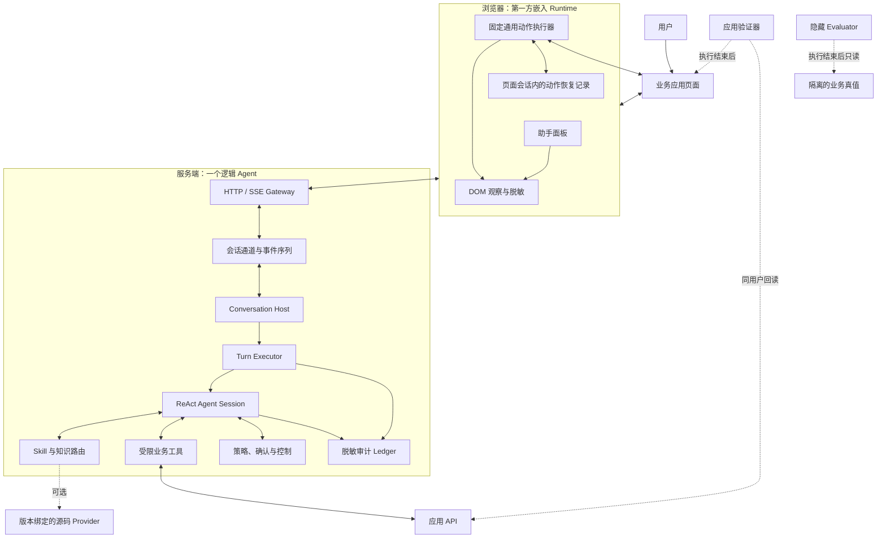

# Web Operation Agent 系统设计

Web Operation Agent 是一个面向复杂业务 Web 应用的嵌入式 AI 助手。用户在应用页面内用自然语言描述目标；服务端 Agent 负责理解、规划、调用知识与业务工具，页面内 Runtime 负责观察当前页面、执行受限的通用动作并返回结果。

系统采用“两层运行结构、一个逻辑 Agent”。推理只发生在服务端。浏览器 Runtime 是可替换的执行端，不持有计划、业务知识或模型能力。

## 1. 目标与非目标

### 1.1 目标

- 在不把模型密钥和内部知识下发到浏览器的前提下，完成企业应用中的查询、导航和受控写入。
- 每次动作之后读取新的页面或工具结果，让 Agent 基于运行时事实重新规划。
- 通过 Application Adapter 接入不同应用，使 Agent 核心不包含具体页面路由、API 字段和认证细节。
- 同时支持页面操作、按需加载的 Business Skill、同用户身份的业务 API，以及可选的源码知识。
- 对写操作默认拒绝，展示准确的影响和目标，取得用户确认后最多执行一次。
- 将“Agent 已结束”和“业务目标已验证”分开，避免把模型自述、HTTP 成功或页面提示误当成最终成功。
- 保留经过脱敏的执行记录，使错误、拒绝和不确定结果可以审计。

### 1.2 非目标

- 不把浏览器动作描述成数据库事务，也不承诺任意页面写入具有原子性。
- 不让页面 Runtime 自主规划、读取源码、持有业务凭据或调用模型。
- 不依赖多 Agent、工作流编排平台、知识图谱或通用静态分析平台。
- 不要求源码检索才能使用产品；源码只是可关闭的知识来源。
- 当前实现不等同于可直接部署的多租户云服务，也不宣称支持任意第三方网站。
- 用户确认只表示授权执行某个精确提案，不替代参数校验、执行回执和业务后置验证。

## 2. 系统边界



浏览器到服务端的页面观察、动作结果、用户消息和确认决定通过认证的 POST 返回；服务端到浏览器的动作与进度通过 SSE 事件发送。当前 Gateway 只监听本机回环地址，协议和组件边界可以继续复用，但它还不是生产网络入口。

## 3. 组件职责

### 3.1 Embedded Web Runtime

Runtime 嵌入业务页面，承担以下职责：

- 显示助手面板，收集自然语言目标和确认决定；
- 通过 PageController 读取结构化 DOM，并生成带页面 epoch 的元素引用；
- 执行固定的通用动作：观察、点击、填写、选择、提交、同源跳转、返回和有限等待；
- 按应用组合选择普通文档跳转或显式启用的 SPA 路由跳转；
- 为动作返回结构化回执和新的页面观察；
- 在整页导航前写入恢复记录，并缓存已完成结果，连接恢复后重发结果而不重复动作；
- 隐藏 PageController 的调试编号，并从观察、错误和参数回显中删除凭据形态的数据。

Runtime 不包含任务历史、模型客户端、源码、Skill 目录、ControlPlan、业务 evaluator 或任意 JavaScript 执行工具。它只执行服务端发送且通过当前观察、页面 epoch、截止时间和能力校验的命令。

Runtime 运行在业务页面的同源脚本环境中。因此当前安全模型要求页面及其第一方脚本可信；Origin 和 capability token 可以阻止其他来源调用会话，却不能隔离同一页面内已经执行的恶意脚本。需要处理不受信任页面时，应使用更强的隔离宿主，而不是把现有嵌入模式直接暴露给任意网站。

### 3.2 Embedded Gateway 与 Remote Session

Gateway 为每个会话签发随机 capability，并绑定允许的页面 Origin。Registry 只保存 token 哈希，产品宿主在会话存续期间保留用于生成 bootstrap 的原始 grant。Runtime 建立连接后还会取得活动 lease；整页导航产生的新 Runtime 会替换旧 lease，旧页面不能继续提交观察或结果。

Remote Session 维护严格 schema 的消息、观察、动作、结果、确认和事件序列。每个页面动作必须：

1. 基于当前 observation id 和 page epoch；
2. 在截止时间前由活动 Runtime 原子 claim；
3. 由 claim 的同一浏览器客户端提交结果；
4. 对重复 id 返回同一结果，对内容冲突的重放拒绝。

这些约束解决页面刷新和 SSE 重连时的重复执行问题。它们不能证明业务写入是否落库；无法证明时必须进入 `INDETERMINATE`。

### 3.3 Conversation Host 与 Turn Executor

`LiveConversationRunner` 顺序消费同一面板中的多轮消息，并复用同一个 Turn Executor。单轮异常会形成独立 outcome，后续消息仍可继续；关闭页面或会话是正常生命周期，不被伪装成任务失败。

`AgentTurnExecutor` 是应用无关的单轮入口。它负责：

- 严格校验 `message_id`、目标文本和页面 URL；
- 把消息绑定到最新页面观察；
- 启动浏览器客户端后再次核对 observation id、epoch 和内容摘要，拒绝绑定期间发生的页面变化；
- 注入预算、动作策略、业务工具、确认通道、控制端和答案 renderer；
- 创建审计 Ledger 并运行一个 `ServerAgentSession`；
- 返回中性的 `AgentTurnExecution`，不判断应用目标是否最终成功。

公开序列化结果只保留运行标识、页面观察摘要、终态、步数、面向用户的答案和业务结果摘要，不直接输出原始用户目标、页面 URL、原始 BusinessToolResult 正文或 Ledger 的绝对路径。

### 3.4 Server Agent Session

`ServerAgentSession` 是系统中唯一进行动态决策的 Agent。它持有当前任务、模型上下文、页面观察、预算、已加载 Skill、业务工具、可选知识先验、控制状态和审计记录。

每个 turn 有独立的步数与墙钟预算。模型只能通过结构化工具调用行动，不能直接访问浏览器对象、任意网络、数据库或 shell。上下文仅保留有限数量的完整页面观察，较早结果会被压缩，避免上下文随步骤数失控增长。

## 4. ReAct 执行循环

核心循环遵循“推理一次、调用一个工具、读取结果、重新规划”：

```text
最新页面观察
    ↓
模型选择一个工具
    ↓
服务端进行 schema、Skill、策略、路由和写权限校验
    ↓
执行页面动作或业务工具
    ↓
返回 ToolResult / ActionReceipt，并取得新的页面观察
    ↓
用运行时事实修正计划，再进入下一轮
```

具体规则如下：

- 模型一次返回多个工具调用时，全部拒绝且不执行，下一轮收到明确的协议反馈。
- 模型没有调用工具时，系统要求它选择一个工具或显式结束；成功的只读业务查询可以按配置直接返回自然语言答案。
- 页面元素引用只在产生它的 observation epoch 内有效。
- 已接受的 Skill 加载、业务工具和页面动作都会把结果加入上下文；被预执行策略拒绝的动作会明确标记为未 dispatch。
- 页面动作、成功的服务端工具以及大多数拒绝路径之后都会重新观察页面，再允许模型继续决策。
- 直接跳转只接受当前页面的精确链接、成功业务 ToolResult 返回的精确 `ui_path`，或服务端已验证为只读的知识路由。
- 步数、墙钟、模型预算、策略拒绝上限或控制错误都可以终止循环。

ReAct 的价值在于让计划始终可撤回。源码或 Skill 提供的路线一旦与页面冲突，系统会记录冲突、暂停或撤回计划，后续动作改用最新事实。

## 5. 事实与知识的优先级

知识来源回答的问题不同，不能把它们混成一个“可信度分数”。当前决策顺序是：

| 优先级 | 来源 | 可以证明 | 不能证明 |
| --- | --- | --- | --- |
| 1 | 最新页面观察与动作回执 | 当前 URL、DOM、可见控件、动作是否得到页面 Runtime 回执 | 隐藏业务记录、数据库提交或未显示的权限 |
| 2 | 同一委托用户的业务 API ToolResult / 写后回读 | 当前业务数据，以及适配器实际回读到的写入结果 | 浏览器当前视觉状态 |
| 3 | 经审核的 Business Skill、App Skill 和产品文档 | 工具用途、槽位、只读路由、操作约束和来源 | 当前记录、当前权限或本次动作结果 |
| 4 | 与部署版本绑定的源码证据 | 可能存在的路由、字段、处理器和服务关系 | 运行时数据、租户配置、功能开关和用户权限 |

当同一类事实冲突时，更新且更接近执行点的运行时事实优先。页面负责 UI 真值，业务 API 负责动态业务数据；二者不一致时，Agent 应停止做成功声明并通过新的观察或同用户回读消除冲突。

## 6. Application Adapter 与知识工具

### 6.1 Application Adapter

Application Adapter 是应用专有事实进入通用 Agent 的组合边界。它可以提供：

- 应用 Origin 与同源 PageController 模块；
- 健康检查；
- 委托用户的凭据读取和刷新；
- Business Skill 目录；
- 带固定 schema 的业务 API executor；
- 应用专有的结果展示和确定性验证。

每个 Adapter 必须先通过版本化 `ApplicationDescriptor` 绑定。Descriptor 固定应用 ID、Origin、导航模式、同源 PageController URL，以及当前 Skill/tool catalog 的 SHA-256。会话组合在接收用户任务前重新计算 catalog 摘要；Descriptor 与实际 catalog 不一致时拒绝启动。自然语言目标不经过应用专有的正则分类器或有限意图枚举，而是直接交给通用 Agent，由候选 Skill、typed tool 和页面观察逐步收敛。

Adapter 不拥有 ReAct 循环，也不应把具体应用路由写入 Agent 核心。当前仓库中的 `TwentyApplicationAdapter` 是一条窄纵切：它接入公司查询与创建，验证 Origin，把 OAuth 凭据保留在服务端，并构造 `BusinessToolRuntime`。测试中的第二个发票 Adapter 使用相同绑定暴露不同 Skill 和工具，Agent 核心没有应用名或任务类型分支。这证明了最小 SPI 的组合边界，但健康检查、身份握手、应用级验证和生命周期接口仍需继续完善。

### 6.2 Business Skill

Business Skill 是不可变的服务端 playbook，包含：

- 唯一 Skill id、标题、意图和触发词；
- 使用步骤；
- 允许出现的 typed tool 名称；
- provenance；
- 是否只读。

Skill 不保存当前业务数据或凭据。Agent 只能先从当前任务匹配到候选 Skill，再显式调用 `load_skill`；对应工具 schema 在加载前不可见。Skill 声明的工具集合必须与 executor schema 完全一致，只读 Skill 不能引用写工具。

这一机制把“先加载能力，再查询或操作”的流程变成服务端可校验的状态转换，而不只是 prompt 中的一句建议。

### 6.3 业务 API 工具

业务 API 工具适合处理页面无法完整暴露的动态数据、分页查询和确定性写后回读。工具只能访问 Adapter 声明的固定操作，不能退化为任意 URL、HTTP 方法或请求体。

`BusinessToolResult` 必须是有限 JSON，并同时提供：

- 给模型使用的业务事实；
- 更小的审计投影；
- 可选的、已出现在结果正文中的安全相对页面路径。

结果拒绝凭据形态的字段，正文大小受限，页面路径必须是无跨源、无路径穿越、无 fragment 的相对路径。模型只能打开本次 ToolResult 实际返回的路径。

当前 Twenty executor 使用委托用户 OAuth 身份查询公司。创建公司时，它在提案前和 dispatch 前检查重复项，执行一次创建请求，并用同一用户读取新记录；响应或回读无法确定时返回不确定写入，而不是重试。

### 6.4 App Skill 与源码 Provider

App Skill 适合描述当前菜单不可见、但已审核的只读页面入口。路由模板和 provenance 留在服务端；Agent 只拿到有限的 Skill 卡片，通过当前页面的真实应用入口进入目标应用，再由服务端验证参数并组装同源只读路径。

源码 Provider 是另一种可选知识来源。现有 Session 支持基于版本绑定 SourceMap 的预先 contract、运行时查询和只读候选路由。每条证据携带发布标识、仓库相对路径、行范围和内容摘要。源码内容始终是先验，不能代替页面观察、业务 API 或写后验证。

应用无关的 `AgentTurnExecutor` 当前默认关闭 source contract，也没有默认注入运行时源码 Provider。应用不接入源码仍可使用页面和 Business Skill/API 主链路；需要源码能力的产品组合必须显式提供并验证版本绑定。

## 7. 读写控制与用户确认

### 7.1 读取与导航

只读任务可以在 turn 配置中禁用点击、填写、选择和提交，只开放观察及受限导航。页面策略拒绝发生在 dispatch 前；拒绝后通常会取得新观察，让 Agent 选择其他路径。

业务读取必须经已加载 Skill 的 typed tool。它使用 Adapter 管理的委托身份，并把当前数据作为 ToolResult 返回。API 返回的页面路径只是后续导航能力，不自动证明用户目标已经完成。

### 7.2 服务端业务写入

服务端写工具采用以下固定流程：

1. 校验工具已经由相关 Skill 加载；
2. Adapter 规范化参数并进行可确定的前置检查；
3. 生成包含 effect、targets、规范化参数和随机 nonce 的 mutation proposal；
4. 在页面面板展示 effect 与 targets；
5. 将当前受认证浏览器会话的决定在服务端绑定到 proposal digest；
6. 在 dispatch 前消耗该 proposal，使其不可再次执行；
7. 最多发送一次写请求；
8. 返回带审计投影的结构化结果；需要业务成功判定的集成还应由 Adapter 进行同用户回读。

`allow_business_mutations` 默认是 `false`。没有显式启用或没有确认通道时，写工具在 dispatch 前终止。用户拒绝对应 `CANCELLED`。

任何发生在 dispatch 后、又无法确定结果的异常都必须对应 `INDETERMINATE`。系统不会因为超时、连接丢失、回执格式错误或回读失败而自动重试写请求。

### 7.3 页面写入

页面中的点击、填写、选择、提交、跳转和返回在部分旧式应用中都可能触发服务端写入，不能仅凭工具名称判断安全性。`ServerAgentSession` 能读取注入 control 的许可与拒绝事件，并在许可已消耗但结果未确认时停止后续潜在写入。

当前通用 Turn Executor 不根据自然语言自行生成或安装隐藏 ControlPlan。产品组合只有在外部控制层已经建立精确许可和网络侧 fail-closed 约束时，才能开放页面写动作；否则必须通过 `disabled_actions` 在 dispatch 前关闭这些动作。当前公司创建纵切采用受确认的服务端 API 写入，页面执行层只负责受限导航。

## 8. 状态与错误语义

`AgentTurnExecution.status` 描述 Agent 循环如何结束，不等同于业务成功：

| 状态 | 含义 |
| --- | --- |
| `FINISHED` | Agent 声称完成或返回了允许直接结束的只读答案；仍需应用验证 |
| `REFUSED` | Agent 明确表示无法完成 |
| `CANCELLED` | 用户拒绝了精确写入提案 |
| `INDETERMINATE` | 写操作可能已发生，结果无法证明；禁止自动重试 |
| `FAILED` | 预算、provider、控制、策略或其他运行错误导致结束 |

进入 Agent 循环前的边界错误使用 typed code，例如无页面观察、消息页面已过期、Runtime 不可用或消息格式无效。可重试标志只用于尚未产生写入风险的边界错误。Conversation Host 会向面板发布安全的恢复提示，并继续处理下一轮消息。

终态消息发送失败不会抹掉已经产生的 `AgentTurnExecution`，也不会把它变成可重试任务；失败类型只写入 Ledger。对 `INDETERMINATE`，用户答案固定说明结果不确定，不能被模型生成的乐观文本覆盖。

## 9. 信任与隐私边界

| 边界 | 信任假设与约束 |
| --- | --- |
| 用户与模型输入 | 不可信；严格 schema、长度和工具参数校验 |
| 页面 DOM 与页面文本 | 不可信运行时数据；可以改变计划，不能发出服务端指令或扩大工具能力 |
| Embedded Runtime | 只信任固定实现和当前活动 lease；无模型密钥、业务 token、源码或控制计划 |
| Embedded Gateway | 校验 capability、Origin、lease、schema、大小、截止时间和重放一致性 |
| Server Agent | 可以推理，但模型输出仍不可信；所有动作必须经过确定性工具边界 |
| Application Adapter | 受信任的应用集成代码；负责身份、参数规范化、API 范围和错误分类 |
| Control / Approval | 受信任的确定性边界；确认绑定精确提案，未知情况默认拒绝 |
| Evaluator | 独立的最高信任读取端；Agent 和 Runtime 不得访问隐藏真值 |

所有跨浏览器边界的数据都会检查未脱敏的 session handoff 和 credential assignment。填写值不会进入动作描述或参数回显，Ledger 在写盘前再次脱敏。原始 capability 会进入短期 bootstrap 和 Runtime，并由产品宿主在会话存续期间持有；registry 只保存其哈希。业务 OAuth 凭据只留在 Adapter 侧。

## 10. 产品执行与 Evaluator 隔离

Agent 的 `finish(done=true)`、页面 toast、HTTP 2xx、动作回执和用户确认都不是最终业务成功。

`AgentTurnExecutor` 只返回中性的执行事实。应用组合可以在 turn 结束后，用当前页面或同用户 API 检查公开后置条件，再决定面向用户的结果。基准测试还可以使用隐藏 evaluator 读取只读数据库真值，但该 evaluator 必须位于 Agent 工具、prompt、文件可见范围和 Runtime 协议之外。

这条边界带来三个约束：

- 产品代码不依赖环境 reset、隐藏答案或 benchmark 的 `product_success`；
- evaluator 不参与 Agent 规划，也不能把正确路径泄露给某一运行；
- 页面或业务验证失败时保留 Agent 的原始终态和轨迹，不能事后改写执行记录。

## 11. 当前实现限制

当前代码是一条可运行的本地产品纵切，距离工业级部署仍有明确差距：

- Gateway、Remote Session registry、事件序列、消息队列和 lease 都在单个 Python 进程内存中；进程重启后不能恢复会话。
- Conversation Host 使用进程内线程和队列，没有外部任务队列、跨实例调度、背压或服务级高可用。
- Session Ledger 是本机 append-only JSONL，逐条 flush 与 fsync；它不是集中式审计存储，也没有跨进程事务。
- capability 与 Origin 绑定已经实现，但最终用户身份、组织、租户和会话 capability 之间还没有一等的持久绑定。
- 浏览器 sessionStorage 可以处理同一标签页内的刷新恢复，不能替代服务端持久幂等存储。
- 模型调用、页面动作和确认有局部超时；完整的协作取消、全链路 deadline 传播和资源回收仍不完整。
- 目前只有一个窄业务 Adapter 和少量 Skill/API 工具，覆盖面不能代表复杂企业应用的完整操作集。
- 源码能力存在于 Session 层，但默认产品 Turn Executor 尚未将它作为可配置 Provider 接入。
- 页面内助手可以完成基本对话、进度和确认，交互与可访问性仍需系统化打磨。
- 当前嵌入模式假定第一方页面可信；面向第三方页面的隔离执行形态尚未实现。

## 12. 演进方向

以下内容是后续架构方向，不是当前已实现能力：

1. 把 session、事件 cursor、动作 claim、确认和幂等结果迁移到可恢复的持久存储，同时保持现有 wire schema。
2. 建立用户、组织、租户、委托应用身份和 capability 的服务端绑定，并在每个工具调用中强制传播。
3. 将 Conversation Host 迁移到有租约、取消、deadline、背压和故障隔离的 worker 执行模型。
4. 把 Application Adapter 抽成稳定 SDK，增加契约测试、能力声明、统一错误语义和同身份验证接口。
5. 将源码、产品文档和其他知识源统一为可开关 Provider，保留运行时事实优先和版本 provenance。
6. 为页面写入补齐通用的提案、网络侧许可、动作关联和写后验证合同，再按证据决定可开放的动作面。
7. 在核心协议稳定后，评估更强隔离的页面执行端；嵌入面板与浏览器扩展可以共享协议，但需要不同的信任模型。
8. 建立开发集、冻结测试集和强基线，分别测量页面执行、Skill/API、源码开关、写入安全、恢复能力、延迟和成本。

## 13. 代码导航

- 单轮产品边界：[product.py](../../src/web_operation_agent/product.py)
- 多轮会话与本地产品宿主：[live.py](../../src/web_operation_agent/live.py)
- 单 Agent ReAct 循环：[session.py](../../src/web_operation_agent/session.py)
- Business Skill 与业务工具合同：[business.py](../../src/web_operation_agent/business.py)
- 当前 Application Adapter 示例：[twenty.py](../../src/web_operation_agent/twenty.py)
- Embedded Gateway：[embedded_gateway.py](../../src/web_operation_agent/embedded_gateway.py)
- 浏览器 Runtime：[embedded.js](../../src/web_operation_agent/web_runtime/embedded.js)
- 会话协议与幂等通道：[remote.py](../../src/web_operation_agent/remote.py)
- 版本化 wire schema：[schemas.py](../../src/web_operation_agent/schemas.py)
