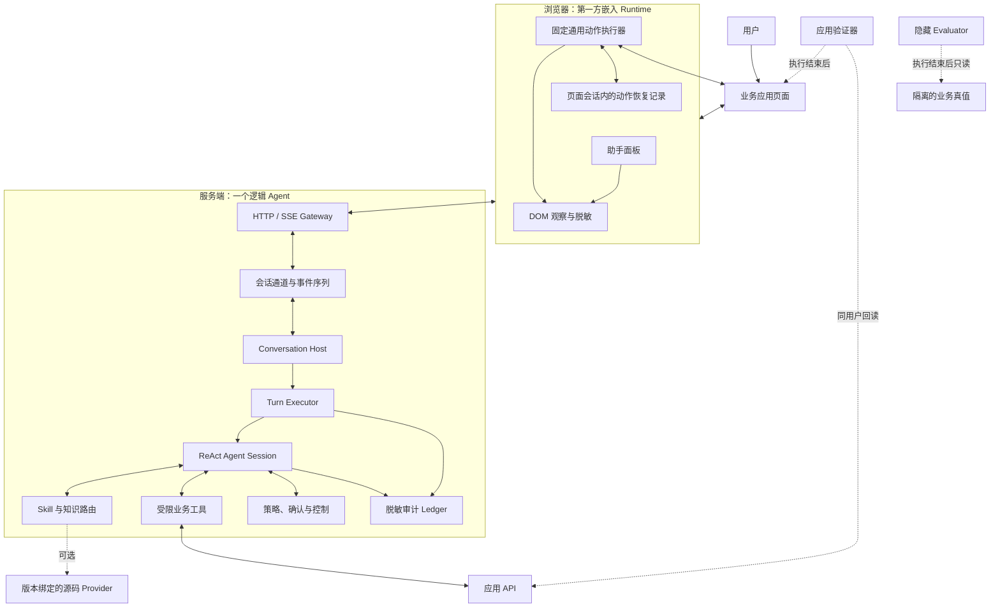

# Web Operation Agent 系统设计

Web Operation Agent 是一个面向复杂业务 Web 应用的嵌入式 AI 助手。用户在应用页面内用自然语言描述目标；服务端 Agent 负责理解、规划、调用知识与业务工具，页面内 Runtime 负责观察当前页面、执行受限的通用动作并返回结果。

系统采用“两层运行结构、一个逻辑 Agent”。推理只发生在服务端。浏览器 Runtime 通过版本化协议与服务端隔离，不持有计划、业务知识或模型能力。当前发布物只有一个规范执行端：页面内嵌 Runtime；新增浏览器宿主必须实现同一 `ActionCommand`/`ActionReceipt` 合同并通过同一行为套件，不能在产品包内复制另一套动作语义。

## 1. 目标与非目标

### 1.1 目标

- 在不把模型密钥和内部知识下发到浏览器的前提下，完成企业应用中的查询、导航和受控写入。
- 每次动作之后读取新的页面或工具结果，让 Agent 基于运行时事实重新规划。
- 通过 Application Adapter 接入不同应用，使 Agent 核心不包含具体页面路由、API 字段和认证细节。
- 同时支持页面操作、按需加载的 Business Skill、同用户身份的业务 API，以及可选的源码知识。
- 对写操作默认拒绝，展示准确的影响和目标，取得用户确认后最多执行一次。
- 将“Agent 已结束”和“业务目标已验证”分开，避免把模型自述、HTTP 成功或页面提示误当成最终成功。
- 保留经过脱敏的执行记录，使错误、拒绝和不确定结果可以审计。

### 1.2 非目标

- 不把浏览器动作描述成数据库事务，也不承诺任意页面写入具有原子性。
- 不让页面 Runtime 自主规划、读取源码、持有业务凭据或调用模型。
- 不依赖多 Agent、工作流编排平台、知识图谱或通用静态分析平台。
- 不要求源码检索才能使用产品；源码只是可关闭的知识来源。
- 当前实现不等同于可直接部署的多租户云服务，也不宣称支持任意第三方网站。
- 用户确认只表示授权执行某个精确提案，不替代参数校验、执行回执和业务后置验证。

## 2. 系统边界



浏览器到服务端的页面观察、动作结果、用户消息和确认决定通过认证的 POST 返回；服务端到浏览器的动作与进度通过 SSE 事件发送。`LiveProductServer` 可以让多个隔离 session 共享一个有容量上限的 Gateway，并独立撤销 capability 和释放 channel 状态。Gateway 默认只监听本机回环地址；部署方只有同时显式开启 `allow_private_network_bind`、绑定 `0.0.0.0` 并提供 HTTPS `public_base_url` 时才能把它放到私网反向代理之后。这项逃生门不把 Gateway 变成可直接暴露的生产网络入口，状态仍在单进程内存中。

## 3. 组件职责

### 3.1 Embedded Web Runtime

Runtime 嵌入业务页面，承担以下职责：

- 显示助手面板，收集自然语言目标和确认决定；
- 通过 PageController 读取结构化 DOM，并生成带页面 epoch 的元素引用；
- 执行固定的通用动作：观察、点击、填写、选择、提交、视口滚动、同源跳转、返回和有限等待；
- PageController 只抽取当前视口；单份观察最多暴露 200 个完整控件并保留上下滚动提示，屏幕外
  内容只能通过最多三页的有界滚动和新观察进入服务端，不能依靠一次无界整页扫描；
- 在副作用动作 claim 前比较当前 URL、目标控件和关联表单与上次观察时的本地指纹；不一致时先重新观察并返回 `stale_observation`。判定只用 URL 与元素指纹，不订阅文档变化事件；
- 按应用组合选择普通文档跳转或显式启用的 SPA 路由跳转；
- 为动作返回结构化回执和新的页面观察；
- 在整页导航前写入恢复记录，并缓存已完成结果，连接恢复后重发结果而不重复动作；
- 隐藏 PageController 的调试编号，并从观察、错误和参数回显中删除凭据形态的数据。

Runtime 不包含任务历史、模型客户端、源码、Skill 目录、ControlPlan、业务 evaluator 或任意 JavaScript 执行工具。它只执行服务端发送且通过当前观察、页面 epoch、截止时间和能力校验的命令。

动作指纹只保存在当前浏览器 Runtime 内，不跨网络发送。它覆盖目标控件的语义、值、可操作状态、选项和关联表单的 action/method/target，因此用户在模型思考期间修改字段、控件被替换或提交目标变化都会使旧动作失效。仅修改无关 DOM 不会自动拒绝动作。JavaScript handler 依赖的其他隐藏页面状态仍无法由该指纹完整证明，应用控制层仍需对写入 fail closed。

Runtime 运行在业务页面的同源脚本环境中。因此当前安全模型要求页面及其第一方脚本可信；Origin 和 capability token 可以阻止其他来源调用会话，却不能隔离同一页面内已经执行的恶意脚本。需要处理不受信任页面时，应使用更强的隔离宿主，而不是把现有嵌入模式直接暴露给任意网站。

### 3.2 Embedded Gateway 与 Remote Session

Gateway 为每个会话签发随机 capability，并绑定允许的页面 Origin。Registry 只保存 token 哈希，产品宿主在会话存续期间保留用于生成 bootstrap 的原始 grant。Runtime 建立连接后还会取得活动 lease；整页导航产生的新 Runtime 会替换旧 lease，旧页面不能继续提交观察或结果。共享 server 对活动 session 数量执行准入上限；关闭一个 session 会原子移除其 token 哈希与 channel，使旧 capability 立即失效而不影响其他 session。每个 session 默认最多存活一小时，并对事件、已接受消息、待处理消息、观察标识、动作、审批和 Runtime 实例分别设置硬上限。消息队列达到瞬时上限时返回可重试的 429；生命周期状态达到硬上限时保留最后一个 terminal 事件并关闭 session。无限等待消息的 Host 也会在 TTL 到达时被唤醒，因此空闲会话不会永久占用线程和准入名额。

Gateway 在与业务端点相同的监听地址上提供两个无凭据探针：`/healthz` 只证明 HTTP 进程仍在响应，`/readyz` 表示组合仍可处理工作。默认监听为 loopback；启用上述私网绑定逃生门时，反向代理与网络策略也必须限制探针。就绪响应经过固定 schema 投影，只允许协议版本、是否就绪、是否接受新 session、当前 session 数量、容量和 provider guard 的数值/布尔状态；不包含 session id、capability、Origin、用户输入、页面内容、应用数据或回调错误正文。Provider 电路打开时返回 503，但容量已满只会把 `accepting_sessions` 设为 false，现有 session 仍可由同一进程服务。回调异常、字段畸形或不一致会返回不含异常文本的 503。这些探针尚未替代部署平台的认证监控、指标采集和告警。


Remote Session 维护严格 schema 的消息、观察、动作、结果、确认和事件序列。每个页面动作必须：

1. 基于当前 observation id 和 page epoch；
2. 在截止时间前由活动 Runtime 原子 claim；
3. 由 claim 的同一浏览器客户端提交结果；
4. 对重复 id 返回同一结果，对内容冲突的重放拒绝。

这些约束解决页面刷新和 SSE 重连时的重复执行问题。它们不能证明业务写入是否落库；无法证明时必须进入 `INDETERMINATE`。

服务端 `BrowserExecutor` 只是 `observe`、`execute` 和 `console` 的结构合同，不实现浏览器行为。唯一的产品实现 `RemoteBrowserClient` 会把动作封装为 `ActionCommand`，经 Remote Session 发送给内嵌 Runtime，并校验返回的 `ActionReceipt` 与原命令、观察和 claim 一致。早期的 `ThinBrowserClient/browser_worker` 子进程执行端只被未发布实验 CLI 使用，且其选择、导航和观察语义已与内嵌 Runtime 分叉，现已从产品包删除。

### 3.3 Conversation Host 与 Turn Executor

`LiveConversationRunner` 顺序消费同一面板中的多轮消息，并复用同一个 Turn Executor。单轮异常会形成独立 outcome，后续消息仍可继续；关闭页面或会话是正常生命周期，不被伪装成任务失败。

每个 Turn Executor 拥有一个有界 `ConversationState`，默认只在当前进程内保留最近 4 轮且模型投影不超过 32 KiB。已完成轮次可以保留经过 `BusinessToolResult` 边界校验的业务事实，用于理解“它”“第二个”等后续指代；失败、取消或不确定轮次不保留业务事实。历史上下文在 prompt 中显式标记为可能过期的不可信应用数据，只参与引用解析；只有当前目标含指代词时，历史文本才可以补充只读 Skill 候选，写 Skill 仍必须由当前目标直接命中。新 turn 在陈述事实或执行页面动作前必须重新读取页面或类型化 API；历史 `ui_path` 不会进入本轮 `_business_routes`，所以不能直接授权跳转。审计只写保留轮数和上下文摘要，不复制上下文正文。

每条活动消息具有唯一 `message_id`。页面内停止操作通过当前 Runtime lease 提交严格 schema 的 `CancellationRequest`，服务端只接受同一 session 中已登记的消息。页面动作的 `turn_id` 与该 `message_id` 相同，因此取消请求、模型轮次、审批和动作可以在同一消息边界内关联。Conversation Host 在成功、普通异常、会话关闭和非预期退出路径中统一完成消息生命周期，完成后的消息不能重新进入取消状态。

主体绑定会话中的每次业务工具调用还会创建一个不可变 `OperationContext`，把 principal、session、turn、operation 和有效期固定在一起。Business Tool 逐次校验 application 与 required scope；mutation proposal 的摘要包含 operation context 摘要，审批请求与决定必须匹配同一 principal、turn 和 operation。原始身份字段不会进入浏览器或 Ledger，审计只记录稳定摘要。

取消和动作认领共享同一把会话锁。如果取消先发生，尚未认领的动作从 pending 状态移除，等待结果的 Agent 被立即唤醒并以 `user_cancelled` 结束；如果浏览器先认领动作，取消不会伪造“未执行”，该动作必须返回确定回执，或在结果无法判定时进入 `INDETERMINATE`。等待中的业务写入确认会自动形成拒绝决定并唤醒 Agent；即使批准与取消同时到达，业务 mutation 在实际 dispatch 前仍会再次检查取消状态。

`AgentTurnExecutor` 是应用无关的单轮入口。它负责：

- 严格校验 `message_id`、目标文本和页面 URL；
- 把消息绑定到最新页面观察；
- 启动浏览器客户端后再次核对 observation id、epoch 和内容摘要，拒绝绑定期间发生的页面变化；
- 注入预算、动作策略、业务工具、确认通道、控制端和答案 renderer；
- 创建审计 Ledger 并运行一个 `ServerAgentSession`；
- 返回中性的 `AgentTurnExecution`，不判断应用目标是否最终成功。

公开序列化结果只保留运行标识、页面观察摘要、终态、步数、面向用户的答案和业务结果摘要，不直接输出原始用户目标、页面 URL、原始 BusinessToolResult 正文或 Ledger 的绝对路径。

### 3.4 Server Agent Session

`ServerAgentSession` 是系统中唯一进行动态决策的 Agent。它持有当前任务、模型上下文、页面观察、预算、已加载 Skill、业务工具、可选知识先验、控制状态和审计记录。

每个 turn 有独立的步数与墙钟预算。每次 provider 请求的 socket timeout 不得超过该 turn 当时剩余的墙钟预算；provider 在截止后才返回时，结果被丢弃并以 `wall_clock_budget` 结束，不能继续触发工具。取消在 provider 排队、建连、已派发 socket、模型返回后、审批前后、业务工具前和页面动作前重复检查，迟到的模型输出不能触发工具。原生 Agent completion 使用可关闭的连接；建连在独立线程中完成，取消后该线程只能关闭连接，不能继续发送 HTTP 请求。合同规划和框架原生 `request_completion` 仍没有同一消息级取消钩子。模型只能通过结构化工具调用行动，不能直接访问浏览器对象、任意网络、数据库或 shell。上下文仅保留有限数量的完整页面观察，较早结果会被压缩，避免上下文随步骤数失控增长。

## 4. ReAct 执行循环

核心循环遵循“推理一次、调用一个工具、读取结果、重新规划”：

```text
最新页面观察
    ↓
模型选择一个工具
    ↓
服务端进行 schema、Skill、策略、路由和写权限校验
    ↓
执行页面动作或业务工具
    ↓
返回 ToolResult / ActionReceipt，并取得新的页面观察
    ↓
用运行时事实修正计划，再进入下一轮
```

具体规则如下：

- 模型一次返回多个工具调用时，全部拒绝且不执行，下一轮收到明确的协议反馈。
- 模型没有调用工具时，系统要求它选择一个工具或显式结束；成功的只读业务查询可以按配置直接结束，若 ToolResult 提供结构化答案投影，记录、来源和完整性由服务端生成。
- 页面元素引用只在产生它的 observation epoch 内有效。
- 已接受的 Skill 加载、业务工具和页面动作都会把结果加入上下文；被预执行策略拒绝的动作会明确标记为未 dispatch。
- 页面动作、成功的服务端工具以及大多数拒绝路径之后都会重新观察页面，再允许模型继续决策。
- 直接跳转只接受当前页面的精确链接、成功业务 ToolResult 返回的精确 `ui_path`，或服务端已验证为只读的知识路由。
- 步数、墙钟、模型预算、策略拒绝上限或控制错误都可以终止循环。

ReAct 的价值在于让计划始终可撤回。源码或 Skill 提供的路线一旦与页面冲突，系统会记录冲突、暂停或撤回计划，后续动作改用最新事实。

## 5. 事实与知识的优先级

知识来源回答的问题不同，不能把它们混成一个“可信度分数”。当前决策顺序是：

| 优先级 | 来源 | 可以证明 | 不能证明 |
| --- | --- | --- | --- |
| 1 | 最新页面观察与动作回执 | 当前 URL、DOM、可见控件、动作是否得到页面 Runtime 回执 | 隐藏业务记录、数据库提交或未显示的权限 |
| 2 | 同一委托用户的业务 API ToolResult / 写后回读 | 当前业务数据，以及适配器实际回读到的写入结果 | 浏览器当前视觉状态 |
| 3 | 同一 actor 的运行时目录与 Adapter 元数据 | 当前可发现的实体、页面提示、字段描述和可读操作 | 当前记录、页面默认过滤的真实结果或写授权 |
| 4 | 经审核的 Business Skill、App Skill 和产品文档 | 工具用途、槽位、只读路由、操作约束和来源 | 当前记录、当前权限或本次动作结果 |
| 5 | 与部署版本绑定的源码与 Git 历史证据 | 静态声明、可能的代码路径、实现片段，以及提交/所有权记录 | 当前数据、当前有效权限、当前组织责任人或一次实际事件的原因 |

当同一类事实冲突时，更新且更接近执行点的运行时事实优先。页面负责 UI 真值，业务 API 负责动态业务数据；二者不一致时，Agent 应停止做成功声明并通过新的观察或同用户回读消除冲突。

## 6. Application Adapter 与知识工具

### 6.1 Application Adapter

Application Adapter 是应用专有事实进入通用 Agent 的组合边界。它可以提供：

- 应用 Origin 与同源 PageController 模块；
- 健康检查；
- 委托用户的凭据读取和刷新；
- Business Skill 目录；
- 带固定 schema 的业务 API executor；
- 身份绑定、工具路由、当前表单、结果数据分类、mutation 后置条件和不确定写入核对端口。

每个 Adapter 必须先通过版本化 `ApplicationDescriptor` 和 `ApplicationPorts` 绑定。Descriptor 固定应用 ID、Origin、导航模式、同源 PageController URL，以及当前 Skill/tool catalog 的 SHA-256。Ports 是会被产品路径实际调用的合同：Identity Port 校验 principal，Route Port 限定 typed tool 可授权的页面路径，Form Port 把 actor-scoped 应用元数据翻译成当前表单描述，Data Port 为结果附加应用声明的数据类别，Postcondition Port 在确认写入后决定能否记录为 completed，Reconciliation Port 为历史不确定写入提供只读核对边界。会话组合在接收用户任务前重新计算 catalog 摘要，并检查端口覆盖所有工具、scope 和 mutation；Descriptor、catalog、端口或运行时接线不一致时拒绝启动。自然语言目标不经过应用专有的正则分类器或有限意图枚举。目标先由通用匹配器按 Skill 自己声明的触发词选出候选，这一步会以 `business_skill_candidates` 记账并标出是否用了兜底；匹配为空时退回一个有界的、按能力挑选的候选集，因此一种没被触发词覆盖的说法不会静默地让某项能力从工具面消失。其余交给通用 Agent，由候选 Skill、typed tool 和页面观察逐步收敛。

#### 通用能力准入规则

应用可以有专用 Adapter、Skill、源码抽取器、元数据翻译、鉴权和后置条件核验；Agent 能力
本身不能因此变成某个应用的另一层 SDK。新增的 Agent-facing tool schema、prompt contract、
状态转换和核心策略不得包含应用模型名、框架 RPC 形状或应用专有意图。允许先在一个 Adapter
中做有测量结果的原型，但继续扩展前必须把稳定部分抽成应用无关合同，并用第二个结构不同的
Adapter 或测试应用运行同一工具面和核心测试。只有第一个 Adapter 通过不能证明能力通用。

框架专有的解析并不违反这条边界：例如一个 Adapter 可以把 ORM model、OpenAPI resource、
GraphQL type 或窗口 action 翻译成共同的 entity、field、operation 和 page descriptor；核心只
消费这些有限 descriptor 和 opaque binding，不知道它们来自哪个框架。反方向则不允许：核心
不得为了一个框架增加专用模型发现、RPC 参数或页面规则。Phase 8 的 P8.4 已把首个 Adapter
原型抽成 `EntityReadPort` 与 `EntityReadTools`：Agent 只见
`discover_entities`、`describe_entity`、`query_entity_records` 和不透明 binding。Odoo
Adapter 翻译 ORM/action/`fields_get`/domain，合成 Contacts Adapter 则翻译 REST list 与本地
过滤；两者运行同一黑盒合同测试。P8.6 又以同一方式抽取通用当前表单合同，并由这两个
Adapter 的不同翻译实现运行同一黑盒合同；继续做聚合或其它实体操作时仍须复用这条准入门。

#### 按意图组装上下文

页面、对话历史、Skill 和部署代码库不是一个等价的大文本池，也不应全部预先塞给模型。每轮
由服务端按来源职责组装：最新页面观察始终是实时 grounding 基线；只有当前措辞指向历史或
正在回答服务端澄清时，才加入有界、已脱敏且明确标为可能陈旧的对话历史；App/Business
Skill 根据当前用户意图选出有限候选，真正的 typed tool 仍需加载 Skill 后才出现；代码库只在
部署启用 `SourceCapability` 时提供惰性的 `lookup_source`，收到具体查询后才把带 release、
file:line 和字节哈希的片段加入本轮证据；只有提交历史问题才调用
`lookup_source_history`，并且只加入绑定部署 commit 的 Git 元数据。任何来源都不能借由被选入
上下文扩大工具 scope 或写授权。

已有 `business_skill_candidates`、`runtime_source_retrieved` 与
`runtime_source_history_retrieved` 分别记录 Skill 选择、真正发生的源码检索和 Git 元数据查询；
未选择的对话和未查询的代码不复制进审计。后续若要统一评测上下文路由，先定义
不含原文、业务值或源码字节的选择事件，再把它纳入 golden ledger，而不是临时增加日志。


### 6.2 Business Skill

Business Skill 是不可变的服务端 playbook，包含：

- 唯一 Skill id、标题、意图和触发词；
- 使用步骤；
- 允许出现的 typed tool 名称；
- provenance；
- 是否只读。

Skill 不保存当前业务数据或凭据。Agent 只能先从当前任务匹配到候选 Skill，再显式调用 `load_skill`；对应工具 schema 在加载前不可见。Skill 声明的工具集合必须与 executor schema 完全一致，只读 Skill 不能引用写工具。

这一机制把“先加载能力，再查询或操作”的流程变成服务端可校验的状态转换，而不只是 prompt 中的一句建议。

### 6.3 业务 API 工具

业务 API 工具适合处理页面无法完整暴露的动态数据、分页查询和确定性写后回读。工具只能访问 Adapter 声明的固定操作，不能退化为任意 URL、HTTP 方法或请求体。

`BusinessToolResult` 必须是有限 JSON，并同时提供：

- 给模型使用的业务事实；
- 更小的审计投影；
- 可选的、已出现在结果正文中的安全相对页面路径。
- 对集合查询可选的不可变 `StructuredQueryAnswer`，其中记录、来源、范围、采集时间和完整性均由 Adapter 在 ToolResult 边界生成。

结果拒绝凭据形态的字段，正文大小受限，页面路径必须是无跨源、无路径穿越、无 fragment 的相对路径。模型只能打开本次 ToolResult 实际返回的路径。

如果一次 turn 在成功读取 typed tool 后直接返回答案，且该结果带有 `StructuredQueryAnswer`，产品层会忽略模型对业务事实的转述，并用结构化投影生成用户可见答案。完整性说明排在记录之前；答案长度不足以容纳全部记录时只在记录边界截断，并明确写出展示数量。结构化投影也进入公开 `AgentTurnExecution` 摘要，Session Ledger 记录投影摘要、返回数、展示数和是否展示截断，不记录另一份原始结果。用于定位记录后继续导航的查询不触发该替换，最终打开页面的说明仍由 Agent 给出。

通用实体读取仍是 typed tool，不是 `resource/method/payload` 逃生口。Agent 先搜索同 actor 的
Adapter 目录，得到与目录摘要绑定的不透明实体 ID；再用实体 ID 取得经过类型和敏感名过滤的
字段描述；最后只能提交当前不透明字段 ID、受限操作符和 AND 条件。核心固定 20 行页上限与
有界 offset，并要求 Adapter 返回稳定排序、准确匹配数、来源总数、范围、采集时间和一致性
说明。目录变化会使旧实体 ID 失效；任意字段描述变化会使该实体的旧字段 ID 全部失效。
专用工具能表达更窄的业务语义时仍优先使用专用工具。

Odoo 只在 Adapter 内把 generic `contains`/`not_in` 等操作符翻译为 domain，固定 `id asc`，
执行 `search_count(domain)`、`search_count([])` 与 `search_read`；action domain/context 只作
发现提示，不冒充查询范围。Contacts 测试 Adapter 不使用 ORM：它读取 actor-scoped REST list，
在 Adapter 内执行相同 AND 过滤、稳定排序与分页。两种翻译都不能让 Agent 提交原生模型名、
endpoint、方法、domain、selector 或 caller-defined order。


### 6.4 通用当前表单

无匹配 Skill 时，表单操作也不能退化成模型猜 selector。Adapter 的可选 Form Port 先从应用
自己的运行时元数据生成 actor-scoped、可写的字段描述；`describe_form` 再把它与最新页面观察
中带语义字段名的当前视口控件求交集。元数据里存在但页面没有的字段、页面出现但 Adapter 未
声明的字段、重复或凭据形态字段都不可操作。返回模型的 form/field ID 是服务端 HMAC 绑定，
覆盖 application、actor、URL、observation epoch/content digest 和整份表单元数据；原生字段名
与 DOM ref 不进入模型参数。

`prepare_form` 每次重新读取元数据和页面交集，拒绝过期 ID、重复字段、非法类型/selection 值，
并要求 Adapter 返回的 `FormDraft` 不能增加未选择字段、改换 route 或扩大持久化语义。草稿只
保存在服务端；已有 `prefill_form` 按最新观察重新解析每个准确语义字段，遇到 stale observation
会有界地重新观察，完成后立即结束 turn。它从不调用 submit 或 click。当前只支持文本、邮箱、
URL、电话、整数、数值、日期、时间以及经过声明的原生 select；checkbox、附件、富文本、关系
autocomplete 不在通用合同内。合同还要求 Adapter 排除会持久化或产生外部副作用的 onchange；
但 Odoo 的 `fields_get` 本身不能证明某个字段没有这类自定义 onchange，因此当前 Odoo Form Port
只能作为实验性翻译，必须通过部署版本的真实浏览器与写后检查后才能开放为生产默认能力。

P8.6 的部署门已在 Odoo `18.0-20260908` 上以零模型脚本运行客户、产品、报价单三个标准创建页：
6 个字段覆盖 scalar combobox、textbox、number、date 与 native select，DOM 值全部匹配，三个
目标模型的记录数分别保持 `7→7`、`0→0`、`0→0`，总耗时为 3.847/3.660/2.688 秒。实测还暴露
并修复了两类集成事实：Odoo 路由先完成而表单后渲染，空交集必须经有界 `wait_for` 获取新观察；
Odoo 18 的 selection DOM value 是 JSON 编码值，而 PageController 1.12.4 按可见文本选择，故
Odoo Adapter 负责前者编码，通用 Runtime 从同一个实时 `<select>` 唯一解析 value→label 后再
派发。该结果只证明冻结标准页面和无提交边界，不证明客户模块的 `onchange` 没有数据库或外部
副作用。Odoo 的有界新建页表单 Port 默认提供；部署特有的 `onchange` 效果仍须单独资格验证，
不能把三页结果推广到全部表单。离页保存的编辑草稿先确认效果与目标，再预填。

部署源码与这里是互补关系，而非选一个：Agent 可以先用带引证源码解释字段、拒绝条件或流程，
再以当前页面与运行时元数据决定实际能填什么。源码不能铸造 form/field ID、selector、scope、
用户值或写许可。Form Port 是可选的；没有仓库、没有 Form Port 或 actor 缺少其 scope 时，普通
页面/API 能力仍照常工作。Odoo Adapter 用当前 action catalog 与 `fields_get` 翻译标量 create
字段；Contacts Adapter 用 REST 应用自己的字段声明翻译同一合同，核心不含两者的专有概念。

### 6.5 App Skill 与源码 Provider

App Skill 适合描述当前菜单不可见、但已审核的只读页面入口。路由模板和 provenance 留在服务端；Agent 只拿到有限的 Skill 卡片，通过当前页面的真实应用入口进入目标应用，再由服务端验证参数并组装同源只读路径。

源码 Provider 是另一种可选知识来源。现有 Session 把两个互补索引组合在同一
`lookup_source` 后面：Adapter 的结构抽取器把它理解的权限声明、页面/路由、字段、拒绝条件、
状态转换与 API schema 编译成通用 `SourceRelation`；应用无关的代码块索引再对 allowlist 内的
Python、JavaScript、XML、YAML、SQL、Markdown 与配置文件做确定性 BM25 召回。后者不假装
理解语义，只把结果标为 implementation。两条路径都绑定同一 release，并返回仓库相对路径、
精确行范围和该范围的 SHA-256；命中的源码字节由 Session 铸成当轮 `SourceEvidence`。
Agent 必须把面向用户的结论绑定到本轮证据引用；答案层只展示结论，不展示源码片段、路径、
行号或哈希，也不把源码实现称作“配置”。对模型转述的源码结论，答案合同要求一段确实
出现在该引用原文或结构事实中的简短支持文本。服务端验证引用、release、哈希与该文本的
归属，不声称仅凭字面匹配就能证明转述在语义上必然正确。证据仍保存在服务端供核验和审计。
只有证据确实
不足以确定具体事件时才说明不确定性，明确的规则不附加固定免责声明。

`lookup_source_history` 是独立的可选 Provider。它只读取本地 Git，要求 allowlist 内的工作树
字节与部署 commit 一致，并把 CODEOWNERS 声明、blame author、文件 commit author 与
部署 commit 到目标 commit 的有界差异分别返回为 `SourceHistoryEvidence`。Git 元数据不冒充
`file:line` 源码引证；没有 `.git` 或没有配置完整 commit id 时明确返回 unavailable。所有权声明、
manifest maintainer、commit author 和当前组织责任人是四种不同事实，答案不能互相替代。

源码证据还携带受服务器约束的事实类型：结构化声明是 `static_declaration`，拒绝分支是
`possible_cause`，原始代码块是 `implementation`。当前有效权限必须由同 actor 运行时目录/API
确认；“为什么这条订单实际被取消”之类的事件原因必须有同 actor 数据、日志或审计事件。
源码只能列出可能路径。源码内容始终是不可信先验，不能授权页面或 API 工具，不能代替页面
观察、业务 API、写后验证或一次性写确认。

应用无关的 `AgentTurnExecutor` 默认仍关闭源码。Odoo 组合只有在部署显式提供源码根与镜像
release 时才启用：addon 先给出实际安装模块清单，结构编译器和原始代码块索引都排除未安装
模块，并把模块摘要与构建 release 合成新的 release 绑定，再将完整 `SourceCapability` 交给
turn。Git 历史还需要可重放的本地仓库和完整部署 commit；容器里只提取源码而没有 `.git` 时，
源码问答仍可用，历史问题明确不可答。应用不接入源码仍可使用页面和 Business Skill/API 主链路。

同一 addon 还提供按当前 actor、公司和语言计算的有界 model/action 目录。目录生成只做
capability discovery，不读取业务记录，也不授权写入；Odoo Adapter 的三段式通用读取工具
消费该目录，但每次真实记录读取仍通过同 actor JSON-RPC、核心 scope 校验、类型化结果与
完整性证据。目录里存在一个模型从来不等于获得任意方法或写入权限。

## 7. 读写控制与用户确认

### 7.1 读取与导航

Turn 配置默认关闭点击、填写、选择、提交、跳转和返回，只保留观察与等待。应用 Adapter 必须用完整的 `disabled_actions` 显式开放经过审查的子集；Odoo 只开放受限导航。页面策略拒绝发生在 dispatch 前；拒绝后通常会取得新观察，让 Agent 选择其他路径。

业务读取必须经已加载 Skill 的 typed tool。它使用 Adapter 管理的委托身份，并把当前数据作为 ToolResult 返回。API 返回的页面路径只是后续导航能力，不自动证明用户目标已经完成。

Business Skill 候选只根据当前用户文本和受限的历史用户文本产生，不读取页面、模型回复或 ToolResult。触发匹配没有得到合格候选时，产品会在固定上限内回退到已安装的只读 Skill；只有当前 turn 已接入真实确认路径时，回退集合才可包含写 Skill。Session ledger 记录 matcher 版本、任务摘要、触发命中、候选 ID、是否兜底和 mutation 开关，不记录原始任务文本。Skill 工件中以 `call tool_name` 形式明确引用的工具必须存在于浏览器工具面或该 Skill 声明的业务工具面，否则应用组合在启动时失败。

### 7.2 服务端业务写入

服务端写工具采用以下固定流程：

1. 校验工具已经由相关 Skill 加载；
2. Adapter 规范化参数并进行可确定的前置检查；
3. 生成包含 effect、targets、规范化参数和随机 nonce 的 mutation proposal；
4. 在页面面板展示 effect 与 targets；
5. 将当前受认证浏览器会话的决定在服务端绑定到 proposal digest；
6. 在持久 mutation journal 中原子地将 proposal 从 `prepared` 认领为 `dispatching`，使并发调用和进程重启都不能再次执行同一 proposal digest；当 proposal 携带 `business_key` 时，认领还会检查同一 `business_key` 下是否已有 `dispatching` 或 `indeterminate` 状态的另一个 proposal，阻止针对同一业务对象的两个并发 proposal 同时通过；
7. 最多发送一次写请求；
8. 将确定结果持久记录为 `completed` 或 `failed`，将无法确定的结果记录为 `indeterminate`；需要业务成功判定的集成还应由 Adapter 进行同用户回读。


这项一次性保证以 proposal digest 为单位。每次 proposal 都包含新的服务端 nonce，因此两个会话分别为同一业务对象生成的新 proposal 目前不会互斥。基于应用声明的业务键和 actor 的跨会话在途互斥属于后续持久恢复工作；在此之前，部署方不应把 proposal 幂等描述为业务语义上的全局 exactly-once。

### 7.3 页面写入

页面中的点击、填写、选择、提交、跳转和返回在部分旧式应用中都可能触发服务端写入，不能仅凭工具名称判断安全性。路由被源码、Skill 或 typed ToolResult 声明为“只读”，只约束业务意图和允许到达的位置，不会降低这次浏览器导航的写入风险。上述动作统一进入 control 见证；结果丢失时按不确定写入结束，许可已消耗但结果未确认时也禁止后续潜在写入。

仓库保留的旧 `ControlPlaneClient` 面向一个许可和 trace 均为全局状态的外部网关。客户端会在本机线程和进程间独占这个网关，在 run 开始前重置状态，将 `run_id` 附加到声明，并在读取最终 trace 后再次清空状态才释放租约。密钥只允许从不超过 4 KiB、非链接且不对 group/world 开放的普通文件读取；管理请求拒绝重定向和超限响应。结束清理失败会保留租约并使只读 run 失败，已出现写入决策的 run 则进入 `INDETERMINATE`。这是一条防止协作客户端串 run 的兼容边界，不支持并发页面写入，也不能代替网关内部的 tenant/session/turn/operation scope、TTL 和 replay protection。

当前通用 Turn Executor 不根据自然语言自行生成或安装隐藏 ControlPlan。核心 `AgentTurnConfig` 默认把全部潜在写页面动作放进 `disabled_actions`；产品组合只有在外部控制层已经建立精确许可和网络侧 fail-closed 约束，或 Adapter 明确证明所开放的是受限只读导航时，才能显式缩小该集合。当前公司创建纵切采用受确认的服务端 API 写入，页面执行层只负责 Odoo Adapter 显式开放的受限导航。

## 8. 状态与错误语义

`AgentTurnExecution.status` 描述 Agent 循环如何结束，不等同于业务成功：

| 状态 | 含义 |
| --- | --- |
| `FINISHED` | Agent 声称完成或返回了允许直接结束的只读答案；仍需应用验证 |
| `REFUSED` | Agent 明确表示无法完成 |
| `CANCELLED` | 用户拒绝了精确写入提案 |
| `INDETERMINATE` | 写操作可能已发生，结果无法证明；禁止自动重试 |
| `FAILED` | 预算、provider、控制、策略或其他运行错误导致结束 |

进入 Agent 循环前的边界错误使用 typed code，例如无页面观察、消息页面已过期、Runtime 不可用或消息格式无效。可重试标志只用于尚未产生写入风险的边界错误。Conversation Host 会向面板发布安全的恢复提示，并继续处理下一轮消息。

终态消息发送失败不会抹掉已经产生的 `AgentTurnExecution`，也不会把它变成可重试任务；失败类型只写入 Ledger。对 `INDETERMINATE`，用户答案固定说明结果不确定，不能被模型生成的乐观文本覆盖。

## 9. 信任与隐私边界

| 边界 | 信任假设与约束 |
| --- | --- |
| 用户与模型输入 | 不可信；严格 schema、长度和工具参数校验 |
| 页面 DOM 与页面文本 | 不可信运行时数据；可以改变计划，不能发出服务端指令或扩大工具能力 |
| Embedded Runtime | 只信任固定实现和当前活动 lease；无模型密钥、业务 token、源码或控制计划 |
| Embedded Gateway | 校验 capability、Origin、lease、schema、大小、截止时间和重放一致性 |
| Server Agent | 可以推理，但模型输出仍不可信；所有动作必须经过确定性工具边界 |
| Application Adapter | 受信任的应用集成代码；负责身份、参数规范化、API 范围和错误分类 |
| Control / Approval | 受信任的确定性边界；确认绑定精确提案，未知情况默认拒绝 |
| Evaluator | 独立的最高信任读取端；Agent 和 Runtime 不得访问隐藏真值 |

所有跨浏览器边界的数据都会检查未脱敏的 session handoff 和 credential assignment。填写值不会进入动作描述或参数回显，Ledger 在写盘前再次脱敏。原始 capability 会进入短期 bootstrap 和 Runtime，并由产品宿主在会话存续期间持有；registry 只保存其哈希。业务 OAuth 凭据只留在 Adapter 侧。

发送给模型的页面观察、业务工具结果、Skill 与源码证据都标记为不可信应用数据。模型可以使用其事实，但不能据此扩大任务范围、获得授权、请求凭据或重新定义工具；最终约束仍由确定性工具 schema、动作策略、principal scope 和确认通道执行。每次 provider 请求在网络调用前经过结构、数量、总字节、有限 JSON 和已知凭据形态检查，并向 Session Ledger 写入模型输入摘要、字节数、角色计数和数据类别，不写入原始 payload。固定版本的外部框架适配器可以通过同一服务端传输提交其原生 OpenAI-compatible 请求体；传输不改写消息和工具选择，但拒绝模型重定向、流式响应和额外字段中的凭据。传输层再次验证完整请求体并限制为 2 MiB。远程 provider endpoint 必须使用 HTTPS，只有 loopback 开发端点可以使用 HTTP；返回体有 4 MiB 上限，HTTP 错误正文不会进入异常或日志。

同一服务进程中的会话必须共享 provider guard。默认最多同时发送 4 个请求；等待槽位的时间会从该次请求的剩余 deadline 中扣除。Guard 接受五类结果：成功、provider 瞬时故障、provider 永久故障、用户取消和本地 deadline。只有前三类改变连续健康故障状态；取消与 deadline 既不增加也不清空计数。连续 3 次 HTTP 408、425、429、5xx、传输异常、畸形 JSON 或超大响应会打开 30 秒冷却电路，在电路打开期间请求不会触网。非瞬时 HTTP 错误或一次成功响应会重置连续故障计数。系统不自动重试已经发送的请求，因为断线或超时无法证明供应商没有完成并计费。排队、建连或请求发送前的取消不写 spend ledger；已派发请求使用随机相关 ID，有可信 usage 的成功调用把 ID、provider 返回的模型标识、token 和费用写入 spend ledger，无法获得可信 usage 的已发送调用写入 `usage_unavailable` 与未知 token/费用，不能按零成本处理。逐 run 摘要只公开模型标识、计数、token、已知费用及请求 ID/账本行的有序摘要，不公开原始相关 ID 或费用行。Session Ledger 分开记录 provider 健康失败、用户取消和本地 deadline；并发出现取消信号不会覆盖已经得到的 provider 失败。Guard 暴露不含内容的进程内状态，但它不是分布式限流器。

这些通用检查不能决定某个应用的普通业务字段是否允许发送到某个模型服务。部署方仍需提供字段级分类、provider/区域策略、保留期和必要的加密或 DLP 边界；在这些策略完成前，不应把包含真实客户数据的页面接入当前 Alpha。

## 10. 产品执行与 Evaluator 隔离

Agent 的 `finish(done=true)`、页面 toast、HTTP 2xx、动作回执和用户确认都不是最终业务成功。

`AgentTurnExecutor` 只返回中性的执行事实。应用组合可以在 turn 结束后，用当前页面或同用户 API 检查公开后置条件，再决定面向用户的结果。基准测试还可以使用隐藏 evaluator 读取只读数据库真值，但该 evaluator 必须位于 Agent 工具、prompt、文件可见范围和 Runtime 协议之外。

这条边界带来三个约束：

- 产品代码不依赖环境 reset、隐藏答案或 benchmark 的 `product_success`；
- evaluator 不参与 Agent 规划，也不能把正确路径泄露给某一运行；
- 页面或业务验证失败时保留 Agent 的原始终态和轨迹，不能事后改写执行记录。

## 11. 当前实现限制

当前代码是一条可运行的本地产品纵切，距离工业级部署仍有明确差距：

- 多个 session 可以共享一个 Gateway，并通过独立 capability 和 channel 隔离；TTL、队列背压和逐类硬配额已经限制单 session 资源占用。可选 `SQLiteSessionStore` 能在进程重启后恢复有界历史、消息去重墓碑与 session 所有权，但会重新签发 capability 和 lease，绝不恢复页面事实、审批、凭据或执行权限。Remote Session registry、实时事件序列、消息队列和活动 lease 仍在单个 Python 进程内存中。
- Conversation Host 使用进程内线程、队列和有界引用上下文，没有外部任务队列、跨实例调度或服务级高可用。进程崩溃会中断当前任务；恢复的历史只能展示，当前同步 Python 调用栈无法从 ReAct 中间步骤续跑，也不会自动重跑已接受但中断的消息。
- Session Ledger 是本机 append-only JSONL，逐条 flush 与 fsync；它不是集中式审计存储，也没有跨进程事务。
- 旧外部页面控制网关仍是全局状态，当前客户端只能通过跨进程独占和双边界 reset 安全地串行运行；网关原生的租户/会话/轮次隔离与崩溃后 TTL 尚未实现。
- 浏览器 sessionStorage 可以处理同一标签页内的刷新恢复，不能替代服务端持久幂等存储。
- 模型调用、页面动作和确认有局部超时；provider 排队和 socket 调用共用剩余 deadline，并受进程内并发槽与瞬时故障短路保护。消息级取消已覆盖审批、业务工具和未认领页面动作；provider 请求的主动中断、跨进程取消、分布式租户配额和完整资源回收仍不完整。
- 通用实体读取和当前表单合同已在 Odoo 与结构不同的 Contacts REST Adapter 上执行同一黑盒
  合同，但这只证明接口与安全边界可移植，不是跨企业应用的操作成功率证明。真实 Odoo 的三个
  冻结标准表单案例已经通过无模型、不提交门；Odoo 默认仅签发这些案例覆盖的精确字段，且还需
  当前视口的控件匹配，只预填、不提交。复杂控件、客户自定义 onchange 副作用、动态 notebook 与更大冻结任务集
  仍未验证。
- 源码能力默认关闭；显式配置后，结构关系与通用代码块使用本地词项排序，Git 历史使用独立
  的类型化查询。英文源码对中文意图的端到端召回仍依赖 Agent 生成合适英文检索词；当前没有
  本地 embedding、跨语言召回或最终回答正确率基准。源码也不能说明 Studio/租户配置后的当前
  有效页面与权限，更不能单独解释某条业务记录的实际事件原因。
- 页面内助手是一个独立的 React 19 项目（[frontend/](../../frontend/)），以 npm 入口挂进宿主页的 Shadow DOM。它是纯视图：不持会话、不发自己的请求、不存时间线——时间线是服务端把会话事件投影出来的，因此整页导航之后由服务端回放，而不是随旧文档一起丢掉。服务端也要读的文本上限、服务端下发的文案与状态名来自服务端拥有的 `panel_contract.json`，面板自行声明任何一项都会被契约测试判红；只有浏览器读的东西——配色与尺寸（`frontend/src/styles/design_tokens.json`）、层级、启动按钮位置、确认卡片可见性门槛、启动提示文案（`frontend/src/presentation.json`）和窗口几何——属于前端，服务端既不读也不存。空状态建议由应用在描述符上声明（`panel_suggestions`），核心包不内置。

  面板与宿主页共用同一个 JavaScript realm（不用 iframe，2026-09-11 定）。代价写在 `SECURITY.md`：宿主页里的脚本可以完成一次审批；CSP 与 Trusted Types 是宿主页的响应头，面板按"永不需要放宽"来写并有回归测试（不用 `innerHTML`、不注入内联样式或脚本、样式走 `CSSStyleSheet.replaceSync`），但开不开由宿主页决定。确认卡仍然拒绝非真实手势、以及它无法证明当时可见的按下——这堵住的是视觉欺骗，不是伪造。

  Chromium 覆盖契约里的每个状态、确认卡的键盘路径与 320px 布局、Markdown 渲染与链接策略、减弱动画、窗口拖动缩放，以及 strict CSP + Trusted Types 下的构造。发布前仍需完成 VoiceOver/NVDA 与支持浏览器矩阵测试。
- 当前嵌入模式假定第一方页面可信；面向第三方页面的隔离执行形态尚未实现。

## 12. 演进方向

以下内容是后续架构方向，不是当前已实现能力：

1. 在现有持久 session 历史与 mutation journal 之上，把活动事件 cursor、动作 claim、确认和 worker 执行状态迁移到可恢复的存储，同时保持“恢复历史不恢复执行权限”和现有 wire schema。
2. 将现有短期 principal/operation 绑定接入可信应用登录会话，补充组织策略、持久撤销和跨进程强制执行。
3. 将 Conversation Host 迁移到有租约、取消、deadline、背压和故障隔离的 worker 执行模型。
4. 把 Application Adapter 抽成稳定 SDK，增加契约测试、能力声明、统一错误语义和同身份验证接口。
5. 在已接入的源码规则、通用仓库检索与 Git 历史之上评测中文/同义表达召回；只有冻结任务上
   的词法基线低于门槛时才加入本地 embedding、AST 或 LSP，并继续保留逐类 provenance。
6. 扩展已经建立的通用表单无模型真实浏览器门：增加动态 onchange、复杂控件、滚动后字段和
   更多安装模块的冻结任务；再为页面写入补齐提案、网络侧许可、动作关联和写后验证合同，按
   证据决定可开放的动作面。
7. 在核心协议稳定后，评估更强隔离的页面执行端；嵌入面板与浏览器扩展可以共享协议，但需要不同的信任模型。
8. 建立开发集、冻结测试集和强基线，分别测量页面执行、Skill/API、源码开关、写入安全、恢复能力、延迟和成本。

## 13. 代码导航

- 单轮产品边界：[product.py](../../src/web_operation_agent/execution/product.py)
- 单轮绑定、会话构造与终态结算：[turn.py](../../src/web_operation_agent/execution/turn.py)
- 多轮会话与本地产品宿主：[live.py](../../src/web_operation_agent/composition/live.py)
- 有界对话引用状态：[conversation.py](../../src/web_operation_agent/state/conversation.py)
- 单 Agent ReAct 循环：[session.py](../../src/web_operation_agent/execution/session.py)
- Business Skill 与业务工具合同：[runtime.py](../../src/web_operation_agent/business/runtime.py)
- 通用当前表单合同：[forms.py](../../src/web_operation_agent/business/forms.py)
- 公开 Application Adapter 参考：[examples/odoo/](../../examples/odoo/README.md)
- Embedded Gateway：[gateway.py](../../src/web_operation_agent/transport/gateway.py)
- 浏览器端入口 `assistant.js`（启动监督者 + Runtime，构建源在 [frontend/src/runtime/](../../frontend/src/runtime/)）：[boot.ts](../../frontend/src/runtime/boot.ts)、[runtime.ts](../../frontend/src/runtime/runtime.ts)
- 助手面板（React 19 + Shadow DOM，构建源在 [frontend/](../../frontend/)）：[mount.tsx](../../frontend/src/mount.tsx)
- 面板与 Runtime 的契约、上限与服务端下发的文案（服务端唯一来源）：[panel_contract.json](../../src/web_operation_agent/web_runtime/panel_contract.json)
- Runtime 侧的面板宿主与传输失败分类：[panelHost.ts](../../frontend/src/runtime/panelHost.ts)
- 服务端把会话事件投影成面板时间线：[panel_view.py](../../src/web_operation_agent/panel_view.py)
- 会话协议与幂等通道：[protocol.py](../../src/web_operation_agent/transport/protocol.py)、[channel.py](../../src/web_operation_agent/transport/channel.py)、[registry.py](../../src/web_operation_agent/transport/registry.py)
- 版本化 wire schema：[schemas.py](../../src/web_operation_agent/schemas.py)
- 主体与操作上下文：[identity.py](../../src/web_operation_agent/state/identity.py)
